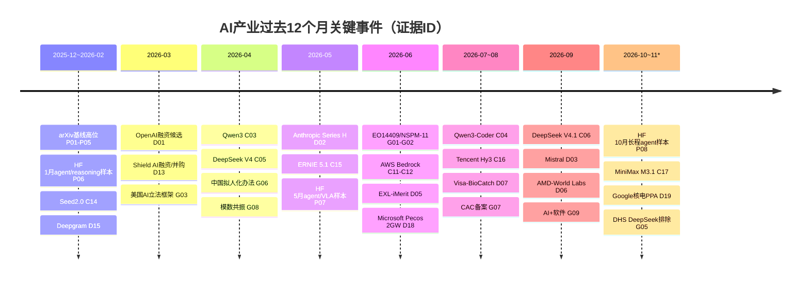
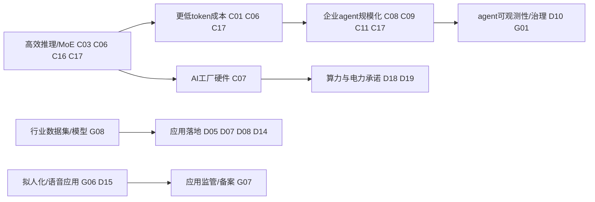

[← A股AI优选 2026-11-03](/2026/11/03/a-share-ai-pick)

**声明：** AI生成内容，仅供参考，不构成投资建议。市场有风险，入市需谨慎。

## AI产业趋势：美国、中国与欧盟政策背景，2025-11-03至2026-11-03

**报告截至：** 2026-11-03T09:07:16Z（UTC）  
**资料检索：** 2026-11-03 UTC  
**范围与方法：** 过去12个月；地区为美国、中国，并在政策层加入欧盟；证据流包括arXiv计数、HF daily papers样本、公司发布、融资/并购/算力与电力承诺、政策。证据ID见 `AI产业趋势.md`。本文只描述产业趋势，不构成投资建议。

### 执行摘要

1. **模型层仍上行，但主叙事从“更大”转向“更便宜、更长上下文、更会执行”。** arXiv五类计数中cs.AI、cs.LG、cs.CL在Q2冲高后仍处高位，HF三个月top papers也从agentic reasoning、agent harness、VLA转向长程业务agent和工具轨迹合成（P01-P09）。公司侧DeepSeek、Qwen、ERNIE、Hunyuan、MiniMax、Anthropic都强调MoE、缓存、长上下文、agent和降本（C01-C06、C14-C17）。
2. **软件/平台层是最清晰的上行层。** Microsoft、AWS、Qwen、DeepSeek、MiniMax、ByteDance、Tencent都把模型封装进agent工具链、Bedrock/Foundry/API、企业工作流或编码工具（C04、C08-C12、C14、C16-C17）。
3. **硬件和能源/电力从间接约束变成直接证据。** NVIDIA Rubin/DGX SuperPOD强调AI工厂全栈与token成本；Microsoft宣布Pecos约2GW数据中心容量并配套 onsite energy；Google/Constellation签20年PPA带来890MW新增核电和2700MW供应协议（C07、D18-D19）。
4. **资本仍集中于模型、算力和垂直应用。** 已记录19条交易/承诺，其中18条带金额；OpenAI和中国私募融资仍为候选，但P1/P2验证金额已覆盖Anthropic、Shield AI、AMD、Visa、Google/Constellation、Microsoft、Deepgram、SiMa.ai等（D02-D19）。
5. **政策分化加深。** 美国同时推进自愿前沿模型框架、国安AI、出口控制和DeepSeek采购排除；中国用备案、拟人化互动办法和“模数共振/AI+软件”推动可控落地；欧盟AI Act进入执行并以AI工厂支持算力（G01-G11）。

### 研究论文（arXiv）

arXiv计数覆盖cs.AI、cs.CL、cs.LG、cs.CV、cs.RO五类。cs.AI从Q1的12,041升至Q2的17,130，Q3为15,302，Q4*为12,851；cs.LG为11,704→15,192→13,326→12,905；cs.RO则逐季上行，Q4*已达4,529（P01、P03、P05）。这说明模型方法和语言技术仍维持高产，机器人/具身智能从小基数进入更快增长区。

HF daily papers月度API的crawler路径仍失败，但本机脚本成功取得2026-01、2026-05、2026-10三个月top papers。样本显示：1月主题是agentic reasoning、RL优化、音视频生成；5月出现`Code as Agent Harness`、`Qwen-VLA`、`MolmoAct2`；10月转向`BizAgentBench`、`Trajectory2Gym`和self-retrospection distillation（P06-P09）。三个月top 10人工归类中，智能体/工具/编码从4→4→5篇，多模态从3→3→1篇，机器人/VLA从0→2→2篇，安全/评测从1→2→3篇。计数只代表研究注意力，不证明商业采用。

### 主要公司动态

**美国与欧洲公司。** Anthropic推出Haiku 5.5并称运行成本较Haiku 4.5平均低约75%，Series H融资用于扩算力和产品伙伴关系（C01-C02）。Microsoft把Copilot、Agent 365、Foundry和多模型harness打包成企业智能体平台（C08-C09）。AWS继续把OpenAI、Anthropic模型放进Bedrock分发和治理层（C11-C12）。NVIDIA Rubin/DGX SuperPOD强调Vera CPU、Rubin GPU、NVLink、DPU和Ethernet全栈协同，目标是降低推理token成本（C07）。OpenAI官网仍403，但搜索索引显示GPT-5.6主叙事为“每token智能”和“performance per dollar”（C13）。

**中国公司。** Qwen3开源MoE和dense模型，Qwen3-Coder进入agentic coding和Qwen Code工具链（C03-C04）。DeepSeek V4/V4.1强调开权、1M上下文、KV缓存压缩、峰谷价格和更低推理成本（C05-C06）。ByteDance Seed 2.0、百度ERNIE 5.1、腾讯Hunyuan Hy3、MiniMax M3.1 Flash都把复杂任务、agent、长上下文、MoE/稀疏化与成本效率作为发布重点（C14-C17）。Moonshot/Kimi平台迁移到K3.1 Pro；Z.ai GLM-5.2资料仅为候选（C18-C19）。

### 并购、投资与初创企业

资本流向仍偏模型、基础设施和高价值应用。模型与算力侧包括Anthropic US$65B Series H、Mistral约€3B、OpenAI US$122B候选、DeepSeek/Moonshot候选、中国外的Shield AI US$2B融资/并购（D01-D04、D11-D13）。硬件与空间/物理AI包括AMD以约US$8.2B股票收购World Labs、SiMa.ai US$150M Series C（D06、D16）。应用侧包括Visa以US$2.4B收购BioCatch、Agilent以US$240M+里程碑收购Proscia、Rezolve AI以US$230M收购Reward、Pathos AI US$237M Series E、Deepgram US$130M Series C并收购OfOne（D07-D09、D14-D15）。

能源和算力承诺已补强：Microsoft宣布Pecos数据中心约2GW容量、未来5-7年多十亿美元投资并配套现场能源；Google/Constellation 20年PPA带来890MW新增核电、另有2700MW供应协议和超过US$4.3B投资（D18-D19）。这把能源/电力从“由芯片和融资间接推断”提高到“有直接容量和PPA证据”。

### 各国政策

美国：EO 14409建立面向covered frontier models的自愿早期接触框架；NSPM-11推动国安体系采用AI；白宫提出全国AI立法框架；BIS撤销AI Diffusion规则但强化半导体与Huawei Ascend相关限制；Federal Register API确认DHS排除DeepSeek产品的采购/移除通知（G01-G05、G11）。

中国：网信办等发布《人工智能拟人化互动服务管理暂行办法》，7月15日生效；生成式AI备案到8月31日累计1112款服务、731款应用/功能；工信部和国家数据局推动“模数共振”，以行业数据集、行业模型和智能体服务新型工业化；工信部另印发“人工智能+软件”专项行动（G06-G09）。

欧盟：AI Act自2026年8月2日起由AI Office和成员国主管机关执行，同时欧盟以AI Continent Action Plan、AI Factories/Gigafactories和InvestAI支持算力与产业能力（G10）。

### 美国与中国对比

美国主线是“资本—云—芯片—模型—企业平台—电力”的闭环：巨额融资、云模型分发、芯片出口控制、联邦采购限制和GW级电力/数据中心项目同时推进。中国主线是“开权/低成本模型—备案治理—行业数据与场景落地”：Qwen、DeepSeek、Hunyuan、MiniMax、ERNIE、Seed强化开权、MoE、agent和成本优势；监管侧用备案和拟人化互动规则设边界；产业侧通过行业数据集、软件专项和智能体推进制造/软件落地。

### 过去12个月的时间线

### 概念与实践的演进

| 概念/实践 | 想法 | 演示 | 产品 | 资本 | 政策 | 状态 | 瓶颈 |
|---|---|---|---|---|---|---|---|
| Agentic coding/工具执行 | P06/P07/P08 | C04/C16/C17 | C04/C09/C11/C17 | D05/D10/D13 | G01 | accelerating | 可靠执行、权限和审计 |
| 高效推理/MoE/KV缓存 | P03/P08 | C03/C06/C16/C17 | C01/C06/C17 | D01-D04 | G04 | accelerating | 真实负载成本透明度 |
| 开权模型生态 | P06-P08 | C03/C05/C16 | C03-C06/C16-C18 | D03/D11/D12 | G07 | accelerating | 合规、商业化和分发 |
| 企业Copilot/Agent平台 | P07/P08 | C08/C09/C11 | C08-C12 | D10/D17 | G01/G03 | mature/accelerating | 数据连接器、可观测性 |
| 机器人/具身/VLA | P05/P07/P09 | C07 | G08 | D06/D16 | G08 | emerging | 数据、仿真到真机迁移 |
| AI工厂/电力 | P03 | C07/D18/D19 | C11/C12/D18 | D01-D04/D18-D19 | G04/G10 | accelerating | 电力接入、许可、供应链 |
| 拟人化/语音/多模态应用 | P06/P09 | C14/C17/G06 | G06/G07/D15 | D09/D15 | G06 | regulated growth | 用户依赖、未成年人保护 |
| AI评测/可观测性 | P08/P09 | D10/C17 | D10 | D05/D10 | G01/G10 | emerging | 标准化、独立验证 |

### 趋势判断与置信度

| 层 | 论文 | 公司动态 | 资本 | 政策 | 方向 | 变化幅度与期间 | 最强反证 |
|---|---|---|---|---|---|---|---|
| 能源和电力 | 间接 | NVIDIA token-per-cost；Microsoft 2GW | Google/Constellation 890MW+2700MW；Microsoft多十亿美元 | EU支持AI工厂，美国管制芯片 | rising | 从间接证据升级为2条P1容量/PPA证据（Q2/Q4） | 中国AI电力合同缺口；PPA不等于即时投运 |
| 硬件 | cs.LG/AI高位 | Rubin全栈发布 | AMD-World Labs、SiMa.ai、模型公司融资 | BIS限制先进芯片 | rising | Q2/Q3硬件与算力交易金额高 | 出口控制可能压制中国高端硬件获取 |
| 软件/平台 | HF agent/工具主题3个月均高 | Copilot/Foundry/Bedrock/Qwen Code/DeepSeek API/MiniMax | iMerit/Fiddler/Fonoa等交易 | 中国模数共振、美国自愿框架 | rising | 公司发布≥19条、覆盖≥14家公司；交易≥5条 | 平台锁定和治理复杂度上升 |
| 模型 | cs.AI Q2较Q1 +42%；HF top papers补足3个月 | Qwen/DeepSeek/Anthropic/ERNIE/Hunyuan/MiniMax连续发布 | 超大额融资 | AI Act、备案、出口控制 | rising | cs.AI、cs.LG、cs.CL高位，模型发布跨中美 | OpenAI与中国私募融资部分候选 |
| 应用 | cs.RO逐季上升；HF VLA/业务agent | Copilot、拟人化、行业AI、语音/视频 | Visa/Agilent/Pathos/Deepgram/Rezolve等 | 中国/欧盟应用监管加强 | rising但分化 | cs.RO Q1 2581→Q4*4529；应用交易多 | 消费陪伴类受监管约束，ROI不均 |

### 情景与失效条件

- **基准情景：平台化扩散。** 模型成本继续下降，企业通过Bedrock、Foundry、Copilot、Qwen/DeepSeek/MiniMax工具链采用多模型agent。失效条件：推理成本下降停止，安全事故导致强制许可或大规模采购暂停。
- **约束情景：算力与政策瓶颈。** 电力、芯片出口控制和融资成本限制前沿扩张，低成本开权模型和行业专用模型受益。失效条件：先进硬件供给快速放量且监管放松。
- **应用情景：行业数据胜出。** 医疗、金融、制造、软件开发、语音/客服等场景因数据和流程闭环先兑现价值。失效条件：客户ROI不足或合规成本高于自动化收益。

### 方法与数据缺口

- HF daily papers crawler仍不可达；但本机脚本已取得2026-01、2026-05、2026-10三个月top papers，最低项已满足，复现时需注意网络路径差异。
- OpenAI官网对crawler仍403，OpenAI发布和融资保留为candidate，未作为唯一关键证据。
- Z.ai GLM页面crawler空白，相关公司行不计入强验证发布数。
- 中国DeepSeek、Moonshot私募融资缺少公司公告或监管文件，不能与P1交易同等看待。
- 能源/电力已补P1直接证据，但中国AI算力电力合同、PPA和并网进度仍缺。

### 数据来源

详见 `AI产业趋势.md`：P01-P09、C01-C19、D01-D19、G01-G11。

## 证据台账

**report_date:** 2026-11-03  
**timezone:** UTC  
**as_of:** 2026-11-03T09:07:16Z  
**window:** 2025-11-03 至 2026-11-03，按四个季度近似：Q1=2025-12~2026-02，Q2=2026-03~05，Q3=2026-06~08，Q4=2026-09~11*（11月仅1-3日）  
**regions:** 美国、中国，政策项加入欧盟  
**layers:** 能源和电力、硬件、软件/平台、模型、应用  
**retrieved_at:** 2026-11-03 UTC

> 说明：每行给出URL、日期、摘录和“Says”。HF月度API在crawler仍失败，但同一脚本从本机可读取HF daily papers月度端点，已补足3个月top papers；OpenAI官网仍403，OpenAI行保留为搜索/替代来源候选。

## 研究论文：arXiv月度计数与HF daily papers

脚本：`industry-trend/scripts/arxiv_hf.py counts --cat <cat> --as-of 2026-11-03 --months 12`；`papers --month <YYYY-MM> --n 10`。计数来自arXiv API，top papers来自HF daily papers API（本机可达，crawler不可达）。



## 公司发布与产品/平台动态

| ID | 类型 | URL | 日期 | 公司 | 层 | 事项 | Tier | 验证 | 摘录 | Says |
|---|---|---|---|---|---|---|---|---|---|---|
| C01 | fact | https://www.anthropic.com/claude-haiku-5-5 | 2026-10-07 | Anthropic | 模型/应用 | Claude Haiku 5.5小模型、降本 | P1 | verified | “Haiku 5.5 is available at a much lower price… around 75% less to run.” | Anthropic把小模型定位为高频、低成本、子智能体工作负载。 |
| C02 | fact | https://www.anthropic.com/news/series-h | 2026-05-28 | Anthropic | 硬件/模型 | Series H扩算力 | P1 | verified | “raised $65 billion in Series H… valuing the company at $965 billion post-money” | Anthropic融资主要用于安全研究、扩算力和产品伙伴关系。 |
| C03 | fact | https://qwenlm.github.io/blog/qwen3 | 2026-04-29 | Alibaba/Qwen | 模型 | Qwen3开源MoE和dense模型 | P1 | verified | “two MoE models… Qwen3-235B-A22B… six dense models… Apache 2.0” | Qwen继续以开权模型扩大模型层供给。 |
| C04 | fact | https://qwenlm.github.io/blog/qwen3-coder | 2026-07-22 | Alibaba/Qwen | 模型/应用 | Qwen3-Coder与Qwen Code | P1 | verified | “480B-parameter Mixture-of-Experts… 256K tokens natively and 1M tokens… Qwen Code” | Qwen把模型发布接到智能体编码工具链。 |
| C05 | fact | https://api-docs.deepseek.com/news/news260424 | 2026-04-24 | DeepSeek | 模型 | DeepSeek V4开源预览、1M上下文 | P1 | verified | “DeepSeek-V4 Preview is officially live & open-sourced… cost-effective 1M context length.” | DeepSeek把长上下文和低成本作为模型差异化。 |
| C06 | fact | https://api-docs.deepseek.com/news/news260910 | 2026-09-10 | DeepSeek | 模型/软件平台 | V4.1-Flash更低KV缓存与价格 | P1 | verified | “KV cache needs just: 1/4 the HBM; 1/8 the SSD storage… Off-peak rates are 50%” | DeepSeek将架构优化转化为推理成本下降。 |
| C07 | fact | https://blogs.nvidia.com/blog/dgx-superpod-rubin/ | 2026-01-05 | NVIDIA | 硬件/能源 | Rubin/DGX SuperPOD | P1 | verified | “Vera CPU, Rubin GPU, NVLink 6 Switch… reduce the cost of inference token generation.” | NVIDIA硬件叙事从单GPU转向AI工厂全栈和token成本。 |
| C08 | fact | https://blogs.microsoft.com/blog/2026/03/09/introducing-the-first-frontier-suite-built-on-intelligence-trust | 2026-03-09 | Microsoft | 软件/平台/应用 | M365 Copilot Wave 3、Agent 365 | P1 | candidate | “General availability of Agent 365 on May 1… Copilot is model diverse by design.” | Microsoft把企业智能体治理、Copilot和多模型选择合为套件。 |
| C09 | fact | https://blogs.microsoft.com/blog/2026/10/28/introducing-the-microsoft-copilot-harness | 2026-10-28 | Microsoft/GitHub | 软件/平台 | Copilot harness through Foundry | P1 | candidate | “harness available through Microsoft Foundry… build agents that reason, use tools” | Microsoft把多模型agent harness产品化。 |
| C10 | fact | https://ai.meta.com/blog/llama-4-multimodal-intelligence/ | 2026 | Meta | 模型 | Llama 4多模态 | P1 | candidate | “The Llama 4 herd: The beginning of a new era of natively multimodal AI innovation” | Meta继续把开源模型方向推向原生多模态。 |
| C11 | fact | https://aws.amazon.com/blogs/aws/get-started-with-openai-gpt-5-5-gpt-5-4-models-and-codex-on-amazon-bedrock/ | 2026-06-01 | AWS/OpenAI | 软件/平台/模型 | OpenAI模型与Codex上Bedrock | P1 | candidate | “availability of OpenAI GPT-5.5, GPT-5.4 models, and Codex on Amazon Bedrock” | AWS Bedrock强化多模型平台与编码agent分发。 |
| C12 | fact | https://aws.amazon.com/blogs/aws/anthropic-claude-fable-5-on-aws-mythos-class-capabilities-with-built-in-safeguards-now-available/ | 2026-06-09 | AWS/Anthropic | 模型/平台 | Claude Fable 5 on AWS | P1 | candidate | “Claude Fable 5 makes Mythos-level capabilities available… with strong safeguards” | 前沿模型通过云平台分级分发，并绑定安全机制。 |
| C13 | fact | https://openai.com/index/gpt-5-6 | 2026-07-09 | OpenAI | 模型 | GPT-5.6发布 | P2 | candidate | “More intelligence from every token, stronger performance per dollar” | OpenAI官网403；搜索索引显示其叙事也是每token智能和性价比。 |
| C14 | fact | https://seed.bytedance.com/en/blog/seed-2-0-official-launch | 2026-02-14 | ByteDance/Seed | 模型/应用 | Seed 2.0 | P1 | verified | “Seed2.0 series… optimized… to help tackle complex real-world tasks” | 字节Seed强化复杂任务、长内容、多模态与生产部署。 |
| C15 | fact | https://ernie.baidu.com/blog/posts/ernie-5.1-0508-release | 2026-05-09 | Baidu/ERNIE | 模型 | ERNIE 5.1 | P1 | verified | “compresses total parameters… achieving… performance… only about 6% of the pre-training cost” | 百度强调参数效率、训练成本和agent后训练。 |
| C16 | fact | https://tencentcloud.com/techpedia/144773?lang=en | 2026-07-06 | Tencent/Hunyuan | 模型/软件 | Hy3 | P1 | verified | “295B total params · 21B active · 256K context · MoE fast/slow thinking · Apache 2.0” | 腾讯Hunyuan以MoE、开权、agentic coding和成本效率竞争。 |
| C17 | fact | https://www.minimax.io/blog/minimax-m31f | 2026-10-19 | MiniMax | 模型/应用 | M3.1 Flash | P1 | verified | “nearly three times faster and reducing usage costs by 70%” | MiniMax把agent、computer use、coding与低成本推理结合。 |
| C18 | fact | https://platform.moonshot.cn/docs/models | 2026-10-31 | Moonshot/Kimi | 模型/平台 | Kimi K3.1 Pro迁移 | P1 | verified | “K2系列模型将于2026年10月31日起停止向新注册用户开放… 使用最新模型 kimi-k3.1-pro” | Moonshot平台向K3.1 Pro迁移，长上下文/编程模型继续迭代。 |
| C19 | fact | https://z.ai/blog/glm-5.2 | 2026-06-16 | Zhipu/Z.ai | 模型/软件 | GLM-5.2 | P2 | candidate | “solid 1M-token context… reducing per-token FLOPs by 2.9×” | Z.ai页面crawler空白，搜索索引用作候选：长程任务和1M上下文是主线。 |

## 并购、投资、上市与算力/能源承诺

| ID | 类型 | URL | 日期 | 交易方 | 层 | 金额 | 阶段 | Tier | 验证 | 摘录 | Says |
|---|---|---|---|---|---|---:|---|---|---|---|---|
| D01 | fact | https://openai.com/index/accelerating-the-next-phase-ai | 2026-03-31 | OpenAI; SoftBank/a16z等 | 模型/硬件 | US$122B | closed | P2 | candidate | “closed our latest funding round with $122 billion… post money valuation of $852 billion” | OpenAI官网crawler 403；搜索索引用作候选。 |
| D02 | fact | https://www.anthropic.com/news/series-h | 2026-05-28 | Anthropic; Altimeter/Dragoneer等 | 模型/硬件 | US$65B | closed | P1 | verified | “raised $65 billion in Series H… valuing the company at $965 billion post-money” | Anthropic融资集中在扩算力和Claude商业化。 |
| D03 | fact | https://siliconangle.com/2026/09/08/open-source-ai-developer-mistral-closes-e3b-funding-round/ | 2026-09-08 | Mistral; Samsung等 | 模型/平台 | €3B (~US$3.49B) | announced | P2 | verified | “raised €3 billion, or about $3.49 billion… Samsung Electronics… led” | 欧洲模型公司继续获得战略资本。 |
| D04 | fact | https://www.anthropic.com/news/series-h | 2026-05-28 | Amazon→Anthropic | 硬件/模型 | US$5B (included) | committed | P1 | verified | “includes $15 billion… from hyperscalers, including $5 billion from Amazon.” | 云厂商资本与模型公司绑定。 |
| D05 | fact | https://imerit.ai/press/exl-to-acquire-imerit/ | 2026-06-24 | EXL→iMerit | 软件/平台 | up to US$310M | definitive agreement | P1 | verified | “$310 million acquisition… upfront consideration of $170 million” | 数据标注/评测/RLHF能力被企业AI服务商收购。 |
| D06 | fact | https://ir.amd.com/news-events/press-releases/detail/1299/amd-to-acquire-world-labs-to-advance-the-future-of-ai-compute | 2026-09-28 | AMD→World Labs | 硬件/模型 | US$8.2B stock | definitive agreement | P1 | verified | “all-stock transaction is valued at approximately $8.2 billion” | 芯片厂商收购空间智能模型团队。 |
| D07 | fact | https://www.biocatch.com/press-release/biocatch-to-join-visa | 2026-08-03 | Visa→BioCatch | 应用 | US$2.4B cash | definitive agreement | P1 | verified | “acquire BioCatch… for $2.4 billion in cash” | 支付/风控应用层AI资产出现大额并购。 |
| D08 | fact | https://proscia.com/press-release/agilent-to-acquire-proscia-advancing-ai-enabled-digital-pathology-and-scientific-intelligence | 2026-10-13 | Agilent→Proscia | 应用 | US$240M + up to US$30M | definitive agreement | P1 | verified | “all-cash transaction valued at $240 million… up to an additional $30 million” | 医疗病理AI软件并入仪器公司。 |
| D09 | fact | https://www.prnewswire.com/news-releases/rezolve-ai-acquires-reward-for-230m-to-accelerate-innovation-in-ai-powered-banking-and-commerce-302684199.html | 2026-02-11 | Rezolve AI→Reward | 应用 | US$230M cash | acquired | P2 | verified | “acquires Reward for $230 million all-cash” | 商业/银行会话式AI应用层整合。 |
| D10 | fact | https://www.crowdstrike.com/en-us/press-releases/crowdstrike-to-acquire-fiddler-to-deliver-agent-observability/ | 2026-11-03 | CrowdStrike→Fiddler AI | 软件/平台 | undisclosed | signed | P1 | verified | “signed a definitive agreement to acquire Fiddler AI… AI agent observability” | Agent可观测性成为安全平台收购方向；不计入金额最低数。 |
| D11 | fact | https://capitaltimes.asia/tech/startups/asia-startup-funding-third-quarter-ai-china | 2026-07 | Moonshot AI | 模型 | US$3.5B | reported | P2 | candidate | “Moonshot AI… raised a $3.5 billion Series F in July” | 中国模型公司大额融资仅取得新闻源。 |
| D12 | fact | https://capitaltimes.asia/tech/startups/asia-startup-funding-third-quarter-ai-china | 2026-Q2 | DeepSeek | 模型 | US$7.4B | reported | P2 | candidate | “lifted by a $7.4 billion financing for DeepSeek” | DeepSeek融资金额未官方确认。 |
| D13 | fact | https://aechelon.com/press-releases/shield-ai-to-acquire-software-simulation-company-aechelon-and-raise-2b-at-12-7b-valuation/ | 2026-03-26 | Shield AI→Aechelon | 应用/软件 | US$2B raise incl. US$1.5B Series G + US$500M preferred | announced | P1 | verified | “raising $1.5 billion in Series G… and $500 million in fixed-return preferred equity financing” | 防务自治/仿真AI获得大额资本并并购仿真软件。 |
| D14 | fact | https://www.pathos.com/pathos-ai-secures-237-million-in-series-e-financing-to-scale-agentic-ai-drug-development-platform-and-advance-oncology-pipeline | 2026-10-23 | Pathos AI | 应用 | US$237M | closed | P1 | verified | “closing of a $237 million Series E financing round” | AI药物研发平台融资，应用层继续吸金。 |
| D15 | fact | https://deepgram.com/learn/press-release-deepgram-raises-series-c | 2026-01-13 | Deepgram | 软件/应用 | US$130M | closed | P1 | verified | “raised $130 million in Series C funding at a $1.3 billion valuation” | 语音AI API平台融资并收购OfOne。 |
| D16 | fact | https://sima.ai/press-release/sima-ai-reaches-1-45b-valuation-with-500-million-in-total-funding-to-scale-physical-ai-in-humanoids-automotive-and-drones/ | 2026-09-28 | SiMa.ai | 硬件/应用 | US$150M | closed | P1 | verified | “announced $150 million in Series C financing… valuing the company at $1.45 billion” | 物理AI芯片/软件栈融资服务机器人、汽车和无人机。 |
| D17 | fact | https://www.fonoa.com/company/news/fonoa-raises-110m-funding-and-acquires-edge | 2026-05-28 | Fonoa→PwC Edge | 软件/应用 | US$110M | closed/acquired | P1 | verified | “acquisition of Indirect Tax Edge… and a $110 million Series C” | 企业税务AI平台融资并整合合规工作流。 |
| D18 | fact | https://blogs.microsoft.com/blog/2026/06/22/powering-the-next-wave-of-ai-expanding-capacity-with-our-new-datacenter-in-pecos/ | 2026-06-22 | Microsoft | 能源/硬件 | ~2GW capacity; multibillion-dollar | announced | P1 | verified | “new datacenter campus… expanding… capacity by approximately 2 gigawatts (GW)” | 直接证据显示AI/云需求推动电力和数据中心容量扩张。 |
| D19 | fact | https://www.constellationenergy.com/news/2026/10/google-and-constellation-announce-landmark-agreement-to-bring-890-mw-of-new-nuclear-capacity-to-pjm-grid.html | 2026-10-06 | Google; Constellation | 能源/硬件 | 890MW new nuclear + 2700MW supply; >US$4.3B investment | PPA | P1 | verified | “bring 890 megawatts… 20-year power purchase agreement… more than $4.3 billion” | hyperscaler AI需求转化为长期电力和核电增容协议。 |

## 政策与监管

| ID | 类型 | URL | 日期 | 地区/机构 | 层 | 工具/状态 | 方向 | Tier | 验证 | 摘录 | Says |
|---|---|---|---|---|---|---|---|---|---|---|---|
| G01 | fact | https://whitehouse.gov/presidential-actions/2026/06/promoting-advanced-artificial-intelligence-innovation-and-security | 2026-06-02 | 美国白宫 | 模型/应用/安全 | Executive Order 14409, in force | mixed/support | P1 | verified | “voluntary framework with AI developers… access to covered frontier models… up to 30 days before” | 美国以自愿框架和网络安全为主，而非强制模型许可。 |
| G02 | fact | https://whitehouse.gov/presidential-actions/2026/06/national-security-presidential-memorandum-nspm-11?cst=&query-11-page=101 | 2026-06 | 美国白宫 | 应用/模型 | NSPM-11, in force | support/restrict | P1 | verified | “accelerate the use of AI across intelligence and warfighting domains” | 美国推动国安领域AI采用，同时要求责任链。 |
| G03 | fact | https://whitehouse.gov/releases/2026/03/president-donald-j-trump-unveils-national-ai-legislative-framework | 2026-03 | 美国白宫 | 应用/模型 | legislative framework | support/mixed | P1 | verified | “national policy framework… enables American industry to innovate and thrive” | 美国提出全国AI立法框架以避免碎片化监管。 |
| G04 | fact | https://media.bis.gov/sites/default/files/documents/05.07%20Recission%20of%20AI%20Diffusion%20Press%20Release.pdf | 2026-05-12 | 美国商务部/BIS | 硬件/模型 | export-control guidance | restrict | P1 | verified | “rescission… AI Diffusion Rule… strengthen export controls on semiconductors worldwide” | 美国撤销AI Diffusion规则但强化芯片与Huawei Ascend相关限制。 |
| G05 | fact | https://www.federalregister.gov/api/v1/documents/2026-21447.json | 2026-10-20 | 美国DHS | 应用/模型 | procurement exclusion, adopted | restrict | P1 | verified | “excluding… DeepSeek… from federal civilian agency procurements; … removing all DeepSeek” | Federal Register API确认DHS排除DeepSeek产品的通知。 |
| G06 | fact | https://www.cac.gov.cn/2026-04/10/c_1777558395078289.htm | 2026-04-10 / 2026-07-15生效 | 中国网信办等 | 应用 | 暂行办法，in force | mixed/restrict | P1 | verified | “自2026年7月15日起施行… 拟人化互动服务… 适用本办法” | 中国对拟人化情感互动AI设定边界、提醒和安全责任。 |
| G07 | fact | https://www.cac.gov.cn/2026-09/14/c_1791136833136332.htm | 2026-09-14 | 中国网信办 | 应用/模型 | 备案公告 | mixed | P1 | verified | “新增124款… 截至8月31日，累计有1112款…完成备案” | 中国生成式AI备案常态化，备案数继续上升。 |
| G08 | fact | https://www.miit.gov.cn/zwgk/zcwj/wjfb/tz/art/2026/art_ba07e09d40834ec992615490fd2ccd18.html | 2026-04-28 | 中国工信部/国家数据局 | 软件/平台/应用 | “模数共振”行动 | support | P1 | verified | “推动人工智能模型与数据资源协同互促… 赋能新型工业化” | 中国以行业数据集、行业模型和智能体推动工业应用。 |
| G09 | fact | https://www.miit.gov.cn/zwgk/zcwj/wjfb/tz/art/2026/art_49783ce685f042029111c8b6e94f0f30.html | 2026-09-11 | 中国工信部 | 软件/平台 | “人工智能+软件”专项行动 | support | P1 | verified | “《‘人工智能+软件’专项行动实施方案》印发给你们” | 中国政策继续推动软件行业AI化。 |
| G10 | fact | https://digital-strategy.ec.europa.eu/en/policies/european-approach-artificial-intelligence | 2026-08-02起 | 欧盟 | 模型/应用 | AI Act enforcement | restrict/support | P1 | verified | “From 2 August 2026, the AI Office and national authorities started to enforce the AI Act.” | 欧盟AI法进入执行阶段，同时推进AI工厂和投资设施。 |
| G11 | fact | https://www.federalregister.gov/api/v1/documents.json?conditions%5Bterm%5D=artificial%20intelligence&conditions%5Bpublication_date%5D%5Bgte%5D=2025-11-03&conditions%5Bpublication_date%5D%5Blte%5D=2026-11-03&per_page=20&order=newest | 2025-11-03~2026-11-03 | 美国Federal Register | 多层 | AI documents search | mixed | P1 | verified | “Documents matching 'artificial intelligence'… count 322” | API可用，窗口内AI相关联邦文件共322条；用于替代网页CAPTCHA。 |

## 计算派生表

### arXiv季度合计

| 类别 | Q1 2025-12~2026-02 | Q2 2026-03~05 | Q3 2026-06~08 | Q4 2026-09~11* |
|---|---:|---:|---:|---:|
| cs.AI | 12041 | 17130 | 15302 | 12851 |
| cs.CL | 5565 | 7691 | 6966 | 6354 |
| cs.LG | 11704 | 15192 | 13326 | 12905 |
| cs.CV | 8030 | 11328 | 9656 | 7871 |
| cs.RO | 2581 | 3718 | 3878 | 4529 |

### HF top-paper主题样本（每月top 10，按标题/摘要人工归类）

| 主题 | 2026-01 | 2026-05 | 2026-10 | 支撑证据 |
|---|---:|---:|---:|---|
| 智能体/工具使用/编码 | 4 | 4 | 5 | P06-P09 |
| 高效推理/RL/蒸馏 | 2 | 1 | 2 | P06-P09 |
| 多模态/音视频 | 3 | 3 | 1 | P06-P09 |
| 机器人/VLA/具身 | 0 | 2 | 2 | P07-P09 |
| 安全/评测/基准 | 1 | 2 | 3 | P07-P09 |

### 资金按季度（披露/报道金额，粗略，不做投资建议）

| 季度 | 金额交易数 | 披露金额合计（约，美元） | 主要层 |
|---|---:|---:|---|
| Q1 | 4 | 124.36B | 模型、应用、软件 |
| Q2 | 6 | 137.92B | 模型、硬件、平台、能源 |
| Q3 | 5 | 17.74B | 模型、应用、硬件 |
| Q4* | 4 | 4.81B+未披露 | 能源、应用、平台 |

## 缺口

- Hugging Face daily papers API 对crawler仍为network unreachable；本机脚本成功取得2026-01、2026-05、2026-10三个月top papers，因此最低项已满足但留有可复现环境差异。
- OpenAI官网仍对crawler返回403；OpenAI发布和融资行仍为candidate，未作为唯一关键证据。
- Z.ai GLM页面crawler返回空内容，仅搜索索引候选；不计入强验证发布数。
- 中国DeepSeek、Moonshot私募融资缺少公司公告或监管文件；保留candidate。
- 能源/电力已补Microsoft和Google/Constellation直接证据，但中国AI算力电力合同仍缺可验证来源。
