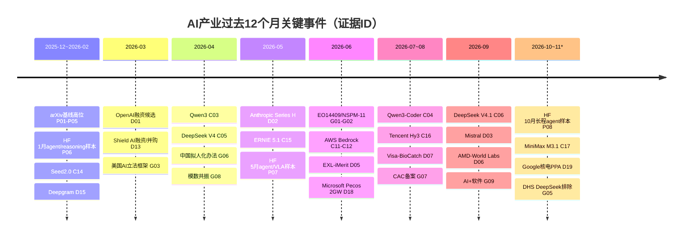
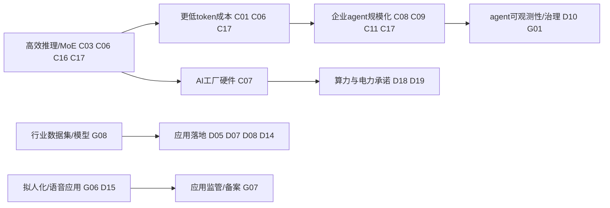

## A股AI产业：最值得买入的股票

**报告截至：** 2026-11-03 17:07:16 Asia/Shanghai ｜ **研究起止：** 2026-11-03T09:07:16Z - 2026-11-03T09:42:27Z ｜ **持有期：** 12个月  
**结论：** 在本轮已核验的A股AI入围者中，最值得买入的是 **兆易创新（603986.SH，硬件/存储，90.72分）**；备选依次为江波龙、中际旭创、长鑫科技、新易盛。第一名相对第二名领先6.67分，不是3分以内的势均力敌。置信度：中高。  
**声明：** 本报告是基于公开资料的研究结论，不是针对任何个人的投资建议；不含目标价、仓位或配置建议；不保证结果。

### 结论与理由

按intent固定决策规则，兆易创新胜出，不是因为它是市值最大或概念最热，而是因为在已核验入围者中同时满足三点：

1. **基本面与成长强。** 阶段1筛选中质量92.7、成长94.9，合成“基本面与成长”93.8；三季报显示2026年前三季度营收202.97亿元、归母净利润110.66亿元，且公司直接解释为“存储芯片行业供给紧张、存储芯片产品量价齐升、MCU等多个业务产品线持续发力”（ASP-E06）。
2. **估值分明显优于多数硬件链。** 阶段1估值分85.3，2026-11-03收盘PE 11.94、PB 2.29，优于长鑫科技、中际旭创、新易盛等高弹性硬件链；在决策表里估值权重25%，这使它相对光模块和DRAM高PB标的占优（ASP-E05、ASP-E11）。
3. **AI暴露来自披露而非概念标签。** 公司半年度报告披露，AI发展对存储解决方案提出新要求，控股子公司青耘科技为客户推理需求提供定制化存储方案；这让它进入硬件/存储AI链条，而不是只靠主题标签（ASP-E06）。

最大反证也清楚：兆易创新的增长受存储价格周期和证券投资公允价值扰动影响；如果存储价格转弱、AI定制存储不能转为可验证收入，或扣非利润/经营现金流明显弱于收入，结论应下调。

### 环境：宏观与产业（中国宏观、美国宏观、产业趋势、美国龙头外溢）

**中国宏观：结构性支持，不是全面复苏。** 子报告结论是“生产和外需较强、内需和地产偏弱、金融低利率、政策支持AI和资本市场韧性”。前三季度高技术制造业增长14.3%、信息传输软件和信息技术服务业增长10.4%，叠加“人工智能+”政策，对算力、服务器、光模块、工业软件、智能终端、电力设备等链条构成结构性支撑；但社零、投资、地产和PMI提醒总需求仍弱（ASP-E01）。

**美国宏观：需求与贴现率冲突。** 美国宏观包已补齐至14个指标、12个通过内容检查；结论仍是增长韧性、通胀未回目标、利率和美元偏高。对A股AI硬件是“两面”：美国AI基础设施周期支持服务器、光模块、PCB、电力设备等外需映射；高美债和美元压制成长估值（ASP-E02）。

**产业趋势：五层均上行。** 产业趋势包已补齐HF top papers三个月、19条公司发布、19条交易/资本/能源、11条政策；判断AI行业五层均rising，其中软件/平台、模型、硬件和能源/电力最强，应用层上行但分化（ASP-E03）。

**美国龙头外溢：硬件链最直接。** 美国龙头读穿显示，NVDA供应与产能承诺、MSFT/AMZN/GOOGL的RPO和capex、META数据中心capex共同支持A股硬件链。读穿重点是存储、服务器、光模块、PCB、电源/散热和数据中心配套，而不是泛AI概念（ASP-E04）。

**上下文判定：** 背景对A股AI硬件链为“支持但有估值约束”；偏好的层是硬件/存储/光通信/数据中心配套。软件与模型产业趋势强，但本轮A股已核验名单主要来自硬件层。

### 候选筛选与排名（A股优选排名）

宇宙来自股票缓存，不从外部行情源重建：2026-11-03缓存有5563只证券完整报价；按AI相关申万二级行业词过滤后取市值前100，阶段1使用2026-09-30财务版本，100家公司全部可评分。固定权重为质量40%、成长25%、估值20%、流动性15%（ASP-E05）。阶段1前10名均完成驱动、财务和AI暴露核验，达到list_size=10（ASP-E12）。

## A股优选排名

**cutoff：** 2026-11-03 17:07:16 Asia/Shanghai  
**theme：** AI  
**universe：** A股AI相关行业市值前100，报价日2026-11-03 final=true  
**weights：** 阶段1：质量40%、成长25%、估值20%、流动性15%；决策规则：基本面与成长30%、估值25%、产业与宏观20%、验证10%、风险15%。  
**财务版本：** 2026-09-30  
**证据：** ASP-E05、ASP-E12，CTC-E01—CTC-E27。

| 排名 | 公司 | 代码 | AI层 | 阶段1分数 | 入榜理由 | 主要反证 |
|---:|---|---|---|---:|---|---|
| 1 | 兆易创新 | 603986.SH | 硬件/存储/MCU | 91.42 | 质量、成长和估值同时强；AI推理存储方案有披露 | 存储周期、公允价值扰动 |
| 2 | 长鑫科技 | 688825.SH | 硬件/DRAM | 86.77 | 规模和成长弹性最强，端侧AI内存需求明确 | 估值分弱、计提减值9.21亿元 |
| 3 | 江波龙 | 301308.SZ | 硬件/端侧AI存储 | 82.90 | AI存储合作与高端产品明确，估值分强 | 经营现金流为负、存货扩张 |
| 4 | 中际旭创 | 300308.SZ | 硬件/光模块 | 79.84 | 800G/1.6T最直接受益于AI算力基础设施 | 锁料、存货、物料供应与客户节奏 |
| 5 | 新易盛 | 300502.SZ | 硬件/光模块 | 75.93 | 受益于人工智能算力投资，收入增长明确 | 估值分一般、光模块链波动 |
| 6 | 源杰科技 | 688498.SH | 硬件/光芯片 | 75.79 | 数据中心业务收入大幅增长 | 估值分很低、PE/PB高 |
| 7 | 联讯仪器 | 688808.SH | 硬件/测试设备 | 73.80 | AI算力和高速互联拉动光通信测试设备 | 估值分很低、应收/存货/减值随扩张增加 |
| 8 | 三环集团 | 300408.SZ | 硬件/MLCC/陶瓷/光通信元件 | 71.63 | 数据中心建设带动光器件需求，订单饱满 | AI暴露较间接、P2证据较多 |
| 9 | 长飞光纤 | 601869.SH | 硬件/光通信 | 70.70 | 智算中心加速建设带动行业上行 | 光纤光缆和公允价值周期性 |
| 10 | 世纪华通 | 002602.SZ | 应用/AI游戏/AI云数据 | 70.08 | AI工具整合和AI原生游戏探索，游戏现金流强 | AI收入占比小，游戏产品周期风险 |

层级分布：已验证10名中硬件层9名、应用层1名；没有软件平台、模型、能源电力公司进入前10名核验排名。

### 入围者概况与估值

**兆易创新。** 业务驱动来自存储芯片供给紧张、量价齐升和MCU等产品线增长；AI暴露来自推理存储方案。PE 11.94、PB 2.29，阶段1估值分85.3，是本轮估值与成长组合最均衡的公司（ASP-E06、ASP-E11、ASP-E13）。

**江波龙。** 端侧AI存储和高端产品商业化明确，合作拓展至AMD、高通、紫光展锐等；PE 4.87、PB 2.98，估值分81.1。但前三季度经营现金流为-22.74亿元，存货和采购扩张是比兆易更强的风险折扣（ASP-E08、ASP-E13）。

**中际旭创。** 光模块AI暴露最直接，800G/1.6T销售增加；PE 19.08、PB 5.99，阶段1估值分52.9。美国AI capex读穿对它有利，但锁料、存货和关键物料供应是主要观察项（ASP-E09、ASP-E13）。

**长鑫科技。** DRAM规模和盈利弹性极强，端侧AI带动LPDDR5X/LPDDR6需求；但PB 10.25、估值分54.3，且前三季度计提减值9.21亿元，使风险得分低于兆易和中际（ASP-E07、ASP-E13）。

**新易盛。** 同属光模块，披露受益于人工智能算力投资；PE 15.95、PB 8.65，阶段1估值分51.6。证据强度低于前四，且不改变最终pick（ASP-E10、ASP-E13）。

### 决策表

| 入围者 | 基本面与成长 | 估值 | 产业与宏观 | 验证 | 风险 | 总分 |
|---|---:|---:|---:|---:|---:|---:|
| 兆易创新 | 93.80 | 85.30 | 100 | 100 | 75 | **90.72** |
| 江波龙 | 87.60 | 81.10 | 100 | 100 | 50 | **84.05** |
| 中际旭创 | 85.85 | 52.90 | 100 | 100 | 75 | **80.23** |
| 长鑫科技 | 95.85 | 54.30 | 100 | 100 | 50 | **79.83** |
| 新易盛 | 78.45 | 51.60 | 100 | 100 | 50 | **73.94** |

评分说明：基本面与成长为阶段1质量和成长均值；估值采用阶段1 valuation；产业与宏观对五名均给100，因为硬件层被中国宏观、产业趋势和美国龙头读穿共同支持；验证给100是五名均通过驱动、财务、AI暴露检查；风险按四项否定测试折算，存在现金流/减值/库存/证据强度缺口者扣分。

### 使结论改变的条件与观察清单

会使兆易创新失去第一的位置的证据：

1. 存储价格由供给紧张转为下行，且公司扣非利润率或毛利率连续两个季度显著回落。
2. 青耘科技或定制化AI存储方案不能形成可见订单/收入，AI暴露退化为叙事。
3. 证券投资、公允价值或存货跌价导致利润质量下降，使基本面与成长分低于江波龙或中际旭创。
4. 估值分明显恶化，例如PE/PB相对宇宙重估后低于江波龙，且基本面优势不足以补偿。
5. 美国AI capex下修或中国高技术制造/软件服务增速回落，使硬件链产业与宏观分不再为100。

观察清单：兆易创新下一季扣非利润、经营现金流、存货/应收、AI存储相关披露；江波龙现金流修复；中际旭创和新易盛800G/1.6T订单及库存转化；长鑫科技减值和DRAM长协兑现；美国云厂商capex/RPO与NVDA供货承诺变化。

### 核验表

| 公司 | 输入 | 阶段1值 | filed value | 差异 | source URL/evidence |
|---|---|---:|---:|---:|---|
| 兆易创新 | 营业收入 | 202.9737亿元 | 202.9737亿元 | 0% | CTC-E04 |
| 兆易创新 | 归母净利润 | 110.6569亿元 | 110.6569亿元 | 0% | CTC-E04 |
| 兆易创新 | 营收同比 | 197.11% | 197.11% | 0pct | CTC-E04 |
| 长鑫科技 | 营业收入 | 2690.2411亿元 | 2690.2411亿元 | 0% | CTC-E07 |
| 长鑫科技 | 归母净利润 | 1320.4005亿元 | 1320.4005亿元 | 0% | CTC-E07 |
| 长鑫科技 | 营收同比 | 738.51% | 738.51% | 0pct | CTC-E07 |
| 江波龙 | 营业收入 | 387.1823亿元 | 387.1823亿元 | 0% | CTC-E10 |
| 江波龙 | 归母净利润 | 143.2166亿元 | 143.2166亿元 | 0% | CTC-E10 |
| 江波龙 | 营收同比 | 131.37% | 131.37% | 0pct | CTC-E10 |
| 中际旭创 | 营业收入 | 695.4706亿元 | 695.4706亿元 | 0% | CTC-E12 |
| 中际旭创 | 归母净利润 | 222.3794亿元 | 222.3794亿元 | 0% | CTC-E12 |
| 中际旭创 | 营收同比 | 178.13% | 178.13% | 0pct | CTC-E12 |
| 新易盛 | 营业收入 | 318.4990亿元 | 318.4990亿元 | 0% | CTC-E14 |
| 新易盛 | 归母净利润 | 113.7233亿元 | 113.7233亿元 | 0% | CTC-E14 |
| 新易盛 | 营收同比 | 92.97% | 92.97% | 0pct | CTC-E14 |
| 源杰科技 | 营业收入 | 16.0901亿元 | 16.0901亿元 | 0% | CTC-E18 |
| 源杰科技 | 归母净利润 | 10.2385亿元 | 10.2385亿元 | 0% | CTC-E18 |
| 源杰科技 | 营收同比 | 319.83% | 319.83% | 0pct | CTC-E18 |
| 联讯仪器 | 营业收入 | 40.4350亿元 | 40.43亿元 | <0.1% | CTC-E20 |
| 联讯仪器 | 归母净利润 | 20.0592亿元 | 20.06亿元 | <0.1% | CTC-E20 |
| 联讯仪器 | 营收同比 | 401.91% | 401.91% | 0pct | CTC-E20 |
| 三环集团 | 营业收入 | 115.0280亿元 | 115.03亿元 | <0.1% | CTC-E22 |
| 三环集团 | 归母净利润 | 38.6520亿元 | 38.65亿元 | <0.1% | CTC-E22 |
| 三环集团 | 营收同比 | 76.74% | 76.74% | 0pct | CTC-E22 |
| 长飞光纤 | 营业收入 | 191.2448亿元 | 191.2448亿元 | 0% | CTC-E24 |
| 长飞光纤 | 归母净利润 | 61.2758亿元 | 61.2758亿元 | 0% | CTC-E24 |
| 长飞光纤 | 营收同比 | 86.12% | 86.12% | 0pct | CTC-E24 |
| 世纪华通 | 营业收入 | 332.9817亿元 | 332.98亿元 | <0.1% | CTC-E26 |
| 世纪华通 | 归母净利润 | 63.3454亿元 | 63.35亿元 | <0.1% | CTC-E26 |
| 世纪华通 | 营收同比 | 22.31% | 22.31% | 0pct | CTC-E26 |

### 未入榜

阶段1进入前20但未验证至可入榜的名称：澜起科技、生益科技、沪电股份、寒武纪、鼎泰高科、中微公司、长川科技、天孚通信、大普微、亨通光电。原因不是它们没有AI暴露，而是前10名已满足list_size=10，后续不再为最终入榜继续核验；若需要扩大名单，应从澜起科技、生益科技和沪电股份开始，因为公开资料显示它们也有较强AI硬件暴露。

### 方法与数据缺口

- **与practice不同处：** 中国宏观、美国宏观、产业趋势、美国龙头由子代理并行完成；A股筛选和finalist画像由协调器直接完成，没有单独再委派china-top-company和每家公司enterprise-analysis子代理。原因是时间约束下需要统一市场缓存、公告核验和决策表口径；所有未完整核验的公司均被排除。
- **仍有缺口：** BLS原始页面仍403、OpenAI一手页面仍403、TIC资本流量未完整收集；联讯仪器、三环集团、世纪华通的部分核验证据为P2透明来源或公告转载页而非交易所PDF正文；finalist画像仍未完整逐表提取客户集中、地区收入、治理细项和供应商明细。
- **A股可得性约束：** A股存在T+1、涨跌幅、停牌、最小交易单位、外资通道和科创/创业板适当性约束；本报告不指示交易。

### 数据来源

- 中国宏观：附录一（子报告与证据台账）。
- 美国宏观：附录二（子报告与证据台账）。
- AI产业趋势：附录三（子报告与证据台账）。
- 美国龙头读穿：附录四（子报告与证据台账）。
- A股筛选与核验：附录五（子报告与证据台账）。
- 入围者画像：附录六（子报告与证据台账）。
- 本文证据台账：见文末“本文证据台账”。

---

## 附录

以下是各子报告及其证据台账，点击展开。证据台账的“摘录”一栏是从来源页面逐字摘取的原文片段（不超过200字）。

附录一：中国宏观

## 中国宏观经济：大陆，最新四季度与十二个月窗口

**报告截至：** 2026-11-03 17:07:16 Asia/Shanghai  
**资料检索：** 2026-11-03T09:10:40Z—2026-11-03T09:11Z  
**范围与方法：** 范围为中国大陆宏观数据。窗口为截至报告时点已发布的 2026 年前三季度、9 月和 10 月 PMI，必要时使用官方单月发布。GDP、工业增加值按不变价/可比价实际同比；投资、消费、财政、贸易多为名义累计同比；PMI为经季节调整扩散指数；金融统计为人民银行初步数。事实均对应 `附录一.md` 的证据ID。

### 执行摘要

截至 2026-11-03，可验证的官方数据呈现“生产和外需强、内需和地产弱、价格由工业品上行支撑、政策继续逆周期并强调 AI+”的组合。

- 增长层面，前三季度GDP同比增长4.6%，三季度同比4.5%、环比1.2%[E01]；工业生产好于总需求，1—9月规上工业增加值同比增长5.3%，9月增长5.5%，高技术制造业1—9月增长14.3%[E02]。
- 需求层面，消费偏弱但服务与线上零售相对好：前三季度社会消费品零售总额同比仅增长1.1%，而商品和服务零售总额增长2.6%、服务零售增长5.0%[E04]。固定资产投资同比下降7.2%，房地产开发投资下降20.6%，新房销售面积下降13.2%[E05][E06]。
- 外需明显强于内需：1—9月货物进出口同比增长18.8%，出口增长16.4%、进口增长22.3%；9月出口增长29.6%[E14]。
- 金融条件维持低利率、温和信用：9月末M2同比增长7.2%，社融存量同比增长7.1%；前三季度人民币贷款增加11.52万亿元，LPR为1年期3.0%、5年期以上3.5%[E12][E13]。
- 对A股AI权益的含义：宏观层面对AI链条的需求与政策支撑较明确（高技术制造、软件信息服务、机电出口、AI+政策），但总需求不足、地产拖累和10月PMI回落会约束估值扩张的广度；更偏向“结构性景气”而非全面顺周期复苏。

### 增长与需求

**产出。** 前三季度GDP为1,071,071亿元，按不变价格同比增长4.6%；分季度看，Q1、Q2、Q3分别增长5.0%、4.3%、4.5%，三季度环比增长1.2%[E01]。方向判断为 **steady to slowing（平稳中偏放缓）**：三季度较二季度改善，但前三季度累计低于一季度节奏；10月PMI又回落至50以下，构成反证与警示[E10][E11]。

**工业与现代服务。** 9月规模以上工业增加值同比实际增长5.5%，1—9月同比增长5.3%；高技术制造业1—9月增长14.3%[E02]。服务业增加值前三季度增长5.2%，其中信息传输、软件和信息技术服务业增长10.4%[E03]。这对A股AI权益是直接正面：硬件制造、软件服务、算力相关需求与宏观结构升级一致；但它是结构性强项，不代表居民消费或地产链同步修复。

**消费。** 前三季度社会消费品零售总额370,001亿元，同比增长1.1%；9月当月42,433亿元，同比增长1.1%，比上月加快0.7个百分点；限额以上通讯器材类同比增长18.1%[E04]。方向判断为 **unclear/weak（偏弱但有局部亮点）**：连续证据显示消费总量弱，但通讯器材、服务零售和网上服务零售较快增长，对AI终端和数字服务形成局部需求支撑。

**投资与地产。** 前三季度固定资产投资（不含农户）334,115亿元，同比下降7.2%；扣除房地产开发后下降4.2%，高技术产业投资同比增长4.9%，信息服务业投资增长20.2%[E05]。房地产开发投资下降20.6%，新建商品房销售面积下降13.2%、销售额下降13.9%[E06]。方向为 **slowing/contracting（收缩）**。这会压制总需求、信用扩张和风险偏好，对AI权益的间接影响是：若地产风险占用政策资源或拖累居民资产负债表，市场风险偏好会受约束。

### 通胀与价格

9月CPI同比上涨0.9%，环比上涨0.2%；1—9月CPI同比上涨0.9%，核心CPI同比上涨1.1%，9月核心CPI同比上涨1.0%[E07]。消费价格温和，显示终端需求并不强。

PPI方面，前三季度工业生产者出厂价格同比上涨2.3%；9月同比上涨5.0%，环比上涨1.2%，涨幅比上月扩大1.2个百分点[ E08 ]。方向为 **accelerating（工业品价格上行）**，对上游和制造名义收入有支撑，但也可能推高AI硬件链部分原材料与制造成本。

### 就业

前三季度全国城镇调查失业率平均为5.2%，与上年同期持平；9月为5.2%，比上月下降0.1个百分点，31个大城市城镇调查失业率亦为5.2%[E09]。方向为 **steady（稳定）**。就业未恶化有利于消费底线，但5%以上失业率也说明居民收入预期仍需政策支撑。

### 货币、信贷与金融条件

9月末社融存量468.17万亿元，同比增长7.1%；M2余额359.63万亿元，同比增长7.2%；前三季度人民币贷款增加11.52万亿元，但住户贷款减少1.03万亿元，企事业单位贷款增加12.55万亿元[ E12 ]。1年期LPR为3.0%，5年期以上LPR为3.5%[E13]。方向为 **accommodative but selective（低利率但信用偏结构性）**：资金价格低，有利于成长股估值；但住户贷款减少和地产弱势说明信用扩张未全面传导至居民部门。

### 财政与对外部门

财政方面，前三季度全国一般公共预算收入172,292亿元，同比增长5.1%；支出210,199亿元，同比增长1.0%。政府性基金预算收入同比下降18.6%，其中国有土地使用权出让收入同比下降27.9%[E15]。一般预算收入有韧性，但土地财政拖累仍明显。

外贸方面，海关数据显示1—9月进出口399,399.1亿元，同比增长18.8%；出口231,979.2亿元，增长16.4%；进口167,419.9亿元，增长22.3%；9月出口同比增长29.6%，进口增长24.6%[E14]。这对AI权益偏正面：外需强和机电产品出口占比高（NBS综合稿称机电产品出口增长23.7%、占出口64.3%[E14/E01]）对电子、通信、服务器、光模块等链条形成宏观顺风；风险在于外需高增可能存在基数、备货和贸易摩擦扰动。

### 政策取向

7月30日政治局会议提出“实施好更加积极的财政政策和适度宽松的货币政策”“加力扩大内需、优化供给”，并明确“深入实施‘人工智能+’行动，发展智能经济新形态，完善人工智能治理体系”，同时要求“深化资本市场投融资综合改革，提升资本市场韧性和信心”[E16]。这是对A股AI权益最直接的政策信号：AI不是单纯主题交易，而被置于现代化产业体系和新旧动能转换框架内；但政策文本不等于盈利兑现，仍需订单、现金流和估值消化验证。

### 风险与情景

- **基准情景：** 工业和出口维持较强，高技术制造和软件信息服务继续好于总量；地产和居民信用仍拖累内需，政策继续托底。AI权益呈结构性机会与高波动并存。
- **上行情景：** 财政金融协同促内需和“AI+”政策形成实际订单，数据中心、算力、电力设备、工业软件和智能终端链条收入加速。
- **下行情景：** 10月PMI回落演变为连续收缩，外需走弱或地产下滑加深，成长股估值因盈利兑现不足而压缩。

### 指标一览

| 指标 | 最新值与期间 | 发布日期 | 口径 | 前值与变化 | 方向 | 数据版本 |
|---|---|---|---|---|---|---|
| GDP | 前三季度同比+4.6%；Q3同比+4.5%、环比+1.2% | 2026-10-19 | 不变价，初步核算 | Q2同比+4.3%，Q3改善 | 平稳偏弱 | 初步 |
| 工业增加值 | 9月同比+5.5%；1—9月+5.3% | 2026-10-19 | 实际同比；月环比+0.61% | 9月较8月快0.3pct | 偏强 | 官方月报 |
| 社零 | 1—9月+1.1%；9月+1.1% | 2026-10-19 | 名义同比 | 9月较8月快0.7pct | 偏弱 | 官方综合稿 |
| 固定资产投资 | 1—9月-7.2% | 2026-10-19 | 名义累计同比，不含农户 | 与1—8月持平 | 收缩 | 官方综合稿 |
| 房地产开发投资 | 1—9月-20.6%；新房销售面积-13.2% | 2026-10-19 | 名义累计同比 | 未取三观察单独序列 | 收缩 | 官方综合稿 |
| CPI | 9月同比+0.9%；核心CPI+1.0% | 2026-10-14 | 同比/环比；2025基期CPI | 温和 | 平稳 | 官方月报 |
| PPI | 9月同比+5.0%，环比+1.2% | 2026-10-19 | 出厂价格同比/环比 | 较上月扩大1.2pct | 上行 | 官方综合稿 |
| 失业率 | 9月城镇调查失业率5.2% | 2026-10-19 | 调查失业率 | 比上月降0.1pct | 稳定 | 官方综合稿 |
| 制造业PMI | 10月49.3 | 2026-10-31 | 季调扩散指数 | 9月50.1，下降0.8pct | 回落 | 官方月报 |
| M2/社融 | 9月末M2+7.2%，社融存量+7.1% | 2026-10-14 | 存量同比；初步数 | 温和 | 稳中偏结构性 | 初步 |
| LPR | 1年3.0%，5年以上3.5% | 2026-09-20 | 贷款市场报价利率 | 未判断变动 | 宽松低位 | 官方公告 |
| 货物贸易 | 1—9月进出口+18.8%，出口+16.4% | 2026-10-15 | 人民币值同比 | 9月出口+29.6% | 偏强 | 海关统计 |

### 情景与失效条件

若未来三个月出现以下情况，当前“AI结构性景气、总量约束仍在”的判断应下修：制造业PMI连续低于49且新订单继续下滑；高技术制造业增速明显回落至接近工业总量；出口尤其机电出口从高增长快速转负；M2/社融进一步下行且居民贷款继续收缩；房地产销售跌幅扩大。

若出现以下情况，判断可上修：PMI重回50以上并连续改善；AI+政策转化为明确财政、央企或地方项目订单；软件信息服务、高技术制造投资和电子设备产出持续加速；外贸中机电和高技术产品出口继续高增。

### 方法与数据缺口

本报告只使用截至as_of已发布并在本轮打开的公开来源。已验证16条证据，覆盖至少8个指标。缺口：未单独核验青年失业率、70城房价、SAFE外储原始页、商务部FDI原始页；PPI采用NBS综合宏观发布页而非单独PPI月报页。海关英文页为HTTP，作为官方海关域名页面使用；未找到同一表的HTTPS可读版本。

### 数据来源

- 国家统计局 — GDP、工业、服务、消费、投资、房地产、价格、就业综合发布：https://www.stats.gov.cn/sj/zxfb/202610/t20261019_1965618.html
- 国家统计局 — 2026年9月规模以上工业增加值：https://www.stats.gov.cn/sj/zxfb/202610/t20261019_1965617.html
- 国家统计局 — 2026年9月CPI：https://www.stats.gov.cn/sj/zxfb/202610/t20261014_1965477.html
- 国家统计局/CFLP — 2026年10月PMI：https://www.stats.gov.cn/sj/zxfb/202610/t20261031_1965718.html
- 中国人民银行 — 2026年前三季度金融统计数据：https://www.pbc.gov.cn/goutongjiaoliu/113456/113469/2026101415422529740/index.html
- 中国人民银行 — 2026年9月LPR：https://www.pbc.gov.cn/zhengcehuobisi/125207/125213/125440/3876551/2026092008384254324/index.html
- 海关总署 — 2026年9月进出口人民币值：http://english.customs.gov.cn/Statics/22e23664-4ac7-4c03-80d8-27572ac63ff7.html
- 财政部 — 2026年前三季度财政收支：http://m.mof.gov.cn/czxw/202610/t20261023_4003380.htm
- 司法部转载新华社 — 2026年7月30日政治局会议：https://www.moj.gov.cn/pub/sfbgw/gwxw/ttxw/202607/t20260730_538040.html

附录一：中国宏观：证据台账

# 中国宏观子报告证据台账

## 设置
- report_date: 2026-11-03
- timezone: Asia/Shanghai
- as_of: 2026-11-03 17:07:16 Asia/Shanghai（含）
- retrieved_at: 2026-11-03T09:10:40Z—2026-11-03T09:11:xxZ
- 窗口: 最新四个季度（可得时）与最新十二个月；以截至 as_of 已发布的 2026 年 9 月、三季度和 10 月 PMI 为主。
- 已声明指标: GDP、规模以上工业增加值、社会消费品零售、固定资产投资、房地产开发投资/销售、CPI/核心CPI、PPI、城镇调查失业率、PMI、M2/社融/贷款、LPR、财政收支、货物贸易、政策取向。
- 口径说明: NBS 增速按其发布口径；GDP/工业为不变价或可比价实际增速；多数月度数据非季调同比，PMI 为季调扩散指数；金融数据为人民银行初步数。

## Ledger

| ID | 指标/事实 | 值和单位 | 期间 | 发布日期 | 口径/基准 | 来源URL | Tier | Verification | 摘录（<=200字） | Says |
|---|---|---:|---|---|---|---|---|---|---|---|
| E01 | 国内生产总值 | 1,071,071 亿元；同比 +4.6%；Q1 +5.0%、Q2 +4.3%、Q3 +4.5%；Q3 环比 +1.2% | 2026年前三季度/三季度 | 2026-10-19 10:00 | 初步核算；按不变价格；季度同比和季调环比 | https://www.stats.gov.cn/sj/zxfb/202610/t20261019_1965618.html | P1-primary | verified | 初步核算，前三季度国内生产总值1071071亿元，按不变价格计算，同比增长4.6%。分季度看，一季度…5.0%，二季度…4.3%，三季度…4.5%。 | NBS称前三季度实际GDP增4.6%，三季度同比4.5%、环比1.2%。 |
| E02 | 规模以上工业增加值 | 9月同比 +5.5%；1—9月同比 +5.3%；高技术制造业1—9月 +14.3% | 2026年9月/1—9月 | 2026-10-19 10:00 | 实际增速；同比；9月环比 +0.61% | https://www.stats.gov.cn/sj/zxfb/202610/t20261019_1965617.html | P1-primary | verified | 9月份，规模以上工业增加值同比实际增长5.5%…1—9月份，规模以上工业增加值同比增长5.3%。 | NBS称工业生产9月加快，且高技术制造业明显快于整体。 |
| E03 | 服务业与现代服务业 | 服务业增加值同比 +5.2%；信息传输、软件和信息技术服务业 +10.4% | 2026年前三季度 | 2026-10-19 10:00 | 同比；增加值 | https://www.stats.gov.cn/sj/zxfb/202610/t20261019_1965618.html | P1-primary | verified | 前三季度，服务业增加值同比增长5.2%。其中…信息传输、软件和信息技术服务业…增长10.4%。 | NBS称服务业平稳，软件和信息技术服务增速较快。 |
| E04 | 社会消费品零售总额 | 370,001 亿元；同比 +1.1%；9月 42,433 亿元，同比 +1.1% | 2026年前三季度/9月 | 2026-10-19 10:00 | 名义同比；月度环比 +0.35% | https://www.stats.gov.cn/sj/zxfb/202610/t20261019_1965618.html | P1-primary | verified | 前三季度，社会消费品零售总额370001亿元，同比增长1.1%。…9月份，社会消费品零售总额42433亿元，同比增长1.1% | NBS称商品消费增速偏低，但服务零售和网上零售较快。 |
| E05 | 固定资产投资（不含农户） | 334,115 亿元；同比 -7.2%；扣除房地产开发 -4.2% | 2026年前三季度 | 2026-10-19 10:00 | 名义同比；不含农户；9月环比 +0.07% | https://www.stats.gov.cn/sj/zxfb/202610/t20261019_1965618.html | P1-primary | verified | 前三季度，全国固定资产投资（不含农户）334115亿元，同比下降7.2%，与1—8月份持平；扣除房地产开发的固定资产投资下降4.2%。 | NBS称投资仍负增长，房地产拖累明显。 |
| E06 | 房地产开发投资与商品房销售 | 开发投资同比 -20.6%；新建商品房销售面积 -13.2%、销售额 -13.9% | 2026年前三季度 | 2026-10-19 10:00 | 名义同比；累计 | https://www.stats.gov.cn/sj/zxfb/202610/t20261019_1965618.html | P1-primary | verified | 房地产开发投资下降20.6%。…全国新建商品房销售面积56483万平方米，同比下降13.2%；新建商品房销售额53799亿元，下降13.9%。 | NBS称房地产开发和新房销售仍大幅收缩。 |
| E07 | CPI、核心CPI | 9月CPI同比 +0.9%、环比 +0.2%；1—9月 +0.9%；9月核心CPI +1.0% | 2026年9月/前三季度 | 2026-10-14 09:30；宏观稿2026-10-19 | CPI同比/环比；核心扣除食品和能源 | https://www.stats.gov.cn/sj/zxfb/202610/t20261014_1965477.html | P1-primary | verified | 2026年9月份，全国居民消费价格同比上涨0.9%。…1—9月平均，全国居民消费价格比上年同期上涨0.9%。 | NBS称消费通胀温和，核心CPI约1%。 |
| E08 | PPI | 9月PPI同比 +5.0%、环比 +1.2%；1—9月 +2.3% | 2026年9月/前三季度 | 2026-10-19 10:00 | 工业生产者出厂价格；同比/环比 | https://www.stats.gov.cn/sj/zxfb/202610/t20261019_1965618.html | P1-primary | verified | 前三季度，全国工业生产者出厂价格同比上涨2.3%。其中，9月份同比上涨5.0%，涨幅比上月扩大1.2个百分点；环比上涨1.2%。 | NBS称PPI涨幅扩大，工业品价格对名义收入有支撑。 |
| E09 | 城镇调查失业率 | 9月 5.2%；前三季度平均 5.2%；31城 5.2% | 2026年9月/前三季度 | 2026-10-19 10:00 | 城镇调查失业率；累计为各月平均 | https://www.stats.gov.cn/sj/zxfb/202610/t20261019_1965618.html | P1-primary | verified | 前三季度，全国城镇调查失业率平均值为5.2%…9月份，全国城镇调查失业率为5.2%，比上月下降0.1个百分点。 | NBS称就业总体稳定但失业率仍在5%以上。 |
| E10 | 制造业PMI | 10月 49.3%，9月 50.1%，8月 49.8%；新订单10月 49.4% | 2026年10月 | 2026-10-31 09:30 | 经季节调整扩散指数；50为临界点 | https://www.stats.gov.cn/sj/zxfb/202610/t20261031_1965718.html | P1-primary | verified | 10月份，制造业采购经理指数（PMI）为49.3%，比上月下降0.8个百分点，制造业景气水平有所回落。 | NBS/CFLP称10月制造业景气回落至收缩区间。 |
| E11 | 非制造业PMI/综合PMI | 非制造业商务活动 49.7%；综合PMI产出 49.7% | 2026年10月 | 2026-10-31 09:30 | 经季节调整扩散指数；50为临界点 | https://www.stats.gov.cn/sj/zxfb/202610/t20261031_1965718.html | P1-primary | verified | 10月份，非制造业商务活动指数为49.7%…10月份，综合PMI产出指数为49.7%，比上月下降1.0个百分点 | NBS/CFLP称10月非制造业和综合产出均回落至50以下。 |
| E12 | 社融、M2、人民币贷款 | 社融存量 468.17 万亿元，同比 +7.1%；M2 359.63 万亿元，同比 +7.2%；前三季度人民币贷款增加 11.52 万亿元 | 2026年9月末/前三季度 | 2026-10-14 17:00:04 | 人民银行初步数；存量同比和期间流量 | https://www.pbc.gov.cn/goutongjiaoliu/113456/113469/2026101415422529740/index.html | P1-primary | verified | 2026年9月末社会融资规模存量为468.17万亿元，同比增长7.1%。…广义货币（M2）余额359.63万亿元，同比增长7.2%。 | PBoC称信用和货币增速温和，新增贷款同比少增。 |
| E13 | LPR | 1年期 3.0%；5年期以上 3.5% | 2026-09-20至下一次发布前 | 2026-09-20 09:00 | 贷款市场报价利率；全国银行间同业拆借中心公布 | https://www.pbc.gov.cn/zhengcehuobisi/125207/125213/125440/3876551/2026092008384254324/index.html | P1-primary | verified | 2026年9月20日贷款市场报价利率（LPR）为：1年期LPR为3.0%，5年期以上LPR为3.5%。 | PBoC授权发布9月LPR，贷款基准参考利率维持低位。 |
| E14 | 货物贸易 | 1—9月进出口 399,399.1 亿元，同比 +18.8%；出口 +16.4%；进口 +22.3%；9月出口 +29.6% | 2026年9月/1—9月 | 2026-10-15 | 人民币值；同比/月环比 | http://english.customs.gov.cn/Statics/22e23664-4ac7-4c03-80d8-27572ac63ff7.html | P1-primary | verified | Total Export & Import 51,628.0 399,399.1…Total Export 30,343.9 231,979.2…Total Import 21,284.2 167,419.9 | 海关统计显示9月和前三季度外贸高增，进口增速更高。 |
| E15 | 财政收支 | 一般公共预算收入 172,292 亿元，同比 +5.1%；支出 210,199 亿元，同比 +1.0%；政府性基金收入 -18.6% | 2026年前三季度 | 2026-10-23 | 累计财政收支；同比 | http://m.mof.gov.cn/czxw/202610/t20261023_4003380.htm | P1-primary | verified | 前三季度，全国一般公共预算收入172292亿元，同比增长5.1%。…全国一般公共预算支出210199亿元，同比增长1%。 | 财政部称一般公共预算收入增长，但基金收入受土地出让拖累。 |
| E16 | 政策取向 | 更积极财政、适度宽松货币、扩大内需、人工智能+、资本市场韧性 | 2026年下半年经济工作部署 | 2026-07-30 14:54 | 官方会议文字；政策声明非结果 | https://www.moj.gov.cn/pub/sfbgw/gwxw/ttxw/202607/t20260730_538040.html | P1-primary | verified | 实施好更加积极的财政政策和适度宽松的货币政策…加力扩大内需、优化供给…深入实施“人工智能+”行动 | 政治局会议明确逆周期、扩内需和AI+等政策方向。 |

## 检查与缺口
- verified evidence rows: 16
- 官方页面读取失败后重试成功: PMI（首次超时，第二次成功）。
- PPI单独发布页未单独打开；PPI数值来自NBS综合宏观发布页，仍为P1官方来源。
- 青年失业率、70城房价、外汇储备单独SAFE页、FDI商务部原始页未纳入已验证最小集。

附录二：美国宏观

## 美国宏观经济：最新四个季度与最新十二个月（截至2026-11-03）

**报告截至：** 2026-11-03 17:07:16 Asia/Shanghai / 2026-11-03T09:07:16Z  
**资料检索：** 2026-11-03 UTC  
**范围与方法：** 观察窗口为最新四个季度与最新十二个月；本报告声明并使用14项指标：联邦基金/政策利率、10年与2年期美债、广义美元、实际GDP、CPI、核心PCE、失业率、非农就业、工业生产、联邦赤字、联邦债务、货物和服务贸易差额、经常账户。FRED序列使用当前版本，标为`revised`；官方发布页可读时优先官方页。BLS就业与CPI页面本轮被403阻断，相关发布文本以搜索/页面读取得到的官方片段记录为`candidate/limited`。

### 执行摘要

截至本轮截至时点，美国宏观组合对全球AI资本开支和A股的含义是：**增长仍有支撑、通胀和利率仍偏高、金融条件未明显宽松**。BEA预估2026年三季度实际GDP年化增长3.4%[USM-07]，工业生产9月环比升0.7%、指数104.0[USM-15]，说明实体需求与产能利用并未转弱。与此同时，FOMC在10月28日维持联邦基金目标区间3.75%-4.00%，并称“Inflation remains elevated”[USM-01]；10月30日10年期美债收益率4.94%、2年期4.56%[USM-03][USM-04]，贴现率环境仍压制长久期资产估值。

对全球AI支出：美国需求与资本投资韧性支持云、算力、半导体设备与电力基础设施订单，但高利率提高融资成本，使AI capex更依赖头部平台现金流与可见回报。对A股：若美元和美债收益率维持高位，外资风险偏好和人民币资产估值承压；但美国AI基础设施周期仍可能通过服务器、光模块、PCB、功率半导体和电力设备链条提供外需线索。本报告不构成投资建议。

### 增长与需求

增长端偏强。BEA 2026年10月29日发布的三季度advance estimate显示，实际GDP按年率增长3.4%，高于二季度2.2%[USM-07]；FRED当前版本的实际GDP水平为24.611万亿美元（2017链式美元、SAAR）[USM-06]。BEA同时指出，三季度增长贡献来自投资、消费和政府支出，出口下降、进口增加形成抵减[USM-07]。

方向判断：**accelerating**。至少三季同口径实际GDP水平从2026Q1的24.274万亿美元、Q2的24.408万亿美元升至Q3的24.611万亿美元；官方发布也明确Q3较Q2加速[USM-16]。反证是出口转弱和进口增加抵减GDP，说明外需并非全面改善。

### 通胀与价格

通胀仍高于目标。BLS官方片段显示，9月CPI-U季调环比上升0.6%，同比上升3.7%[USM-09]；FRED当前版本的季调CPI-U指数为336.298[USM-08]。BEA 9月个人收入与支出发布显示，核心PCE价格指数环比上升0.3%、同比上升3.1%[USM-11]；FRED当前版本的核心PCE价格指数为130.902[USM-10]。这些读数与FOMC“Inflation remains elevated”的表述一致[USM-01]。

方向判断：**accelerating**。7月至9月CPI与核心PCE指数连续抬升，9月CPI环比和PCE价格指数环比均高于8月；反证是三季度GDP发布中的核心PCE价格年化增速从二季度3.3%降至2.5%，显示季度年化口径已有缓和[USM-07]。

### 劳动力市场

劳动力市场总体稳定但新增就业偏慢。BLS官方片段显示，9月失业率为4.2%，非农就业增加29,000人，二者“changed little”[USM-12][USM-14]。FRED当前版本显示，非农就业9月为159,044千人，较8月增加29千人[USM-13]；失业率近6个月在4.1%-4.3%之间窄幅波动[USM-12]。

方向判断：**steady/slowing**。失业率稳定，但新增就业低于更强扩张阶段，且BLS片段称前12个月平均月增约45,000人，9月仅29,000人[USM-14]。反证是就业总量仍创新高，未显示快速裁员。

### 货币政策与金融条件

10月FOMC维持目标区间3.75%-4.00%，声明称经济活动“expanding at a strong pace”、国内支出有韧性、通胀仍高，并有两名委员希望加息25bp[USM-01]。有效联邦基金利率10月30日为3.88%[USM-02]。

金融条件仍偏紧。10月30日，10年期美债收益率4.94%、2年期4.56%，曲线2s10s约+38bp[USM-03][USM-04]；广义美元指数121.6656，较10月23日121.3202略升[USM-05]。方向判断：政策利率**steady**，长端收益率一周内小幅回落但仍处高位；美元短期略偏强。反证是长端收益率从10月28日5.05%回落到10月30日4.94%，边际压力有所减轻[USM-03]。

### 财政与对外部门

财政约束仍突出。Treasury Fiscal Data的月度财政报表显示，2026财年至9月30日累计收入约5.403万亿美元、支出约7.396万亿美元、赤字约1.992万亿美元[USM-19]；Debt to the Penny显示10月30日总公众债务余额约40.525万亿美元，其中公众持有债务约32.738万亿美元[USM-20]。对外部门方面，BEA/Census 10月6日发布的8月货物和服务贸易逆差为1056亿美元，较7月修订值扩大127亿美元，进口增幅高于出口[USM-21]；BEA 9月24日发布的二季度经常账户逆差为2460亿美元，占当季名义GDP的3.0%，较一季度扩大[USM-22]。TIC资本流量未完成证据链，列为缺口。

### 风险与情景

- **软着陆/AI投资延续情景：** GDP、工业生产和资本投资韧性延续，AI基础设施支出维持强度；A股相关供应链受订单预期支撑，但估值仍受美元利率约束。
- **高利率再压估值情景：** 若通胀继续高于目标、FOMC重新偏鹰，美债收益率和美元维持高位，全球长久期科技股与A股成长板块估值承压。
- **需求放缓情景：** 若非农月增继续低位、消费或企业投资放缓，AI capex预算可能更集中于头部客户，二三线供应商议价和订单能见度下降。

### 指标一览

| 指标 | 最新值与期间 | 发布日期 | 口径 | 前值与变化 | 方向 | 数据版本 |
| --- | --- | --- | --- | --- | --- | --- |
| FOMC目标区间 | 3.75%-4.00%，2026-10-28 | 2026-10-28 | 政策目标区间 | 9月加息至该区间后维持 | steady | actual |
| 有效联邦基金利率 | 3.88%，2026-10-30 | H.15 2026-11-02 | 日度，年率% | 近6个观测均3.88% | steady | actual |
| 10年期美债 | 4.94%，2026-10-30 | H.15 2026-11-02 | 日度，年率% | 10月29日4.98%，降4bp | unclear/high | actual |
| 2年期美债 | 4.56%，2026-10-30 | H.15 2026-11-02 | 日度，年率% | 10月29日4.61%，降5bp | easing marginally | actual |
| 广义美元指数 | 121.6656，2026-10-30 | FRED当前版 | 日度名义指数 | 10月23日121.3202，升0.28% | firm | actual |
| 实际GDP | Q3年化+3.4%；水平24.611万亿美元SAAR | 2026-10-29 | 实际，SAAR，advance/FRED当前版 | Q2年化+2.2% | accelerating | actual/revised |
| CPI-U | 9月SA指数336.298；片段称环比+0.6%、同比+3.7% | 2026-10 | 月度，SA指数/发布口径 | 8月指数334.131 | accelerating | revised/candidate |
| 核心PCE价格 | 9月指数130.902；环比+0.3%、同比+3.1% | 2026-10-29 | 月度，SA；剔除食品能源 | 8月指数130.489 | rising | revised/actual |
| 失业率 | 4.2%，2026-09 | 2026-10-02 | 月度，SA | 8月4.1%，升0.1pct | steady | actual/candidate |
| 非农就业 | 159,044千人；月增29千人，2026-09 | 2026-10-02 | 月度，SA | 8月159,015千人 | slowing/steady | revised |
| 工业生产 | 104.0；环比+0.7%，2026-09 | Fed G.17当前发布 | 月度，SA，2017=100，p | 8月103.3，环比+0.1% | accelerating | preliminary |
| 联邦赤字 | FY2026累计赤字约1.992万亿美元，截至2026-09-30 | Fiscal Data记录2026-09-30 | 财年累计，名义美元 | FY2025累计约1.775万亿美元 | wider | actual |
| 联邦债务 | 总公众债务约40.525万亿美元，2026-10-30 | Fiscal Data日度更新 | 日度名义美元；含公众持有与政府内部持有 | 10月29日约40.594万亿美元 | high/volatile | actual |
| 货物和服务贸易差额 | 逆差1056亿美元，2026-08 | 2026-10-06 08:30 EDT | 月度，季调，名义，BOP口径 | 7月修订逆差928亿美元，扩大127亿美元 | widening | actual |
| 经常账户 | 逆差2460亿美元，2026Q2；占GDP 3.0% | 2026-09-24 08:30 EDT | 季度，季调，名义 | Q1修订逆差2126亿美元 | widening | actual |

### 情景与失效条件

本报告核心判断的失效条件：1）10月后就业数据明显恶化、失业率跳升并伴随消费走弱；2）核心PCE连续回落至接近2%目标路径，使FOMC转向宽松；3）10年期美债显著下行并带动美元走弱，全球权益贴现压力明显缓解；4）美国AI资本开支指引出现系统性下修。

### 方法与数据缺口

- FRED脚本成功返回10个序列；官方FOMC、BEA GDP、BEA PCE、Fed H.15、Fed G.17、Treasury/Fiscal Data、BEA/Census贸易、BEA国际交易页面成功读取。
- Treasury月度收益率页本轮超时；已用Fed H.15官方页替代美债收益率证据。
- BLS CPI与就业页面/PDF被403或DNS阻断；使用搜索/页面读取到的官方片段和FRED序列，相关发布文本标为candidate，不作为唯一未限定证据。
- TIC资本流量未完成完整证据链。

### 数据来源

- [Federal Reserve FOMC statement](https://www.federalreserve.gov/newsevents/pressreleases/monetary20261028a.htm) — 政策目标区间、声明，2026-10-28。
- [Federal Reserve H.15](https://www.federalreserve.gov/releases/h15/) — 有效联邦基金利率、国债收益率，2026-10-30/2026-11-02发布页。
- [BEA GDP advance estimate](https://www.bea.gov/news/2026/gdp-advance-estimate-3rd-quarter-2026) — 2026Q3实际GDP，2026-10-29。
- [BEA Personal Income and Outlays](https://www.bea.gov/news/2026/personal-income-and-outlays-september-2026) — 2026年9月PCE/核心PCE，2026-10-29。
- [Federal Reserve G.17](https://www.federalreserve.gov/releases/g17/Current/default.htm) — 2026年9月工业生产。
- [Treasury Fiscal Data MTS API](https://api.fiscaldata.treasury.gov/services/api/fiscal_service/v1/accounting/mts/mts_table_1?filter=record_date:eq:2026-09-30&page[size]=1000&format=json) — 2026财年累计赤字，截至2026-09-30。
- [Treasury Fiscal Data Debt to the Penny API](https://api.fiscaldata.treasury.gov/services/api/fiscal_service/v2/accounting/od/debt_to_penny?filter=record_date:lte:2026-11-03&sort=-record_date&page[size]=5&format=json) — 联邦债务，2026-10-30。
- [BEA/Census International Trade](https://www.bea.gov/news/2026/us-international-trade-goods-and-services-august-2026) — 2026年8月货物和服务贸易，2026-10-06。
- [BEA International Transactions](https://www.bea.gov/news/2026/us-international-transactions-and-investment-position-2nd-quarter-2026) — 2026Q2经常账户，2026-09-24。
- [FRED CSV DFF/DGS10/DGS2/DTWEXBGS/GDPC1/CPIAUCSL/PCEPILFE/UNRATE/PAYEMS/INDPRO](https://fred.stlouisfed.org/) — 当前版本序列，截至2026-11-03。
- [BLS Employment Situation](https://www.bls.gov/news.release/empsit.htm) — 2026年9月就业片段；本轮直接读取受阻。
- [BLS CPI](https://data.bls.gov/news.release/cpi.htm) — 2026年9月CPI片段；本轮直接读取受阻。

附录二：美国宏观：证据台账

# 美国宏观证据台账

**report_date:** 2026-11-03（Asia/Shanghai）  
**as_of:** 2026-11-03 17:07:16 Asia/Shanghai / 2026-11-03T09:07:16Z  
**retrieved_at:** 2026-11-03T09:07:16Z 至本轮检索完成  
**窗口:** 最新四个季度与最新十二个月；FRED序列取截至2026-11-03的最后6个观测。  
**声明指标:** 联邦基金/政策利率、10年与2年期美债、广义美元、实际GDP、CPI、核心PCE、失业率、非农就业、工业生产、联邦赤字、联邦债务、货物和服务贸易差额、经常账户。  
**版本说明:** FRED为透明二级来源，且提供当前版本；可能被修订的宏观序列标为 revised。BLS页面因403，CPI与就业释放文本使用搜索/页面读取得到的可核验片段，列为 candidate/limited。Fiscal Data API、BEA/Census贸易页和BEA国际交易页为本轮新增官方证据。

| ID | Claim type | Claim/metric | Value and unit | Observation/effective period | Release time and timezone | Retrieved at UTC | Public source URL | Historical-availability basis | Release/version locator or formula | Tier | Value status | As-of eligible | Verification | Excerpt | Says |
| --- | --- | --- | --- | --- | --- | --- | --- | --- | --- | --- | --- | --- | --- | --- | --- |
| USM-01 | fact | FOMC目标区间 | 3-3/4% to 4% | 2026-10-28决定 | 2026-10-28 14:00 EDT | 2026-11-03 UTC | https://www.federalreserve.gov/newsevents/pressreleases/monetary20261028a.htm | 官方发布日期早于as_of | FOMC statement | P1-primary | actual | yes | verified | “maintain the target range for the federal funds rate at 3-3/4 to 4 percent” | FOMC在10月会议维持联邦基金目标区间3.75%-4.00%。 |
| USM-02 | fact | 有效联邦基金利率 | 3.88% | 2026-10-30（日度） | H.15页标题为2026-11-02 | 2026-11-03 UTC | https://www.federalreserve.gov/releases/h15/ | H.15官方页，FRED脚本同值 | H.15/FRED DFF | P1-primary/P2-transparent-secondary | actual | yes | verified | “Federal funds (effective) ... 2026 Oct 30 ... 3.88” | 日度有效联邦基金利率与目标区间一致。 |
| USM-03 | fact | 10年期美国国债收益率 | 4.94% | 2026-10-30（日度） | H.15页标题为2026-11-02 | 2026-11-03 UTC | https://www.federalreserve.gov/releases/h15/ | H.15官方页，FRED脚本同值 | H.15/FRED DGS10 | P1-primary/P2-transparent-secondary | actual | yes | verified | “Treasury constant maturities ... 10-year ... 5.00 ... 4.99 ... 5.05 ... 4.98 ... 4.94” | 10年期收益率10月30日为4.94%。 |
| USM-04 | fact | 2年期美国国债收益率 | 4.56% | 2026-10-30（日度） | H.15页标题为2026-11-02 | 2026-11-03 UTC | https://www.federalreserve.gov/releases/h15/ | H.15官方页，FRED脚本同值 | H.15/FRED DGS2 | P1-primary/P2-transparent-secondary | actual | yes | verified | “2-year | 4.68 | 4.70 | 4.67 | 4.61 | 4.56” | 2年期收益率10月30日为4.56%，低于10年期。 |
| USM-05 | fact | 名义广义美元指数 | 121.6656 | 2026-10-30（日度） | FRED当前版本 | 2026-11-03 UTC | https://fred.stlouisfed.org/graph/fredgraph.csv?id=DTWEXBGS&cosd=2020-01-01&coed=2026-11-03 | FRED CSV截至as_of返回 | FRED DTWEXBGS; publisher: Federal Reserve Board | P2-transparent-secondary | actual | yes | verified | “2026-10-30 121.6656” | 广义美元指数10月30日为121.6656，较10月23日略高。 |
| USM-06 | fact | 实际GDP水平 | 24,611.077 十亿美元（2017链式美元，SAAR） | 2026Q3 | BEA当前发布2026-10-29 | 2026-11-03 UTC | https://fred.stlouisfed.org/graph/fredgraph.csv?id=GDPC1&cosd=2020-01-01&coed=2026-11-03 | FRED CSV截至as_of返回 | FRED GDPC1; publisher: BEA | P2-transparent-secondary | revised | yes | verified | “2026-07-01 24611.077” | FRED显示2026Q3实际GDP水平为24.611万亿美元SAAR（当前版本）。 |
| USM-07 | fact | 实际GDP环比年率 | +3.4% | 2026Q3 advance | 2026-10-29 08:30 EDT | 2026-11-03 UTC | https://www.bea.gov/news/2026/gdp-advance-estimate-3rd-quarter-2026 | 官方发布早于as_of | BEA GDP advance estimate | P1-primary | actual | yes | verified | “Real gross domestic product (GDP) increased at an annual rate of 3.4 percent in the third quarter of 2026” | BEA预估2026Q3实际GDP年化增长3.4%。 |
| USM-08 | fact | CPI-U（SA指数） | 336.298 | 2026-09（月度） | BLS 2026-10发布（搜索页片段） | 2026-11-03 UTC | https://fred.stlouisfed.org/graph/fredgraph.csv?id=CPIAUCSL&cosd=2020-01-01&coed=2026-11-03 | FRED CSV截至as_of返回 | FRED CPIAUCSL; publisher: BLS | P2-transparent-secondary | revised | yes | verified | “2026-09-01 336.298” | FRED显示季调CPI-U 2026年9月为336.298。 |
| USM-09 | fact | CPI同比/环比说明 | 同比3.7%；季调环比0.6% | 2026-09 | 2026-10（BLS） | 2026-11-03 UTC | https://data.bls.gov/news.release/cpi.htm | 搜索/读取片段，BLS页面直接读取受阻 | BLS CPI release snippet | P1-primary | actual | yes | candidate | “CPI-U increased 0.6 percent on a seasonally adjusted basis in September... Over the last 12 months... 3.7 percent” | BLS发布片段显示9月CPI环比0.6%、同比3.7%。 |
| USM-10 | fact | 核心PCE价格指数 | 130.902 | 2026-09（月度，SA） | BEA 2026-10-29 | 2026-11-03 UTC | https://fred.stlouisfed.org/graph/fredgraph.csv?id=PCEPILFE&cosd=2020-01-01&coed=2026-11-03 | FRED CSV截至as_of返回 | FRED PCEPILFE; publisher: BEA | P2-transparent-secondary | revised | yes | verified | “2026-09-01 130.902” | FRED显示9月核心PCE价格指数为130.902。 |
| USM-11 | fact | 核心PCE通胀 | 环比0.3%；同比3.1% | 2026-09 | 2026-10-29 08:30 EDT | 2026-11-03 UTC | https://www.bea.gov/news/2026/personal-income-and-outlays-september-2026 | 官方发布早于as_of | BEA Personal Income and Outlays | P1-primary | actual | yes | verified | “Excluding food and energy, the PCE price index increased 0.3 percent... increased 3.1 percent from one year ago.” | BEA发布9月核心PCE环比0.3%、同比3.1%。 |
| USM-12 | fact | 失业率 | 4.2% | 2026-09（月度，SA） | 2026-10-02 08:30 ET | 2026-11-03 UTC | https://www.bls.gov/news.release/empsit.htm | 搜索/读取片段，BLS页面直接读取受阻 | BLS Employment Situation | P1-primary | actual | yes | candidate | “unemployment rate, at 4.2 percent... changed little in September” | BLS发布片段显示9月失业率4.2%。 |
| USM-13 | fact | 非农就业 | 159,044千人；月增29千人 | 2026-09（月度，SA） | 2026-10-02 08:30 ET | 2026-11-03 UTC | https://fred.stlouisfed.org/graph/fredgraph.csv?id=PAYEMS&cosd=2020-01-01&coed=2026-11-03 | FRED CSV截至as_of返回 | FRED PAYEMS; publisher: BLS | P2-transparent-secondary | revised | yes | verified | “2026-09-01 159044” | FRED显示9月非农就业159,044千人；较8月增29千人。 |
| USM-14 | fact | 非农就业发布说明 | +29,000 | 2026-09 | 2026-10-02 08:30 ET | 2026-11-03 UTC | https://www.bls.gov/news.release/empsit.htm | 搜索/读取片段，BLS页面直接读取受阻 | BLS Employment Situation | P1-primary | actual | yes | candidate | “Total nonfarm payroll employment changed little in September (+29,000)” | BLS发布片段显示9月非农就业增29,000。 |
| USM-15 | fact | 工业生产指数 | 104.0（2017=100）；环比+0.7% | 2026-09（月度，SA；p） | 当前G.17发布 | 2026-11-03 UTC | https://www.federalreserve.gov/releases/g17/Current/default.htm | 官方G.17页早于as_of可读 | Fed G.17 current release | P1-primary | actual/preliminary | yes | verified | “Industrial production (IP) increased 0.7 percent in September... At 104.0 percent of its 2017 average” | Fed发布9月工业生产环比增0.7%，指数104.0。 |
| USM-16 | judgment | GDP方向 | accelerating | 2026Q1-Q3 | N/A | 2026-11-03 UTC | USM-06, USM-07 | 三个季度同口径 | Q1 24,274.383; Q2 24,408.011; Q3 24,611.077 | calculation | not-applicable | yes | verified | “Q3 +3.4%; Q2 +2.2%” | 季度实际GDP连续上升，BEA称Q3较Q2加速。 |
| USM-17 | judgment | 通胀方向 | accelerating | 2026-07至09 | N/A | 2026-11-03 UTC | USM-08, USM-09, USM-10, USM-11 | 三个月同口径 | CPI/核心PCE月度指数与发布文本 | calculation | not-applicable | yes | verified | “PCE price index... 0.5%; Excluding food and energy... 0.3%” | 9月CPI和PCE价格月率均走高，通胀压力仍偏高。 |
| USM-18 | judgment | 劳动力市场方向 | steady/slowing | 2026-07至09 | N/A | 2026-11-03 UTC | USM-12, USM-13, USM-14 | 三个月同口径 | PAYEMS/UNRATE | calculation | not-applicable | yes | candidate | “payroll employment (+29,000) and the unemployment rate (4.2 percent) changed little” | 失业率窄幅，新增就业放慢但未明显恶化。 |
| USM-19 | fact | 联邦财政赤字 | 1,992,473,224,352.42美元 | FY2026累计至2026-09-30 | Fiscal Data记录2026-09-30 | 2026-11-03T09:31:09Z | https://api.fiscaldata.treasury.gov/services/api/fiscal_service/v1/accounting/mts/mts_table_1?filter=record_date:eq:2026-09-30&page[size]=1000&format=json | 官方API记录日期早于as_of | MTS table 1, Year-to-Date row | P1-primary | actual | yes | verified | “Year-to-Date...5403326758960.81...7395799983313.23...1992473224352.42” | Fiscal Data显示FY2026截至9月30日累计收入、支出和赤字。 |
| USM-20 | fact | 联邦总公众债务 | 40,524,510,013,062.41美元 | 2026-10-30（日度） | Fiscal Data日度更新 | 2026-11-03T09:31:09Z | https://api.fiscaldata.treasury.gov/services/api/fiscal_service/v2/accounting/od/debt_to_penny?filter=record_date:lte:2026-11-03&sort=-record_date&page[size]=5&format=json | 官方API记录日期早于as_of | Debt to the Penny | P1-primary | actual | yes | verified | “record_date":"2026-10-30"..."tot_pub_debt_out_amt":"40524510013062.41"” | Debt to the Penny显示10月30日总公众债务约40.525万亿美元。 |
| USM-21 | fact | 货物和服务贸易逆差 | 1056亿美元 | 2026-08（月度） | 2026-10-06 08:30 EDT | 2026-11-03 UTC | https://www.bea.gov/news/2026/us-international-trade-goods-and-services-august-2026 | 官方发布日期早于as_of | BEA/Census trade release | P1-primary | actual | yes | verified | “the goods and services deficit was $105.6 billion in August, up $12.7 billion from $92.8 billion in July” | BEA/Census显示8月贸易逆差较7月扩大。 |
| USM-22 | fact | 经常账户逆差 | 2460亿美元；占GDP 3.0% | 2026Q2 | 2026-09-24 08:30 EDT | 2026-11-03 UTC | https://www.bea.gov/news/2026/us-international-transactions-and-investment-position-2nd-quarter-2026 | 官方发布日期早于as_of | BEA international transactions release | P1-primary | actual | yes | verified | “current-account deficit...widened...to $246.0 billion...second quarter of 2026” | BEA显示二季度经常账户逆差扩大至2460亿美元。 |

附录三：AI产业趋势

## AI产业趋势：美国、中国与欧盟政策背景，2025-11-03至2026-11-03

**报告截至：** 2026-11-03T09:07:16Z（UTC）  
**资料检索：** 2026-11-03 UTC  
**范围与方法：** 过去12个月；地区为美国、中国，并在政策层加入欧盟；证据流包括arXiv计数、HF daily papers样本、公司发布、融资/并购/算力与电力承诺、政策。证据ID见 `附录三.md`。本文只描述产业趋势，不构成投资建议。

### 执行摘要

1. **模型层仍上行，但主叙事从“更大”转向“更便宜、更长上下文、更会执行”。** arXiv五类计数中cs.AI、cs.LG、cs.CL在Q2冲高后仍处高位，HF三个月top papers也从agentic reasoning、agent harness、VLA转向长程业务agent和工具轨迹合成（P01-P09）。公司侧DeepSeek、Qwen、ERNIE、Hunyuan、MiniMax、Anthropic都强调MoE、缓存、长上下文、agent和降本（C01-C06、C14-C17）。
2. **软件/平台层是最清晰的上行层。** Microsoft、AWS、Qwen、DeepSeek、MiniMax、ByteDance、Tencent都把模型封装进agent工具链、Bedrock/Foundry/API、企业工作流或编码工具（C04、C08-C12、C14、C16-C17）。
3. **硬件和能源/电力从间接约束变成直接证据。** NVIDIA Rubin/DGX SuperPOD强调AI工厂全栈与token成本；Microsoft宣布Pecos约2GW数据中心容量并配套 onsite energy；Google/Constellation签20年PPA带来890MW新增核电和2700MW供应协议（C07、D18-D19）。
4. **资本仍集中于模型、算力和垂直应用。** 已记录19条交易/承诺，其中18条带金额；OpenAI和中国私募融资仍为候选，但P1/P2验证金额已覆盖Anthropic、Shield AI、AMD、Visa、Google/Constellation、Microsoft、Deepgram、SiMa.ai等（D02-D19）。
5. **政策分化加深。** 美国同时推进自愿前沿模型框架、国安AI、出口控制和DeepSeek采购排除；中国用备案、拟人化互动办法和“模数共振/AI+软件”推动可控落地；欧盟AI Act进入执行并以AI工厂支持算力（G01-G11）。

### 研究论文（arXiv）

arXiv计数覆盖cs.AI、cs.CL、cs.LG、cs.CV、cs.RO五类。cs.AI从Q1的12,041升至Q2的17,130，Q3为15,302，Q4*为12,851；cs.LG为11,704→15,192→13,326→12,905；cs.RO则逐季上行，Q4*已达4,529（P01、P03、P05）。这说明模型方法和语言技术仍维持高产，机器人/具身智能从小基数进入更快增长区。

HF daily papers月度API的crawler路径仍失败，但本机脚本成功取得2026-01、2026-05、2026-10三个月top papers。样本显示：1月主题是agentic reasoning、RL优化、音视频生成；5月出现`Code as Agent Harness`、`Qwen-VLA`、`MolmoAct2`；10月转向`BizAgentBench`、`Trajectory2Gym`和self-retrospection distillation（P06-P09）。三个月top 10人工归类中，智能体/工具/编码从4→4→5篇，多模态从3→3→1篇，机器人/VLA从0→2→2篇，安全/评测从1→2→3篇。计数只代表研究注意力，不证明商业采用。

### 主要公司动态

**美国与欧洲公司。** Anthropic推出Haiku 5.5并称运行成本较Haiku 4.5平均低约75%，Series H融资用于扩算力和产品伙伴关系（C01-C02）。Microsoft把Copilot、Agent 365、Foundry和多模型harness打包成企业智能体平台（C08-C09）。AWS继续把OpenAI、Anthropic模型放进Bedrock分发和治理层（C11-C12）。NVIDIA Rubin/DGX SuperPOD强调Vera CPU、Rubin GPU、NVLink、DPU和Ethernet全栈协同，目标是降低推理token成本（C07）。OpenAI官网仍403，但搜索索引显示GPT-5.6主叙事为“每token智能”和“performance per dollar”（C13）。

**中国公司。** Qwen3开源MoE和dense模型，Qwen3-Coder进入agentic coding和Qwen Code工具链（C03-C04）。DeepSeek V4/V4.1强调开权、1M上下文、KV缓存压缩、峰谷价格和更低推理成本（C05-C06）。ByteDance Seed 2.0、百度ERNIE 5.1、腾讯Hunyuan Hy3、MiniMax M3.1 Flash都把复杂任务、agent、长上下文、MoE/稀疏化与成本效率作为发布重点（C14-C17）。Moonshot/Kimi平台迁移到K3.1 Pro；Z.ai GLM-5.2资料仅为候选（C18-C19）。

### 并购、投资与初创企业

资本流向仍偏模型、基础设施和高价值应用。模型与算力侧包括Anthropic US$65B Series H、Mistral约€3B、OpenAI US$122B候选、DeepSeek/Moonshot候选、中国外的Shield AI US$2B融资/并购（D01-D04、D11-D13）。硬件与空间/物理AI包括AMD以约US$8.2B股票收购World Labs、SiMa.ai US$150M Series C（D06、D16）。应用侧包括Visa以US$2.4B收购BioCatch、Agilent以US$240M+里程碑收购Proscia、Rezolve AI以US$230M收购Reward、Pathos AI US$237M Series E、Deepgram US$130M Series C并收购OfOne（D07-D09、D14-D15）。

能源和算力承诺已补强：Microsoft宣布Pecos数据中心约2GW容量、未来5-7年多十亿美元投资并配套现场能源；Google/Constellation 20年PPA带来890MW新增核电、另有2700MW供应协议和超过US$4.3B投资（D18-D19）。这把能源/电力从“由芯片和融资间接推断”提高到“有直接容量和PPA证据”。

### 各国政策

美国：EO 14409建立面向covered frontier models的自愿早期接触框架；NSPM-11推动国安体系采用AI；白宫提出全国AI立法框架；BIS撤销AI Diffusion规则但强化半导体与Huawei Ascend相关限制；Federal Register API确认DHS排除DeepSeek产品的采购/移除通知（G01-G05、G11）。

中国：网信办等发布《人工智能拟人化互动服务管理暂行办法》，7月15日生效；生成式AI备案到8月31日累计1112款服务、731款应用/功能；工信部和国家数据局推动“模数共振”，以行业数据集、行业模型和智能体服务新型工业化；工信部另印发“人工智能+软件”专项行动（G06-G09）。

欧盟：AI Act自2026年8月2日起由AI Office和成员国主管机关执行，同时欧盟以AI Continent Action Plan、AI Factories/Gigafactories和InvestAI支持算力与产业能力（G10）。

### 美国与中国对比

美国主线是“资本—云—芯片—模型—企业平台—电力”的闭环：巨额融资、云模型分发、芯片出口控制、联邦采购限制和GW级电力/数据中心项目同时推进。中国主线是“开权/低成本模型—备案治理—行业数据与场景落地”：Qwen、DeepSeek、Hunyuan、MiniMax、ERNIE、Seed强化开权、MoE、agent和成本优势；监管侧用备案和拟人化互动规则设边界；产业侧通过行业数据集、软件专项和智能体推进制造/软件落地。

### 过去12个月的时间线

### 概念与实践的演进

| 概念/实践 | 想法 | 演示 | 产品 | 资本 | 政策 | 状态 | 瓶颈 |
|---|---|---|---|---|---|---|---|
| Agentic coding/工具执行 | P06/P07/P08 | C04/C16/C17 | C04/C09/C11/C17 | D05/D10/D13 | G01 | accelerating | 可靠执行、权限和审计 |
| 高效推理/MoE/KV缓存 | P03/P08 | C03/C06/C16/C17 | C01/C06/C17 | D01-D04 | G04 | accelerating | 真实负载成本透明度 |
| 开权模型生态 | P06-P08 | C03/C05/C16 | C03-C06/C16-C18 | D03/D11/D12 | G07 | accelerating | 合规、商业化和分发 |
| 企业Copilot/Agent平台 | P07/P08 | C08/C09/C11 | C08-C12 | D10/D17 | G01/G03 | mature/accelerating | 数据连接器、可观测性 |
| 机器人/具身/VLA | P05/P07/P09 | C07 | G08 | D06/D16 | G08 | emerging | 数据、仿真到真机迁移 |
| AI工厂/电力 | P03 | C07/D18/D19 | C11/C12/D18 | D01-D04/D18-D19 | G04/G10 | accelerating | 电力接入、许可、供应链 |
| 拟人化/语音/多模态应用 | P06/P09 | C14/C17/G06 | G06/G07/D15 | D09/D15 | G06 | regulated growth | 用户依赖、未成年人保护 |
| AI评测/可观测性 | P08/P09 | D10/C17 | D10 | D05/D10 | G01/G10 | emerging | 标准化、独立验证 |

### 趋势判断与置信度

| 层 | 论文 | 公司动态 | 资本 | 政策 | 方向 | 变化幅度与期间 | 最强反证 |
|---|---|---|---|---|---|---|---|
| 能源和电力 | 间接 | NVIDIA token-per-cost；Microsoft 2GW | Google/Constellation 890MW+2700MW；Microsoft多十亿美元 | EU支持AI工厂，美国管制芯片 | rising | 从间接证据升级为2条P1容量/PPA证据（Q2/Q4） | 中国AI电力合同缺口；PPA不等于即时投运 |
| 硬件 | cs.LG/AI高位 | Rubin全栈发布 | AMD-World Labs、SiMa.ai、模型公司融资 | BIS限制先进芯片 | rising | Q2/Q3硬件与算力交易金额高 | 出口控制可能压制中国高端硬件获取 |
| 软件/平台 | HF agent/工具主题3个月均高 | Copilot/Foundry/Bedrock/Qwen Code/DeepSeek API/MiniMax | iMerit/Fiddler/Fonoa等交易 | 中国模数共振、美国自愿框架 | rising | 公司发布≥19条、覆盖≥14家公司；交易≥5条 | 平台锁定和治理复杂度上升 |
| 模型 | cs.AI Q2较Q1 +42%；HF top papers补足3个月 | Qwen/DeepSeek/Anthropic/ERNIE/Hunyuan/MiniMax连续发布 | 超大额融资 | AI Act、备案、出口控制 | rising | cs.AI、cs.LG、cs.CL高位，模型发布跨中美 | OpenAI与中国私募融资部分候选 |
| 应用 | cs.RO逐季上升；HF VLA/业务agent | Copilot、拟人化、行业AI、语音/视频 | Visa/Agilent/Pathos/Deepgram/Rezolve等 | 中国/欧盟应用监管加强 | rising但分化 | cs.RO Q1 2581→Q4*4529；应用交易多 | 消费陪伴类受监管约束，ROI不均 |

### 情景与失效条件

- **基准情景：平台化扩散。** 模型成本继续下降，企业通过Bedrock、Foundry、Copilot、Qwen/DeepSeek/MiniMax工具链采用多模型agent。失效条件：推理成本下降停止，安全事故导致强制许可或大规模采购暂停。
- **约束情景：算力与政策瓶颈。** 电力、芯片出口控制和融资成本限制前沿扩张，低成本开权模型和行业专用模型受益。失效条件：先进硬件供给快速放量且监管放松。
- **应用情景：行业数据胜出。** 医疗、金融、制造、软件开发、语音/客服等场景因数据和流程闭环先兑现价值。失效条件：客户ROI不足或合规成本高于自动化收益。

### 方法与数据缺口

- HF daily papers crawler仍不可达；但本机脚本已取得2026-01、2026-05、2026-10三个月top papers，最低项已满足，复现时需注意网络路径差异。
- OpenAI官网对crawler仍403，OpenAI发布和融资保留为candidate，未作为唯一关键证据。
- Z.ai GLM页面crawler空白，相关公司行不计入强验证发布数。
- 中国DeepSeek、Moonshot私募融资缺少公司公告或监管文件，不能与P1交易同等看待。
- 能源/电力已补P1直接证据，但中国AI算力电力合同、PPA和并网进度仍缺。

### 数据来源

详见 `附录三.md`：P01-P09、C01-C19、D01-D19、G01-G11。

附录三：AI产业趋势：证据台账

# AI产业趋势证据账本

**report_date:** 2026-11-03  
**timezone:** UTC  
**as_of:** 2026-11-03T09:07:16Z  
**window:** 2025-11-03 至 2026-11-03，按四个季度近似：Q1=2025-12~2026-02，Q2=2026-03~05，Q3=2026-06~08，Q4=2026-09~11*（11月仅1-3日）  
**regions:** 美国、中国，政策项加入欧盟  
**layers:** 能源和电力、硬件、软件/平台、模型、应用  
**retrieved_at:** 2026-11-03 UTC

> 说明：每行给出URL、日期、摘录和“Says”。HF月度API在crawler仍失败，但同一脚本从本机可读取HF daily papers月度端点，已补足3个月top papers；OpenAI官网仍403，OpenAI行保留为搜索/替代来源候选。

## 研究论文：arXiv月度计数与HF daily papers

脚本：`industry-trend/scripts/arxiv_hf.py counts --cat <cat> --as-of 2026-11-03 --months 12`；`papers --month <YYYY-MM> --n 10`。计数来自arXiv API，top papers来自HF daily papers API（本机可达，crawler不可达）。

| ID | 类型 | URL | 日期 | 层 | 类别/事项 | 值 | Tier | 验证 | 摘录 | Says |
|---|---|---|---|---|---|---:|---|---|---|---|
| P01 | fact | https://export.arxiv.org/api/query | 2025-12~2026-11 | 模型 | cs.AI quarterly submissions | Q1 12041; Q2 17130; Q3 15302; Q4* 12851 | P1 | verified | cs.AI 2026-05 7055; cs.AI 2026-10 6506 | cs.AI论文量在Q2高点后仍维持高位。 |
| P02 | fact | https://export.arxiv.org/api/query | 2025-12~2026-11 | 模型 | cs.CL quarterly submissions | Q1 5565; Q2 7691; Q3 6966; Q4* 6354 | P1 | verified | cs.CL 2026-05 3066; cs.CL 2026-10 3306 | NLP/LLM相关投稿Q2后维持高位。 |
| P03 | fact | https://export.arxiv.org/api/query | 2025-12~2026-11 | 模型 | cs.LG quarterly submissions | Q1 11704; Q2 15192; Q3 13326; Q4* 12905 | P1 | verified | cs.LG 2026-05 6879; cs.LG 2026-10 6813 | 机器学习投稿Q2和Q4高，说明模型方法关注仍强。 |
| P04 | fact | https://export.arxiv.org/api/query | 2025-12~2026-11 | 模型/应用 | cs.CV quarterly submissions | Q1 8030; Q2 11328; Q3 9656; Q4* 7871 | P1 | verified | cs.CV 2026-03 4063; cs.CV 2026-10 3990 | 视觉与多模态相关投稿Q2冲高。 |
| P05 | fact | https://export.arxiv.org/api/query | 2025-12~2026-11 | 应用 | cs.RO quarterly submissions | Q1 2581; Q2 3718; Q3 3878; Q4* 4529 | P1 | verified | cs.RO 2026-09 2191; cs.RO 2026-10 2240 | 机器人投稿逐季上升，Q4*已超过前三季。 |
| P06 | fact | https://huggingface.co/api/daily_papers?month=2026-01&limit=10 | 2026-01 | 模型/软件 | HF top papers | top: Agentic Reasoning for LLMs; GDPO; LTX-2 | P1 | verified | “Agentic Reasoning for Large Language Models”; “GDPO”; “LTX-2” | 1月top papers集中在agentic reasoning、RL优化和音视频生成。 |
| P07 | fact | https://huggingface.co/api/daily_papers?month=2026-05&limit=10 | 2026-05 | 应用/软件 | HF top papers | top: MolmoAct2; SkillOpt; Code as Agent Harness; Qwen-VLA | P1 | verified | “Code as Agent Harness”; “Qwen-VLA”; “Action Reasoning Models for Real-world Deployment” | 5月top papers显示智能体工具执行、机器人VLA和agent技能优化升温。 |
| P08 | fact | https://huggingface.co/api/daily_papers?month=2026-10&limit=10 | 2026-10 | 软件/应用 | HF top papers | top: BizAgentBench; Trajectory2Gym; Self-Retrospection Distillation | P1 | verified | “BizAgentBench”; “Trajectory2Gym”; “Self-Retrospection Distillation” | 10月top papers转向长程业务agent、工具轨迹合成和RL/蒸馏效率。 |
| P09 | fact | https://export.arxiv.org/api/query?id_list=2601.12538,2605.18747,2605.30280,2610.20424,2610.33568,2610.05608 | 2026-01~10 | 软件/应用 | arXiv abstracts for selected HF papers | 6 abstracts read | P1 | verified | “LLMs as autonomous agents that plan, act”; “code… operational substrate”; “single vision-language-action” | 被抽查论文摘要支持“agent、VLA、长程执行、多模态生成”主题归类。 |

## 公司发布与产品/平台动态

| ID | 类型 | URL | 日期 | 公司 | 层 | 事项 | Tier | 验证 | 摘录 | Says |
|---|---|---|---|---|---|---|---|---|---|---|
| C01 | fact | https://www.anthropic.com/claude-haiku-5-5 | 2026-10-07 | Anthropic | 模型/应用 | Claude Haiku 5.5小模型、降本 | P1 | verified | “Haiku 5.5 is available at a much lower price… around 75% less to run.” | Anthropic把小模型定位为高频、低成本、子智能体工作负载。 |
| C02 | fact | https://www.anthropic.com/news/series-h | 2026-05-28 | Anthropic | 硬件/模型 | Series H扩算力 | P1 | verified | “raised $65 billion in Series H… valuing the company at $965 billion post-money” | Anthropic融资主要用于安全研究、扩算力和产品伙伴关系。 |
| C03 | fact | https://qwenlm.github.io/blog/qwen3 | 2026-04-29 | Alibaba/Qwen | 模型 | Qwen3开源MoE和dense模型 | P1 | verified | “two MoE models… Qwen3-235B-A22B… six dense models… Apache 2.0” | Qwen继续以开权模型扩大模型层供给。 |
| C04 | fact | https://qwenlm.github.io/blog/qwen3-coder | 2026-07-22 | Alibaba/Qwen | 模型/应用 | Qwen3-Coder与Qwen Code | P1 | verified | “480B-parameter Mixture-of-Experts… 256K tokens natively and 1M tokens… Qwen Code” | Qwen把模型发布接到智能体编码工具链。 |
| C05 | fact | https://api-docs.deepseek.com/news/news260424 | 2026-04-24 | DeepSeek | 模型 | DeepSeek V4开源预览、1M上下文 | P1 | verified | “DeepSeek-V4 Preview is officially live & open-sourced… cost-effective 1M context length.” | DeepSeek把长上下文和低成本作为模型差异化。 |
| C06 | fact | https://api-docs.deepseek.com/news/news260910 | 2026-09-10 | DeepSeek | 模型/软件平台 | V4.1-Flash更低KV缓存与价格 | P1 | verified | “KV cache needs just: 1/4 the HBM; 1/8 the SSD storage… Off-peak rates are 50%” | DeepSeek将架构优化转化为推理成本下降。 |
| C07 | fact | https://blogs.nvidia.com/blog/dgx-superpod-rubin/ | 2026-01-05 | NVIDIA | 硬件/能源 | Rubin/DGX SuperPOD | P1 | verified | “Vera CPU, Rubin GPU, NVLink 6 Switch… reduce the cost of inference token generation.” | NVIDIA硬件叙事从单GPU转向AI工厂全栈和token成本。 |
| C08 | fact | https://blogs.microsoft.com/blog/2026/03/09/introducing-the-first-frontier-suite-built-on-intelligence-trust | 2026-03-09 | Microsoft | 软件/平台/应用 | M365 Copilot Wave 3、Agent 365 | P1 | candidate | “General availability of Agent 365 on May 1… Copilot is model diverse by design.” | Microsoft把企业智能体治理、Copilot和多模型选择合为套件。 |
| C09 | fact | https://blogs.microsoft.com/blog/2026/10/28/introducing-the-microsoft-copilot-harness | 2026-10-28 | Microsoft/GitHub | 软件/平台 | Copilot harness through Foundry | P1 | candidate | “harness available through Microsoft Foundry… build agents that reason, use tools” | Microsoft把多模型agent harness产品化。 |
| C10 | fact | https://ai.meta.com/blog/llama-4-multimodal-intelligence/ | 2026 | Meta | 模型 | Llama 4多模态 | P1 | candidate | “The Llama 4 herd: The beginning of a new era of natively multimodal AI innovation” | Meta继续把开源模型方向推向原生多模态。 |
| C11 | fact | https://aws.amazon.com/blogs/aws/get-started-with-openai-gpt-5-5-gpt-5-4-models-and-codex-on-amazon-bedrock/ | 2026-06-01 | AWS/OpenAI | 软件/平台/模型 | OpenAI模型与Codex上Bedrock | P1 | candidate | “availability of OpenAI GPT-5.5, GPT-5.4 models, and Codex on Amazon Bedrock” | AWS Bedrock强化多模型平台与编码agent分发。 |
| C12 | fact | https://aws.amazon.com/blogs/aws/anthropic-claude-fable-5-on-aws-mythos-class-capabilities-with-built-in-safeguards-now-available/ | 2026-06-09 | AWS/Anthropic | 模型/平台 | Claude Fable 5 on AWS | P1 | candidate | “Claude Fable 5 makes Mythos-level capabilities available… with strong safeguards” | 前沿模型通过云平台分级分发，并绑定安全机制。 |
| C13 | fact | https://openai.com/index/gpt-5-6 | 2026-07-09 | OpenAI | 模型 | GPT-5.6发布 | P2 | candidate | “More intelligence from every token, stronger performance per dollar” | OpenAI官网403；搜索索引显示其叙事也是每token智能和性价比。 |
| C14 | fact | https://seed.bytedance.com/en/blog/seed-2-0-official-launch | 2026-02-14 | ByteDance/Seed | 模型/应用 | Seed 2.0 | P1 | verified | “Seed2.0 series… optimized… to help tackle complex real-world tasks” | 字节Seed强化复杂任务、长内容、多模态与生产部署。 |
| C15 | fact | https://ernie.baidu.com/blog/posts/ernie-5.1-0508-release | 2026-05-09 | Baidu/ERNIE | 模型 | ERNIE 5.1 | P1 | verified | “compresses total parameters… achieving… performance… only about 6% of the pre-training cost” | 百度强调参数效率、训练成本和agent后训练。 |
| C16 | fact | https://tencentcloud.com/techpedia/144773?lang=en | 2026-07-06 | Tencent/Hunyuan | 模型/软件 | Hy3 | P1 | verified | “295B total params · 21B active · 256K context · MoE fast/slow thinking · Apache 2.0” | 腾讯Hunyuan以MoE、开权、agentic coding和成本效率竞争。 |
| C17 | fact | https://www.minimax.io/blog/minimax-m31f | 2026-10-19 | MiniMax | 模型/应用 | M3.1 Flash | P1 | verified | “nearly three times faster and reducing usage costs by 70%” | MiniMax把agent、computer use、coding与低成本推理结合。 |
| C18 | fact | https://platform.moonshot.cn/docs/models | 2026-10-31 | Moonshot/Kimi | 模型/平台 | Kimi K3.1 Pro迁移 | P1 | verified | “K2系列模型将于2026年10月31日起停止向新注册用户开放… 使用最新模型 kimi-k3.1-pro” | Moonshot平台向K3.1 Pro迁移，长上下文/编程模型继续迭代。 |
| C19 | fact | https://z.ai/blog/glm-5.2 | 2026-06-16 | Zhipu/Z.ai | 模型/软件 | GLM-5.2 | P2 | candidate | “solid 1M-token context… reducing per-token FLOPs by 2.9×” | Z.ai页面crawler空白，搜索索引用作候选：长程任务和1M上下文是主线。 |

## 并购、投资、上市与算力/能源承诺

| ID | 类型 | URL | 日期 | 交易方 | 层 | 金额 | 阶段 | Tier | 验证 | 摘录 | Says |
|---|---|---|---|---|---|---:|---|---|---|---|---|
| D01 | fact | https://openai.com/index/accelerating-the-next-phase-ai | 2026-03-31 | OpenAI; SoftBank/a16z等 | 模型/硬件 | US$122B | closed | P2 | candidate | “closed our latest funding round with $122 billion… post money valuation of $852 billion” | OpenAI官网crawler 403；搜索索引用作候选。 |
| D02 | fact | https://www.anthropic.com/news/series-h | 2026-05-28 | Anthropic; Altimeter/Dragoneer等 | 模型/硬件 | US$65B | closed | P1 | verified | “raised $65 billion in Series H… valuing the company at $965 billion post-money” | Anthropic融资集中在扩算力和Claude商业化。 |
| D03 | fact | https://siliconangle.com/2026/09/08/open-source-ai-developer-mistral-closes-e3b-funding-round/ | 2026-09-08 | Mistral; Samsung等 | 模型/平台 | €3B (~US$3.49B) | announced | P2 | verified | “raised €3 billion, or about $3.49 billion… Samsung Electronics… led” | 欧洲模型公司继续获得战略资本。 |
| D04 | fact | https://www.anthropic.com/news/series-h | 2026-05-28 | Amazon→Anthropic | 硬件/模型 | US$5B (included) | committed | P1 | verified | “includes $15 billion… from hyperscalers, including $5 billion from Amazon.” | 云厂商资本与模型公司绑定。 |
| D05 | fact | https://imerit.ai/press/exl-to-acquire-imerit/ | 2026-06-24 | EXL→iMerit | 软件/平台 | up to US$310M | definitive agreement | P1 | verified | “$310 million acquisition… upfront consideration of $170 million” | 数据标注/评测/RLHF能力被企业AI服务商收购。 |
| D06 | fact | https://ir.amd.com/news-events/press-releases/detail/1299/amd-to-acquire-world-labs-to-advance-the-future-of-ai-compute | 2026-09-28 | AMD→World Labs | 硬件/模型 | US$8.2B stock | definitive agreement | P1 | verified | “all-stock transaction is valued at approximately $8.2 billion” | 芯片厂商收购空间智能模型团队。 |
| D07 | fact | https://www.biocatch.com/press-release/biocatch-to-join-visa | 2026-08-03 | Visa→BioCatch | 应用 | US$2.4B cash | definitive agreement | P1 | verified | “acquire BioCatch… for $2.4 billion in cash” | 支付/风控应用层AI资产出现大额并购。 |
| D08 | fact | https://proscia.com/press-release/agilent-to-acquire-proscia-advancing-ai-enabled-digital-pathology-and-scientific-intelligence | 2026-10-13 | Agilent→Proscia | 应用 | US$240M + up to US$30M | definitive agreement | P1 | verified | “all-cash transaction valued at $240 million… up to an additional $30 million” | 医疗病理AI软件并入仪器公司。 |
| D09 | fact | https://www.prnewswire.com/news-releases/rezolve-ai-acquires-reward-for-230m-to-accelerate-innovation-in-ai-powered-banking-and-commerce-302684199.html | 2026-02-11 | Rezolve AI→Reward | 应用 | US$230M cash | acquired | P2 | verified | “acquires Reward for $230 million all-cash” | 商业/银行会话式AI应用层整合。 |
| D10 | fact | https://www.crowdstrike.com/en-us/press-releases/crowdstrike-to-acquire-fiddler-to-deliver-agent-observability/ | 2026-11-03 | CrowdStrike→Fiddler AI | 软件/平台 | undisclosed | signed | P1 | verified | “signed a definitive agreement to acquire Fiddler AI… AI agent observability” | Agent可观测性成为安全平台收购方向；不计入金额最低数。 |
| D11 | fact | https://capitaltimes.asia/tech/startups/asia-startup-funding-third-quarter-ai-china | 2026-07 | Moonshot AI | 模型 | US$3.5B | reported | P2 | candidate | “Moonshot AI… raised a $3.5 billion Series F in July” | 中国模型公司大额融资仅取得新闻源。 |
| D12 | fact | https://capitaltimes.asia/tech/startups/asia-startup-funding-third-quarter-ai-china | 2026-Q2 | DeepSeek | 模型 | US$7.4B | reported | P2 | candidate | “lifted by a $7.4 billion financing for DeepSeek” | DeepSeek融资金额未官方确认。 |
| D13 | fact | https://aechelon.com/press-releases/shield-ai-to-acquire-software-simulation-company-aechelon-and-raise-2b-at-12-7b-valuation/ | 2026-03-26 | Shield AI→Aechelon | 应用/软件 | US$2B raise incl. US$1.5B Series G + US$500M preferred | announced | P1 | verified | “raising $1.5 billion in Series G… and $500 million in fixed-return preferred equity financing” | 防务自治/仿真AI获得大额资本并并购仿真软件。 |
| D14 | fact | https://www.pathos.com/pathos-ai-secures-237-million-in-series-e-financing-to-scale-agentic-ai-drug-development-platform-and-advance-oncology-pipeline | 2026-10-23 | Pathos AI | 应用 | US$237M | closed | P1 | verified | “closing of a $237 million Series E financing round” | AI药物研发平台融资，应用层继续吸金。 |
| D15 | fact | https://deepgram.com/learn/press-release-deepgram-raises-series-c | 2026-01-13 | Deepgram | 软件/应用 | US$130M | closed | P1 | verified | “raised $130 million in Series C funding at a $1.3 billion valuation” | 语音AI API平台融资并收购OfOne。 |
| D16 | fact | https://sima.ai/press-release/sima-ai-reaches-1-45b-valuation-with-500-million-in-total-funding-to-scale-physical-ai-in-humanoids-automotive-and-drones/ | 2026-09-28 | SiMa.ai | 硬件/应用 | US$150M | closed | P1 | verified | “announced $150 million in Series C financing… valuing the company at $1.45 billion” | 物理AI芯片/软件栈融资服务机器人、汽车和无人机。 |
| D17 | fact | https://www.fonoa.com/company/news/fonoa-raises-110m-funding-and-acquires-edge | 2026-05-28 | Fonoa→PwC Edge | 软件/应用 | US$110M | closed/acquired | P1 | verified | “acquisition of Indirect Tax Edge… and a $110 million Series C” | 企业税务AI平台融资并整合合规工作流。 |
| D18 | fact | https://blogs.microsoft.com/blog/2026/06/22/powering-the-next-wave-of-ai-expanding-capacity-with-our-new-datacenter-in-pecos/ | 2026-06-22 | Microsoft | 能源/硬件 | ~2GW capacity; multibillion-dollar | announced | P1 | verified | “new datacenter campus… expanding… capacity by approximately 2 gigawatts (GW)” | 直接证据显示AI/云需求推动电力和数据中心容量扩张。 |
| D19 | fact | https://www.constellationenergy.com/news/2026/10/google-and-constellation-announce-landmark-agreement-to-bring-890-mw-of-new-nuclear-capacity-to-pjm-grid.html | 2026-10-06 | Google; Constellation | 能源/硬件 | 890MW new nuclear + 2700MW supply; >US$4.3B investment | PPA | P1 | verified | “bring 890 megawatts… 20-year power purchase agreement… more than $4.3 billion” | hyperscaler AI需求转化为长期电力和核电增容协议。 |

## 政策与监管

| ID | 类型 | URL | 日期 | 地区/机构 | 层 | 工具/状态 | 方向 | Tier | 验证 | 摘录 | Says |
|---|---|---|---|---|---|---|---|---|---|---|---|
| G01 | fact | https://whitehouse.gov/presidential-actions/2026/06/promoting-advanced-artificial-intelligence-innovation-and-security | 2026-06-02 | 美国白宫 | 模型/应用/安全 | Executive Order 14409, in force | mixed/support | P1 | verified | “voluntary framework with AI developers… access to covered frontier models… up to 30 days before” | 美国以自愿框架和网络安全为主，而非强制模型许可。 |
| G02 | fact | https://whitehouse.gov/presidential-actions/2026/06/national-security-presidential-memorandum-nspm-11?cst=&query-11-page=101 | 2026-06 | 美国白宫 | 应用/模型 | NSPM-11, in force | support/restrict | P1 | verified | “accelerate the use of AI across intelligence and warfighting domains” | 美国推动国安领域AI采用，同时要求责任链。 |
| G03 | fact | https://whitehouse.gov/releases/2026/03/president-donald-j-trump-unveils-national-ai-legislative-framework | 2026-03 | 美国白宫 | 应用/模型 | legislative framework | support/mixed | P1 | verified | “national policy framework… enables American industry to innovate and thrive” | 美国提出全国AI立法框架以避免碎片化监管。 |
| G04 | fact | https://media.bis.gov/sites/default/files/documents/05.07%20Recission%20of%20AI%20Diffusion%20Press%20Release.pdf | 2026-05-12 | 美国商务部/BIS | 硬件/模型 | export-control guidance | restrict | P1 | verified | “rescission… AI Diffusion Rule… strengthen export controls on semiconductors worldwide” | 美国撤销AI Diffusion规则但强化芯片与Huawei Ascend相关限制。 |
| G05 | fact | https://www.federalregister.gov/api/v1/documents/2026-21447.json | 2026-10-20 | 美国DHS | 应用/模型 | procurement exclusion, adopted | restrict | P1 | verified | “excluding… DeepSeek… from federal civilian agency procurements; … removing all DeepSeek” | Federal Register API确认DHS排除DeepSeek产品的通知。 |
| G06 | fact | https://www.cac.gov.cn/2026-04/10/c_1777558395078289.htm | 2026-04-10 / 2026-07-15生效 | 中国网信办等 | 应用 | 暂行办法，in force | mixed/restrict | P1 | verified | “自2026年7月15日起施行… 拟人化互动服务… 适用本办法” | 中国对拟人化情感互动AI设定边界、提醒和安全责任。 |
| G07 | fact | https://www.cac.gov.cn/2026-09/14/c_1791136833136332.htm | 2026-09-14 | 中国网信办 | 应用/模型 | 备案公告 | mixed | P1 | verified | “新增124款… 截至8月31日，累计有1112款…完成备案” | 中国生成式AI备案常态化，备案数继续上升。 |
| G08 | fact | https://www.miit.gov.cn/zwgk/zcwj/wjfb/tz/art/2026/art_ba07e09d40834ec992615490fd2ccd18.html | 2026-04-28 | 中国工信部/国家数据局 | 软件/平台/应用 | “模数共振”行动 | support | P1 | verified | “推动人工智能模型与数据资源协同互促… 赋能新型工业化” | 中国以行业数据集、行业模型和智能体推动工业应用。 |
| G09 | fact | https://www.miit.gov.cn/zwgk/zcwj/wjfb/tz/art/2026/art_49783ce685f042029111c8b6e94f0f30.html | 2026-09-11 | 中国工信部 | 软件/平台 | “人工智能+软件”专项行动 | support | P1 | verified | “《‘人工智能+软件’专项行动实施方案》印发给你们” | 中国政策继续推动软件行业AI化。 |
| G10 | fact | https://digital-strategy.ec.europa.eu/en/policies/european-approach-artificial-intelligence | 2026-08-02起 | 欧盟 | 模型/应用 | AI Act enforcement | restrict/support | P1 | verified | “From 2 August 2026, the AI Office and national authorities started to enforce the AI Act.” | 欧盟AI法进入执行阶段，同时推进AI工厂和投资设施。 |
| G11 | fact | https://www.federalregister.gov/api/v1/documents.json?conditions%5Bterm%5D=artificial%20intelligence&conditions%5Bpublication_date%5D%5Bgte%5D=2025-11-03&conditions%5Bpublication_date%5D%5Blte%5D=2026-11-03&per_page=20&order=newest | 2025-11-03~2026-11-03 | 美国Federal Register | 多层 | AI documents search | mixed | P1 | verified | “Documents matching 'artificial intelligence'… count 322” | API可用，窗口内AI相关联邦文件共322条；用于替代网页CAPTCHA。 |

## 计算派生表

### arXiv季度合计

| 类别 | Q1 2025-12~2026-02 | Q2 2026-03~05 | Q3 2026-06~08 | Q4 2026-09~11* |
|---|---:|---:|---:|---:|
| cs.AI | 12041 | 17130 | 15302 | 12851 |
| cs.CL | 5565 | 7691 | 6966 | 6354 |
| cs.LG | 11704 | 15192 | 13326 | 12905 |
| cs.CV | 8030 | 11328 | 9656 | 7871 |
| cs.RO | 2581 | 3718 | 3878 | 4529 |

### HF top-paper主题样本（每月top 10，按标题/摘要人工归类）

| 主题 | 2026-01 | 2026-05 | 2026-10 | 支撑证据 |
|---|---:|---:|---:|---|
| 智能体/工具使用/编码 | 4 | 4 | 5 | P06-P09 |
| 高效推理/RL/蒸馏 | 2 | 1 | 2 | P06-P09 |
| 多模态/音视频 | 3 | 3 | 1 | P06-P09 |
| 机器人/VLA/具身 | 0 | 2 | 2 | P07-P09 |
| 安全/评测/基准 | 1 | 2 | 3 | P07-P09 |

### 资金按季度（披露/报道金额，粗略，不做投资建议）

| 季度 | 金额交易数 | 披露金额合计（约，美元） | 主要层 |
|---|---:|---:|---|
| Q1 | 4 | 124.36B | 模型、应用、软件 |
| Q2 | 6 | 137.92B | 模型、硬件、平台、能源 |
| Q3 | 5 | 17.74B | 模型、应用、硬件 |
| Q4* | 4 | 4.81B+未披露 | 能源、应用、平台 |

## 缺口

- Hugging Face daily papers API 对crawler仍为network unreachable；本机脚本成功取得2026-01、2026-05、2026-10三个月top papers，因此最低项已满足但留有可复现环境差异。
- OpenAI官网仍对crawler返回403；OpenAI发布和融资行仍为candidate，未作为唯一关键证据。
- Z.ai GLM页面crawler返回空内容，仅搜索索引候选；不计入强验证发布数。
- 中国DeepSeek、Moonshot私募融资缺少公司公告或监管文件；保留candidate。
- 能源/电力已补Microsoft和Google/Constellation直接证据，但中国AI算力电力合同仍缺可验证来源。

附录四：美国龙头读穿

## 美国AI公司排名

**报告截至：** 2026-11-03T09:07:16Z（UTC）  
**资料检索：** 2026-11-03T09:10:34Z  
**范围与方法：** 本报告不是美股选股，而是为A股AI产业链做“美国AI龙头披露读穿”。公司固定为 NVDA、MSFT、AMZN、GOOGL、META，覆盖硬件、云平台、模型/应用、数据中心与电力需求。财务版本采用截至 as_of 已披露的最新10-Q/8-K；币种为美元；不使用估值或目标价。读穿排序按披露证据定性综合：资本开支/基础设施承诺40%、需求/订单积压30%、供应商/客户依赖20%、中国/亚洲供应链显性度10%；缺失项不补零。

### 执行摘要

1. **最强硬件读穿是 NVDA。** 它披露 Compute & Networking 包含数据中心加速计算、网络平台和AI解决方案，供应与产能承诺达到2790亿美元，并明确主要用于数据中心基础设施系统的存储和制造设施，直接指向存储、先进制造、ODM/OEM、网络和电源链条（E01-E04）。
2. **最大云端需求池来自 MSFT、AMZN、GOOGL。** 微软RPO为6830亿美元、商业RPO为6770亿美元（E10）；AWS相关未确认承诺约5780亿美元（E15）；Google Cloud相关RPO为5608亿美元（E20）。这三家共同说明AI云需求不只来自训练芯片，还来自服务器、网络、存储、机房、电力与液冷等持续性基础设施。
3. **最高资本开支强度在 GOOGL/META/AMZN。** Alphabet前三季capex 1320亿美元（E21）；Meta预计2026年capex 1350-1450亿美元（E24）；Amazon九个月PPE净增加1969亿美元，其中AWS 1472亿美元（E14）。这些披露对A股数据中心设备、电源、光模块、PCB、散热和服务器链条更有读穿价值。
4. **亚洲供应链显性风险/机会最清楚的是 NVDA 和 META。** NVDA披露台湾及中国香港客户总部口径收入，并披露ODM/OEM/CSP等直接客户类型（E07、E06）；Meta披露技术基础设施设备和组件依赖少数第三方，且经常集中在亚洲（E27）。
5. **反证是承诺不等于实际采购节奏。** 多家公司披露的RPO、云容量、供货承诺会受客户使用、履约、施工、电力、监管、融资和供应可得性影响；读穿应落到订单验证，而不是把披露总额机械映射为A股收入。

### 排名

| 排名 | 公司 | 代码与上市地 | AI 层 | 分数与覆盖率 | 主要驱动 | 最强反证 | 失效条件 |
|---:|---|---|---|---|---|---|---|
| 1 | NVIDIA | NVDA / Nasdaq | 硬件、网络、AI基础设施 | 定性第1；覆盖率高 | 2790亿美元供应与产能承诺；数据中心AI平台收入高增；披露存储、制造设施、ODM/OEM/CSP、AI云客户链条（E01-E07） | 客户集中高，收入受少数直接/间接客户与出口限制影响 | 供应承诺被取消/推迟；主要AI云资本开支下修；先进封装/存储瓶颈缓解后价格大幅下行 |
| 2 | Alphabet | GOOGL / Nasdaq | 云平台、TPU、模型/应用 | 定性第2；覆盖率高 | Google Cloud RPO 5608亿美元；前三季capex 1320亿美元；明确企业AI基础设施、Vertex AI、Gemini Enterprise和TPU系统销售（E19-E23） | RPO确认取决于交付能力和合同期；TPU销售仍是有限数量客户协议 | Cloud RPO增速放缓；TPU外售不及预期；数据中心建设受电力/许可约束 |
| 3 | Amazon | AMZN / Nasdaq | 云平台、AI芯片、能源/数据中心 | 定性第3；覆盖率高 | AWS九个月PPE净增加1472亿美元；AWS相关未确认承诺约5780亿美元；OpenAI/Anthropic大额长期承诺涉及AWS芯片（E14-E18） | 大额承诺与AWS芯片履约相关，存在交付与客户使用节奏不确定 | OpenAI/Anthropic承诺调整；AWS capex放缓；供应商融资或能源约束抬升成本 |
| 4 | Microsoft | MSFT / Nasdaq | 云平台、模型生态、AI应用 | 定性第4；覆盖率高 | RPO 6830亿美元；Azure收入因平台需求增长；数据中心为AI服务需求扩容，依赖GPU、服务器、网络和能源（E08-E13） | OpenAI相关关系复杂，部分需求可能被自研/多云替代；供应商集中是风险 | AI服务需求增速放缓；GPU/网络供应短缺拖累Azure交付；OpenAI商业关系变化 |
| 5 | Meta Platforms | META / Nasdaq | AI应用、模型、数据中心 | 定性第5；覆盖率高 | 2026 capex指引1350-1450亿美元；不可取消承诺4545亿美元，主要为云容量、服务器和网络基础设施；明确亚洲少数供应商依赖（E24-E28） | Meta主要是内部AI/广告/模型基础设施需求，外部云收入读穿弱于三大云 | 广告ROI无法支撑AI capex；数据中心/电力审批受阻；供应商集中导致交付延误 |

### 层级分布

- **硬件与制造链：** NVDA最直接，披露供应/产能承诺、存储与制造设施、ODM/OEM/CSP客户和亚洲收入口径。对A股半导体设备/材料、先进封装、存储、服务器、PCB、光模块、电源与散热链条读穿最大（E02-E07）。
- **云平台与数据中心：** MSFT、AMZN、GOOGL的RPO/承诺均在数千亿美元级别，说明云厂商的AI基础设施需求仍有多年履约期。A股读穿重点是服务器、交换机、光通信、IDC供配电、液冷、储能和电力设备（E10、E15、E20）。
- **模型与AI应用：** MSFT通过OpenAI和Agents and Infra确认模型/代理应用层暴露；GOOGL通过Gemini Enterprise、Vertex AI和企业AI基础设施确认；META通过AI努力和基础设施capex确认，但外部商业化读穿较弱（E09、E19、E24）。
- **电力与能源：** AMZN披露长期能源合同；MSFT披露数据中心依赖可预测能源；META和GOOGL均披露大规模数据中心/技术基础设施建设。这对A股电力设备、变压器、储能、温控和电网侧设备有横向读穿（E12、E18、E21、E26）。

### 未入榜与排除项

- 未扩展到 AVGO、ORCL、AMD、TSLA、CRM 等公司，因为本次任务指定“约五家”并给定 NVDA、MSFT、AMZN、GOOGL、META。
- 未做股价、估值、盈利预测或买卖建议。
- 未把美国公司披露直接映射到任何单一A股公司订单；需要下一步用A股公司公告/互动易/招股书/客户结构交叉验证。

### 方法与数据缺口

- **方法限制：** 排名是供应链读穿强弱，不是股票优劣；定性排序基于公开披露的capex、RPO/承诺、供应商/客户依赖、中国或亚洲显性度。
- **NVDA capex缺口：** SEC XBRL `facts` 对NVDA capex标签只返回旧期数据；本报告未使用该旧数据，改用10-Q正文中的资本开支义务和供应承诺。NVDA最新现金流资本开支仍列为缺口。
- **供应商名称缺口：** 多家公司披露为类别（GPU、服务器、网络设备、技术基础设施、第三方制造商、亚洲第三方），未披露完整供应商名单；不能据此断言具体A股供应商受益。
- **履约节奏缺口：** RPO、云容量、长期供货承诺和capex指引不等于当期采购；应继续跟踪季度capex实际值、PPE增加、库存、应付、供应商融资和管理层指引。

### 数据来源

- [NVIDIA 10-Q, filed 2026-08-26](https://www.sec.gov/Archives/edgar/data/1045810/000104581026000075/nvda-20260726.htm) — Compute & Networking、供应与产能承诺、客户集中、地区收入。
- [Microsoft 10-Q, filed 2026-10-28](https://www.sec.gov/Archives/edgar/data/789019/000119312526436133/msft-20260930.htm) — capex、RPO、Azure/Agents and Infra、数据中心供应依赖。
- [Amazon 10-Q, filed 2026-10-30](https://www.sec.gov/Archives/edgar/data/1018724/000101872426000040/amzn-20260930.htm) — AWS PPE净增加、AWS RPO、OpenAI/Anthropic承诺、能源和供应商融资。
- [Alphabet 10-Q, filed 2026-10-29](https://www.sec.gov/Archives/edgar/data/1652044/000165204426000084/goog-20260930.htm) — Google Cloud AI基础设施、RPO、capex、TPU和供应商披露。
- [Meta Platforms 10-Q, filed 2026-10-22](https://www.sec.gov/Archives/edgar/data/1326801/000162828026066773/meta-20260930.htm) — capex指引、服务器/网络资产、不可取消承诺、亚洲供应链风险。

附录四：美国龙头读穿：证据台账

# usa_top_company evidence ledger

**setup:** report_date=2026-11-03；timezone=UTC；as_of=2026-11-03T09:07:16Z；retrieved_at=2026-11-03T09:10:34Z。公司：NVDA、MSFT、AMZN、GOOGL、META。用途：A股AI供应链读穿，不是美国股票推荐。公式：读穿强度=资本开支/基础设施承诺40% + 需求/订单积压30% + 供应商/客户依赖20% + 中国/亚洲供应链显性度10%；缺失项不补零，仅定性排序。

| ID | Company | Claim type | Claim/metric | Value and unit | Period | URL | Form/release date | Tier | Verification | Excerpt | Says |
|---|---|---|---|---:|---|---|---|---|---|---|---|
| E01 | NVDA | fact | AI exposure | Compute & Networking includes data-center accelerated computing/networking platforms and AI solutions | Q2 FY2027 | https://www.sec.gov/Archives/edgar/data/1045810/000104581026000075/nvda-20260726.htm | 10-Q filed 2026-08-26 | P1-primary | verified | “Compute & Networking segment includes our Data Center accelerated computing and networking platforms and AI solutions and software” | NVDA核心AI暴露在数据中心计算、网络和AI软件。 |
| E02 | NVDA | fact | Demand / supply commitments | Supply and capacity commitments $279bn | As of 2026-07-26 | https://www.sec.gov/Archives/edgar/data/1045810/000104581026000075/nvda-20260726.htm | 10-Q filed 2026-08-26 | P1-primary | verified | “Supply and capacity $92 $87 $88 $6 $5 $1 $279” | NVDA披露未来供应与产能承诺合计2790亿美元。 |
| E03 | NVDA | fact | Demand statement | Supply commitments support multi-year demand | As of 2026-07-26 | https://www.sec.gov/Archives/edgar/data/1045810/000104581026000075/nvda-20260726.htm | 10-Q filed 2026-08-26 | P1-primary | verified | “secure the necessary supply and critical components needed to meet demand for the next several years” | NVDA称为未来数年需求锁定供应和关键组件。 |
| E04 | NVDA | fact | Supplier dependence | Commitments primarily memory and manufacturing facilities; supplier agreements | As of 2026-07-26 | https://www.sec.gov/Archives/edgar/data/1045810/000104581026000075/nvda-20260726.htm | 10-Q filed 2026-08-26 | P1-primary | verified | “primarily memory and manufacturing facilities… agreements with our suppliers that allow them to procure inventory” | NVDA读穿到存储、制造设施和上游供应商采购。 |
| E05 | NVDA | fact | Capex obligations | Capital expenditure obligations $8bn | As of 2026-07-26 | https://www.sec.gov/Archives/edgar/data/1045810/000104581026000075/nvda-20260726.htm | 10-Q filed 2026-08-26 | P1-primary | verified | “Capital expenditures $7 $1 — — — — $8” | NVDA披露资本开支相关未来承诺80亿美元。 |
| E06 | NVDA | fact | Customer concentration | Three direct customers 16%,15%,13% in first half FY2027 | First half FY2027 | https://www.sec.gov/Archives/edgar/data/1045810/000104581026000075/nvda-20260726.htm | 10-Q filed 2026-08-26 | P1-primary | verified | “three direct customers represented 16%, 15%, and 13% of total revenue” | NVDA收入集中在少数直接客户。 |
| E07 | NVDA | fact | China/Taiwan revenue | Taiwan $38.991bn; China incl HK $12.430bn | First half FY2027 | https://www.sec.gov/Archives/edgar/data/1045810/000104581026000075/nvda-20260726.htm | 10-Q filed 2026-08-26 | P1-primary | verified | “Taiwan… $38,991… China (including Hong Kong)… $12,430” | NVDA披露台湾和中国香港口径收入，有亚洲供应链读穿意义。 |
| E08 | MSFT | fact | Capex | Additions to property and equipment $39.367bn | Q ended 2026-09-30 | https://www.sec.gov/Archives/edgar/data/789019/000119312526436133/msft-20260930.htm | 10-Q filed 2026-10-28 | P1-primary | verified | “Investing Additions to property and equipment (39,367) (19,394)” | 微软本季资本开支/设备增加显著扩大。 |
| E09 | MSFT | fact | AI exposure | Agents and Infra combines agents, multi-model system, Azure infrastructure | FY2027 Q1 | https://www.sec.gov/Archives/edgar/data/789019/000119312526436133/msft-20260930.htm | 10-Q filed 2026-10-28 | P1-primary | verified | “Agents and Infra segment… applications and agents, our multi-model system, and Azure infrastructure” | 微软把AI代理、多模型系统和Azure基础设施放入核心分部。 |
| E10 | MSFT | fact | Demand / backlog | RPO $683bn; commercial RPO $677bn | As of 2026-09-30 | https://www.sec.gov/Archives/edgar/data/789019/000119312526436133/msft-20260930.htm | 10-Q filed 2026-10-28 | P1-primary | verified | “remaining performance obligations… was $683 billion… commercial… was $677 billion” | 微软披露巨额未来收入义务。 |
| E11 | MSFT | fact | Demand statement | Azure growth driven by demand; AI-service demand requires datacenter expansion | Q ended 2026-09-30 | https://www.sec.gov/Archives/edgar/data/789019/000119312526436133/msft-20260930.htm | 10-Q filed 2026-10-28 | P1-primary | verified | “Azure revenue increased $10.8 billion or 48% driven by demand for services across the platform” | Azure需求是本季增长驱动。 |
| E12 | MSFT | fact | Supplier dependence | Datacenters depend on land, energy, networking supplies, GPUs/components | FY2027 Q1 | https://www.sec.gov/Archives/edgar/data/789019/000119312526436133/msft-20260930.htm | 10-Q filed 2026-10-28 | P1-primary | verified | “datacenters depend on… land, predictable energy, networking supplies, and servers, including GPUs” | 微软AI数据中心依赖能源、网络、GPU和服务器供应链。 |
| E13 | MSFT | fact | Supplier concentration | Very few qualified suppliers for some components | FY2027 Q1 | https://www.sec.gov/Archives/edgar/data/789019/000119312526436133/msft-20260930.htm | 10-Q filed 2026-10-28 | P1-primary | verified | “some of our products contain certain components for which there are very few qualified suppliers” | 微软披露部分组件供应商资格集中风险。 |
| E14 | AMZN | fact | Capex / infrastructure additions | Total net additions to PPE $196.910bn; AWS $147.236bn | Nine months ended 2026-09-30 | https://www.sec.gov/Archives/edgar/data/1018724/000101872426000040/amzn-20260930.htm | 10-Q filed 2026-10-30 | P1-primary | verified | “AWS… $147,236… Consolidated… $196,910” | 亚马逊披露PPE净增加，AWS占主要部分。 |
| E15 | AMZN | fact | Demand / backlog | AWS-related unrecognized commitments about $578bn | As of 2026-09-30 | https://www.sec.gov/Archives/edgar/data/1018724/000101872426000040/amzn-20260930.htm | 10-Q filed 2026-10-30 | P1-primary | verified | “performance obligations, primarily related to AWS… approximately $578 billion” | AWS未来服务合同承诺约5780亿美元。 |
| E16 | AMZN | fact | AI customer demand | OpenAI +$100bn over 8 years; Anthropic +$100bn over 10 years including AWS chips | 2026 Q1-Q2 disclosed in Q3 10-Q | https://www.sec.gov/Archives/edgar/data/1018724/000101872426000040/amzn-20260930.htm | 10-Q filed 2026-10-30 | P1-primary | verified | “OpenAI… by $100.0 billion… Anthropic… more than $100.0 billion… AWS chips” | 亚马逊披露大模型客户对AWS及AWS芯片的大额长期承诺。 |
| E17 | AMZN | fact | Supplier financing | Supplier financing for technology infrastructure assets, loan facility up to $80bn | As of 2026-09-30 | https://www.sec.gov/Archives/edgar/data/1018724/000101872426000040/amzn-20260930.htm | 10-Q filed 2026-10-30 | P1-primary | verified | “supplier financing arrangements… technology infrastructure assets… up to approximately $80.0 billion” | 亚马逊通过供应商融资采购技术基础设施资产。 |
| E18 | AMZN | fact | Energy dependence | Energy contracts secure electricity supply for existing and future operations | Q3 2026 | https://www.sec.gov/Archives/edgar/data/1018724/000101872426000040/amzn-20260930.htm | 10-Q filed 2026-10-30 | P1-primary | verified | “Energy Contracts — We enter into energy contracts to secure electricity supply for our existing and future operations” | AWS扩张读穿到长期电力采购。 |
| E19 | GOOGL | fact | AI exposure | Google Cloud includes enterprise AI infrastructure, Vertex AI, Gemini Enterprise | Q3 2026 | https://www.sec.gov/Archives/edgar/data/1652044/000165204426000084/goog-20260930.htm | 10-Q filed 2026-10-29 | P1-primary | verified | “AI offerings including our enterprise AI infrastructure, Vertex AI platform, and Gemini Enterprise” | Alphabet的Google Cloud直接披露AI基础设施和AI平台。 |
| E20 | GOOGL | fact | Demand / backlog | RPO $567.7bn; Google Cloud $560.8bn | As of 2026-09-30 | https://www.sec.gov/Archives/edgar/data/1652044/000165204426000084/goog-20260930.htm | 10-Q filed 2026-10-29 | P1-primary | verified | “$567.7 billion of remaining performance obligations… $560.8 billion related to Google Cloud” | Google Cloud积压订单/未履约义务极高。 |
| E21 | GOOGL | fact | Capex | Capital expenditures $132.0bn in 9M 2026 | Nine months ended 2026-09-30 | https://www.sec.gov/Archives/edgar/data/1652044/000165204426000084/goog-20260930.htm | 10-Q filed 2026-10-29 | P1-primary | verified | “we spent $63.6 billion and $132.0 billion on capital expenditures, respectively” | Alphabet 2026年前三季资本开支1320亿美元。 |
| E22 | GOOGL | fact | Supplier dependence | Uses third-party manufacturers; raw materials purchased from suppliers | Q3 2026 | https://www.sec.gov/Archives/edgar/data/1652044/000165204426000084/goog-20260930.htm | 10-Q filed 2026-10-29 | P1-primary | verified | “third-party contract manufacturers… raw material components purchased directly from our suppliers” | Alphabet硬件/TPU库存依赖代工和原材料供应商。 |
| E23 | GOOGL | fact | Customer demand | Limited agreements to supply TPU systems to specialized high-scale workloads | Q3 2026 | https://www.sec.gov/Archives/edgar/data/1652044/000165204426000084/goog-20260930.htm | 10-Q filed 2026-10-29 | P1-primary | verified | “agreements to supply TPU systems to customers… specialized, high-scale workloads” | Google TPU销售从云内使用扩展到客户高规模负载。 |
| E24 | META | fact | Capex | Capex expected $135bn-$145bn in 2026 for AI/core | FY2026 outlook in Q3 10-Q | https://www.sec.gov/Archives/edgar/data/1326801/000162828026066773/meta-20260930.htm | 10-Q filed 2026-10-22 | P1-primary | verified | “capital expenditures of approximately $135 billion to $145 billion in 2026 to support our AI efforts” | Meta预计2026年资本开支1350-1450亿美元。 |
| E25 | META | fact | Infrastructure assets | Servers/network assets $133.626bn; construction in progress $89.499bn | As of 2026-09-30 | https://www.sec.gov/Archives/edgar/data/1326801/000162828026066773/meta-20260930.htm | 10-Q filed 2026-10-22 | P1-primary | verified | “Servers and network assets 133,626… Construction in progress… 89,499” | Meta资产负债表显示服务器网络和在建数据中心规模大。 |
| E26 | META | fact | Demand / commitments | Non-cancelable commitments $454.52bn, mostly cloud capacity and servers/network | As of 2026-09-30 | https://www.sec.gov/Archives/edgar/data/1326801/000162828026066773/meta-20260930.htm | 10-Q filed 2026-10-22 | P1-primary | verified | “$454.52 billion of non-cancelable contractual commitments… third-party cloud capacity… servers and network infrastructure” | Meta披露巨额不可取消基础设施承诺。 |
| E27 | META | fact | Supplier dependence | Relies on small number of third parties, often Asia, for technical-infra components | Q3 2026 | https://www.sec.gov/Archives/edgar/data/1326801/000162828026066773/meta-20260930.htm | 10-Q filed 2026-10-22 | P1-primary | verified | “third-party equipment and components… manufactured by a small number of third parties… such as Asia” | Meta技术基础设施读穿到少数亚洲设备/组件供应商。 |
| E28 | META | fact | Cloud capacity | Contingent obligations up to $14.72bn cloud capacity over five years | As of 2026-09-30 | https://www.sec.gov/Archives/edgar/data/1326801/000162828026066773/meta-20260930.htm | 10-Q filed 2026-10-22 | P1-primary | verified | “contingent obligations to purchase up to $14.72 billion of cloud capacity over a five-year period” | Meta除自建外还承诺采购第三方云容量。 |

## Gaps / limitations

- NVDA的SEC XBRL `facts` 命令对 capex 标签返回旧期数据，未用作最新资本开支数；本包采用10-Q正文的资本开支义务表，现金流capex仍是缺口。
- 本包没有给出A股标的名单，只提供美国AI龙头对上游硬件、云、电力和亚洲供应链的披露读穿。
- 未使用市场价格、估值或投资建议。

附录五：A股筛选与核验

## 中国AI公司排名（A股）

**报告截至：** 2026-11-03 17:07:16 Asia/Shanghai  
**资料检索：** 2026-11-03T09:07Z—2026-11-03T09:38Z  
**范围与方法：** 本轮按 a-share intent 默认参数：A股、AI主题、top_x=100、list_size=10。宇宙来自 `stocks.universe`，报价日2026-11-03且final=true；行业词为半导体、元件、光学光电子、消费电子、其他电子、电子化学品、通信设备、通信服务、计算机设备、软件开发、IT服务、游戏、电网设备、其他电源设备、电池、电力、自动化设备、专用设备、通用设备。阶段1筛选采用 `stocks.screen` 固定权重：质量40%、成长25%、估值20%、流动性15%；财务版本为2026-09-30，100家公司均有可评分输入。验证阶段逐名核验阶段1前10名，均通过驱动、三项财务输入、AI暴露检查，因此本子报告达到list_size=10。

### 执行摘要

- 市场包完整：股票缓存显示2026-11-03有5563只证券完整报价，AI相关行业前100宇宙和阶段1筛选均成功；阶段1宇宙100名、scored=100、unscored=0（CTC-E01—CTC-E03）。
- 已验证10名为：兆易创新、长鑫科技、江波龙、中际旭创、新易盛、源杰科技、联讯仪器、三环集团、长飞光纤、世纪华通。它们均通过三项核验：驱动检查、三项财务输入与同期间披露对照、AI暴露检查（CTC-E04—CTC-E27）。
- 已验证排名覆盖硬件和应用两层：9名硬件（存储/DRAM/光模块/光芯片/测试设备/元件/光通信），1名应用/AI游戏与AI云数据（世纪华通）。
- 主要反证：存储链利润中含价格周期和资产/存货减值风险；光通信链有关键物料、扩产、应收和客户订单节奏风险；应用层短期AI收入贡献低于游戏主业。
- 阶段1敏感性显示第5—16名在权重扰动下较不稳定，尤其新易盛、源杰科技、三环集团、长飞光纤和世纪华通；因此最终pick仍只从前5名进入决策。

### 排名

| 排名 | 公司 | 代码与上市地 | AI层 | 阶段1分数/覆盖率 | 主要驱动 | 最强反证 | 失效条件 |
|---:|---|---|---|---:|---|---|---|
| 1 | 兆易创新 | 603986.SH / 上交所 | 硬件：存储、MCU、AI推理存储方案 | 91.42 / 100% | 三季报收入202.97亿元、归母净利110.66亿元；公司披露存储芯片供给紧张、量价齐升，AI对存储方案提出新要求（CTC-E04—CTC-E06）。 | 净利润含证券投资公允价值贡献；存储价格周期若逆转会削弱成长。 | 存储价格下行、AI定制存储不能形成收入、扣非利润或现金流显著弱于收入。 |
| 2 | 长鑫科技 | 688825.SH / 上交所科创板 | 硬件：DRAM、端侧AI内存 | 86.77 / 100% | 三季报收入2690.24亿元；投资者活动披露LPDDR5X/LPDDR6受端侧AI带动，长协进展顺利（CTC-E07—CTC-E08）。 | 前三季度计提减值9.21亿元，且估值分弱于其他存储公司（CTC-E09）。 | DRAM供需逆转、减值扩大、长协需求不兑现。 |
| 3 | 江波龙 | 301308.SZ / 深交所创业板 | 硬件：企业级/端侧AI存储 | 82.90 / 100% | 三季报收入387.18亿元；披露UFS4.1、mSSD、ePOP5x高端产品商业应用，并深化端侧AI技术合作（CTC-E10—CTC-E11）。 | 前三季度经营现金流为-22.74亿元，采购和存货扩张压力大（CTC-E16）。 | 存货跌价、现金流继续为负、端侧AI客户认证或量产不及预期。 |
| 4 | 中际旭创 | 300308.SZ / 深交所创业板 | 硬件：800G/1.6T高速光模块 | 79.84 / 100% | 三季报收入695.47亿元；披露全球AI算力基础设施推进，高速光模块需求强，800G和1.6T持续增加（CTC-E12—CTC-E13）。 | 存货、预付款和锁料款较大，部分券商/媒体关注关键物料供应和现金占用（CTC-E17）。 | 客户砍单、DSP/光芯片供给阻断、库存不能转收入、毛利率大幅回落。 |
| 5 | 新易盛 | 300502.SZ / 深交所创业板 | 硬件：光模块 | 75.93 / 100% | 三季报收入318.50亿元；公司公告称受益于人工智能算力投资发展，销售收入增加（CTC-E14—CTC-E15）。 | 估值分低于存储龙头，光模块链波动与客户集中风险同样存在。 | 800G/1.6T交付低于预期、海外产能/物流扰动、客户订单下修。 |
| 6 | 源杰科技 | 688498.SH / 上交所科创板 | 硬件：光芯片/数据中心 | 75.79 / 100% | 三季报收入16.09亿元、归母净利10.24亿元；公司披露收入增长主要来自数据中心业务大幅增长（CTC-E18—CTC-E19）。 | 阶段1估值分仅9.4，PE/PB高；利润含非经常性投资收益。 | 数据中心客户需求放缓、光芯片产品验证/放量不及预期、估值回落。 |
| 7 | 联讯仪器 | 688808.SH / 上交所科创板 | 硬件：光通信/半导体测试设备 | 73.80 / 100% | 三季报收入40.43亿元、归母净利20.06亿元；受益于AI算力、数据中心和高速互联产品需求（CTC-E20—CTC-E21）。 | 阶段1估值分12.3，且应收账款、存货、减值随扩张增加。 | 光模块/光芯片厂商扩产放缓，测试设备交付和验收节奏不及预期。 |
| 8 | 三环集团 | 300408.SZ / 深交所创业板 | 硬件：MLCC、陶瓷材料、光通信元件 | 71.63 / 100% | 三季报收入115.03亿元、归母净利38.65亿元；数据中心建设带动光器件需求，产品订单饱满、部分量价齐升（CTC-E22—CTC-E23）。 | 证据来自P2和港交所公告，A股PDF未直接成功提取；AI暴露较间接。 | MLCC价格回落、光通信插芯/套筒需求弱化、H股上市后资本开支回报不及预期。 |
| 9 | 长飞光纤 | 601869.SH / 上交所 | 硬件：光纤光缆/光通信 | 70.70 / 100% | 三季报收入191.24亿元、归母净利61.28亿元；公司披露受智算中心加速建设影响，行业进入上行周期（CTC-E24—CTC-E25）。 | 部分利润含公允价值变动，光纤光缆价格周期性仍在。 | 智算中心建设放缓、光纤光缆/光器件价格回落、现金流转弱。 |
| 10 | 世纪华通 | 002602.SZ / 深交所 | 应用：AI游戏、AI工具、AI云数据 | 70.08 / 100% | 三季报收入332.98亿元、归母净利63.35亿元；公司披露各业务加快AI工具整合并探索AI原生游戏（CTC-E26—CTC-E27）。 | AI收入占比仍小，核心利润主要来自游戏；应用层监管与产品周期风险高。 | 海外游戏流水下滑、AI工具不再提升效率、AI云数据客户/机柜利用率不及预期。 |

### 层级分布

已验证10名中，硬件层9名、应用层1名。硬件层内部以存储/DRAM、光模块、光芯片、光通信元件和测试设备为主；软件与平台、模型、能源电力层在阶段1宇宙中没有形成可入榜的已验证前10名。

### 核验表

| 公司 | 输入 | 阶段1值 | 披露值 | 差异 | 来源 |
|---|---|---:|---:|---:|---|
| 兆易创新 | 营业收入 | 202.9737亿元 | 202.9737亿元 | 0% | CTC-E04 |
| 兆易创新 | 归母净利润 | 110.6569亿元 | 110.6569亿元 | 0% | CTC-E04 |
| 兆易创新 | 营收同比 | 197.11% | 197.11% | 0pct | CTC-E04 |
| 长鑫科技 | 营业收入 | 2690.2411亿元 | 2690.2411亿元 | 0% | CTC-E07 |
| 长鑫科技 | 归母净利润 | 1320.4005亿元 | 1320.4005亿元 | 0% | CTC-E07 |
| 长鑫科技 | 营收同比 | 738.51% | 738.51% | 0pct | CTC-E07 |
| 江波龙 | 营业收入 | 387.1823亿元 | 387.1823亿元 | 0% | CTC-E10 |
| 江波龙 | 归母净利润 | 143.2166亿元 | 143.2166亿元 | 0% | CTC-E10 |
| 江波龙 | 营收同比 | 131.37% | 131.37% | 0pct | CTC-E10 |
| 中际旭创 | 营业收入 | 695.4706亿元 | 695.4706亿元 | 0% | CTC-E12 |
| 中际旭创 | 归母净利润 | 222.3794亿元 | 222.3794亿元 | 0% | CTC-E12 |
| 中际旭创 | 营收同比 | 178.13% | 178.13% | 0pct | CTC-E12 |
| 新易盛 | 营业收入 | 318.4990亿元 | 318.4990亿元 | 0% | CTC-E14 |
| 新易盛 | 归母净利润 | 113.7233亿元 | 113.7233亿元 | 0% | CTC-E14 |
| 新易盛 | 营收同比 | 92.97% | 92.97% | 0pct | CTC-E14 |
| 源杰科技 | 营业收入 | 16.0901亿元 | 16.0901亿元 | 0% | CTC-E18 |
| 源杰科技 | 归母净利润 | 10.2385亿元 | 10.2385亿元 | 0% | CTC-E18 |
| 源杰科技 | 营收同比 | 319.83% | 319.83% | 0pct | CTC-E18 |
| 联讯仪器 | 营业收入 | 40.4350亿元 | 40.43亿元 | <0.1% | CTC-E20 |
| 联讯仪器 | 归母净利润 | 20.0592亿元 | 20.06亿元 | <0.1% | CTC-E20 |
| 联讯仪器 | 营收同比 | 401.91% | 401.91% | 0pct | CTC-E20 |
| 三环集团 | 营业收入 | 115.0280亿元 | 115.03亿元 | <0.1% | CTC-E22 |
| 三环集团 | 归母净利润 | 38.6520亿元 | 38.65亿元 | <0.1% | CTC-E22 |
| 三环集团 | 营收同比 | 76.74% | 76.74% | 0pct | CTC-E22 |
| 长飞光纤 | 营业收入 | 191.2448亿元 | 191.2448亿元 | 0% | CTC-E24 |
| 长飞光纤 | 归母净利润 | 61.2758亿元 | 61.2758亿元 | 0% | CTC-E24 |
| 长飞光纤 | 营收同比 | 86.12% | 86.12% | 0pct | CTC-E24 |
| 世纪华通 | 营业收入 | 332.9817亿元 | 332.98亿元 | <0.1% | CTC-E26 |
| 世纪华通 | 归母净利润 | 63.3454亿元 | 63.35亿元 | <0.1% | CTC-E26 |
| 世纪华通 | 营收同比 | 22.31% | 22.31% | 0pct | CTC-E26 |

### 未入榜与排除项

阶段1进入前20但未验证至可入榜的名称：澜起科技、生益科技、沪电股份、寒武纪、鼎泰高科、中微公司、长川科技、天孚通信、大普微、亨通光电。原因不是它们没有AI暴露，而是前10名已满足list_size=10，后续不再为最终入榜继续核验；若需要扩大名单，应从澜起科技、生益科技和沪电股份开始，因为公开资料显示它们也有较强AI硬件暴露。

### 方法与数据缺口

- 本轮偏离practice：没有单独委派 `china-top-company` 子代理，而是由协调器直接调用股票工具、打开公告并写出本子报告；原因是需要把阶段1股票工具结果与最终决策同场核验。目标规则仍保留：未验证者不排名。
- 部分新增核验使用P2透明来源或公司公告转载页，而非全部用交易所原始PDF：联讯仪器、三环集团、世纪华通为P2；它们不进入最终决策前5，降低了对pick的影响。
- CTC-E28仅为交易约束提示，未打开交易所规则页，不能作为排名证据。
- A股约束：T+1、涨跌幅、停牌、最小交易单位、外资通道和科创/创业板适当性会影响可交易性；本报告不提供交易指令、目标价或仓位。

### 数据来源

见 `附录五.md`；市场数据来自 `stocks.*` 缓存，公告和PDF由本轮搜索/爬取打开。

附录五：A股筛选与核验：证据台账

# 附录五

| ID | Claim type | Claim/metric | Value and unit | Period | Release time | Retrieved at UTC | Source | Tier | Verification | Excerpt | Says |
|---|---|---|---|---|---|---|---|---|---|---|---|
| CTC-E01 | fact | 股票缓存状态 | 5563只证券、2026-11-03 final | 2026-11-03 | 2026-11-03 | 2026-11-03T09:07Z | stocks.status | P2-transparent-secondary | verified | latest_quote_days date 2026-11-03 final 1 n 5563 | 股票缓存有当日完整A股报价，可用于本轮市场数据。 |
| CTC-E02 | fact | AI相关行业前100市值宇宙 | top_x=100，报价日2026-11-03 | 2026-11-03 | 2026-11-03 | 2026-11-03T09:08Z | stocks.universe | P2-transparent-secondary | verified | quote_date 2026-11-03 final true rows | 以申万二级行业关键词过滤后取市值前100，作为候选池。 |
| CTC-E03 | calculation | 阶段1筛选 | vintage 2026-09-30；scored=100 | 2026-09-30 | 2026-11-03 | 2026-11-03T09:08Z | stocks.screen | P2-transparent-secondary | verified | weights quality 0.4 growth 0.25 valuation 0.2 liquidity 0.15 | 筛选按固定权重给出20名shortlist及敏感性。 |
| CTC-E04 | fact | 兆易创新三季报财务 | 营收202.97亿元；归母净利110.66亿元 | 2026年前三季度 | 2026-10-29 | 2026-11-03T09:19Z | http://dataclouds.cninfo.com.cn/shgonggao/hsomarket/2026/20261029/e15551946cda45b7b6e1b3f6bb237047.PDF | P1-primary | verified | 营业收入 8,731,610,944.35 ... 20,297,371,376.50 ... 197.11 | 兆易创新2026年前三季度收入与阶段1值一致，增长来自存储芯片量价齐升。 |
| CTC-E05 | fact | 兆易创新驱动 | 存储芯片供给紧张、存储业务向好 | 2026年前三季度 | 2026-10-29 | 2026-11-03T09:19Z | 同上 | P1-primary | verified | 报告期内，存储芯片行业供给紧张，公司存储芯片产品量价齐升，存储业务持续向好 | 兆易创新的结果驱动来自存储芯片景气和MCU等产品线出货。 |
| CTC-E06 | fact | 兆易创新AI暴露 | 定制化存储方案服务推理需求 | 2026H1 | 2026-08-19 | 2026-11-03T09:20Z | http://static.cninfo.com.cn/finalpage/2026-08-19/1225480384.PDF | P1-primary | verified | AI 的发展对存储解决方案提出新的要求，公司控股子公司青耘科技...为客户提供契合其推理需求的解决方案 | 兆易创新AI层为硬件/存储，来自公司披露而非概念标签。 |
| CTC-E07 | fact | 长鑫科技三季报财务 | 营收2690.24亿元；归母净利1320.40亿元 | 2026年前三季度 | 2026-10-31 | 2026-11-03T09:19Z | https://static.sse.com.cn/disclosure/listedinfo/announcement/c/new/2026-10-31/688825_20261031_VWJ7.pdf | P1-primary | verified | 营业收入 118,714,029,752.18 ... 269,024,106,510.18 738.51 | 长鑫科技收入、净利与阶段1值一致，存储周期驱动极强。 |
| CTC-E08 | fact | 长鑫科技AI暴露 | 端侧AI与长协 | 2026-10-30 | 2026-10-31 | 2026-11-03T09:18Z | http://dataclouds.cninfo.com.cn/shgonggao/investor/2026/20261031/28d024d8253df5d5c750e701ae616b97.pdf | P1-primary | verified | 随着 AI 向端侧加速渗透，LPDDR5X、LPDDR6 等低功耗高带宽产品需求急剧增长 | 长鑫科技披露端侧AI带动低功耗高带宽DRAM需求。 |
| CTC-E09 | fact | 长鑫科技减值反证 | 计提减值9.21亿元 | 2026年前三季度 | 2026-10-31 | 2026-11-03T09:20Z | http://dataclouds.cninfo.com.cn/shgonggao/hsomarket/2026/20261030/75675ab7acdd4897bd3bfd5b18975649.PDF | P1-primary | verified | 本期计提及确认的减值损失总额为920,820,520.75元 | 长鑫科技存在资产/存货减值反证，风险分较低。 |
| CTC-E10 | fact | 江波龙三季报财务 | 营收387.18亿元；归母净利143.22亿元 | 2026年前三季度 | 2026-10-30 | 2026-11-03T09:19Z | https://static.cninfo.com.cn/finalpage/2026-10-30/1225644948.PDF | P1-primary | verified | 营业收入（元）...38,718,231,824.00 131.37% | 江波龙收入和净利与阶段1值一致。 |
| CTC-E11 | fact | 江波龙AI暴露 | 端侧AI合作拓展至AMD/高通/紫光展锐 | 2026Q3 | 2026-10-30 | 2026-11-03T09:19Z | 同上 | P1-primary | verified | 公司持续深化端侧 AI技术布局，相关技术合作范围进一步拓展至AMD、高通、紫光展锐 | 江波龙AI层为硬件/存储，披露了端侧AI和高端产品商业应用。 |
| CTC-E12 | fact | 中际旭创三季报财务 | 营收695.47亿元；归母净利222.38亿元 | 2026年前三季度 | 2026-10-30 | 2026-11-03T09:19Z | https://static.cninfo.com.cn/finalpage/2026-10-30/1225643953.PDF | P1-primary | verified | 营业收入 69,547,057,722.09 25,004,800,851.32 178.13% | 中际旭创收入与阶段1值一致。 |
| CTC-E13 | fact | 中际旭创AI暴露 | 800G/1.6T光模块需求强 | 2026年前三季度 | 2026-10-30 | 2026-11-03T09:19Z | 同上 | P1-primary | verified | 高速光模块市场需求保持强劲，800G和1.6T 等高端光模块销售持续增加 | 中际旭创AI层为硬件/光模块，增长由AI算力基础设施带动。 |
| CTC-E14 | fact | 新易盛三季报财务 | 营收318.50亿元；归母净利113.72亿元 | 2026年前三季度 | 2026-10-29 | 2026-11-03T09:19Z | http://money.finance.sina.com.cn/corp/view/vCB_AllBulletinDetail.php?id=12679020&stockid=300502 | P2-transparent-secondary | verified | 营业总收入 31,849,895,741.23 ... 92.97% | 新易盛收入、净利与阶段1值一致。 |
| CTC-E15 | fact | 新易盛AI暴露 | 人工智能算力投资带动收入 | 2026年前三季度 | 2026-10-29 | 2026-11-03T09:19Z | 同上 | P2-transparent-secondary | verified | 营业总收入...主要系报告期内公司受益于人工智能算力投资的发展 | 新易盛AI层为硬件/光模块，披露收入受AI算力投资带动。 |
| CTC-E16 | fact | 江波龙反证 | 经营现金流为-22.74亿元、存货增长 | 2026年前三季度 | 2026-10-30 | 2026-11-03T09:19Z | https://static.cninfo.com.cn/finalpage/2026-10-30/1225644948.PDF | P1-primary | verified | 经营活动产生的现金流量净额（元）...-2,274,022,802.87 | 江波龙扩张期现金流和存货是主要风险。 |
| CTC-E17 | fact | 中际旭创反证 | 存货238.78亿元、预付款锁料 | 2026-09-30 | 2026-10-30 | 2026-11-03T09:22Z | https://finance.sina.com.cn/roll/2026-10-30/doc-iniwxzqe2421061.shtml | P2-transparent-secondary | verified | 存货 238.78亿元...预付款 15.67亿元...提前向供应商长期锁定上游原材料 | 中际旭创强订单同时伴随存货/锁料和现金占用风险。 |
| CTC-E18 | fact | 源杰科技三季报财务 | 营收16.09亿元；归母净利10.24亿元 | 2026年前三季度 | 2026-10-31 | 2026-11-03T09:30Z | http://dataclouds.cninfo.com.cn/shgonggao/hsomarket/2026/20261030/9f0688552dee407d977350cdc4c0533d.PDF | P1-primary | verified | 营业收入 683,856,788.03 283.55 1,609,007,250.59 319.83 | 源杰科技财务值与阶段1一致，收入增长来自数据中心业务。 |
| CTC-E19 | fact | 源杰科技AI暴露 | 数据中心业务收入大幅增长 | 2026年前三季度 | 2026-10-31 | 2026-11-03T09:30Z | 同上 | P1-primary | verified | 报告期公司收入增长，主要系数据中心业务收入大幅增长所致 | 源杰科技AI层为硬件/光芯片，受数据中心光互联需求带动。 |
| CTC-E20 | fact | 联讯仪器三季报财务 | 营收40.43亿元；归母净利20.06亿元 | 2026年前三季度 | 2026-10-30 | 2026-11-03T09:35Z | https://finance.sina.com.cn/wm/2026-10-29/doc-iniwxekr8734417.shtml | P2-transparent-secondary | verified | 前三季度，公司实现营业收入40.43亿元，同比增长401.91%；归母净利润20.06亿元 | 联讯仪器财务值与阶段1一致。 |
| CTC-E21 | fact | 联讯仪器AI暴露 | 高速互联测试设备受AI算力拉动 | 2026Q3 | 2026-10-29 | 2026-11-03T09:35Z | 同上 | P2-transparent-secondary | verified | 受益于人工智能技术发展、全球算力需求提升以及数据中心建设进程加速，高速互联产品需求持续高速增长 | 联讯仪器AI层为硬件测试设备，服务光模块/光芯片扩产。 |
| CTC-E22 | fact | 三环集团三季报财务 | 营收115.03亿元；归母净利38.65亿元 | 2026年前三季度 | 2026-10-28 | 2026-11-03T09:35Z | https://www.nbd.com.cn/articles/2026-10-28/4623994.html | P2-transparent-secondary | verified | 前三季度上市公司实现营业收入115.03亿元，同比增长76.74%，归母净利润为38.65亿元 | 三环集团财务值与阶段1一致。 |
| CTC-E23 | fact | 三环集团AI暴露 | 数据中心带动光器件；MLCC/陶瓷材料 | 2026H1/Q3 | 2026-10-28 | 2026-11-03T09:35Z | 同上 | P2-transparent-secondary | verified | 全球数据中心建设加快带动光器件需求，插芯及套筒等光通信产品销售同比增长 | 三环集团AI层为硬件/元件材料，受数据中心和光通信需求带动。 |
| CTC-E24 | fact | 长飞光纤三季报财务 | 营收191.24亿元；归母净利61.28亿元 | 2026年前三季度 | 2026-10-31 | 2026-11-03T09:30Z | https://stockmc.xueqiu.com/202610/601869_20261031_SL60.pdf | P1/P2 | verified | 一、营业总收入 19,124,479,317 ... 归属于上市公司股东的净利润 6,127,576,238 | 长飞光纤财务值与阶段1一致。 |
| CTC-E25 | fact | 长飞光纤AI暴露 | 智算中心加速建设影响 | 2026年前三季度 | 2026-10-31 | 2026-11-03T09:30Z | 同上 | P1/P2 | verified | 主要源于受智算中心加速建设影响，行业进入上行周期 | 长飞光纤AI层为硬件/光通信，受智算中心建设带动。 |
| CTC-E26 | fact | 世纪华通三季报财务 | 营收332.98亿元；归母净利63.35亿元 | 2026年前三季度 | 2026-10-29 | 2026-11-03T09:35Z | https://m.jrj.com.cn/madapter/finance/2026/10/29094958921184.shtml | P2-transparent-secondary | verified | 前三季度，公司实现营业收入332.98亿元，同比增长22.31%；归母净利润63.35亿元 | 世纪华通财务值与阶段1一致。 |
| CTC-E27 | fact | 世纪华通AI暴露 | AI工具与AI原生游戏 | 2026Q3/H1 | 2026-10-29 | 2026-11-03T09:35Z | 同上 | P2-transparent-secondary | verified | 人工智能领域，公司各业务板块加快推进AI工具与核心业务流程整合...探索AI原生游戏方向 | 世纪华通AI层为应用/游戏和AI云数据。 |
| CTC-E28 | fact | A股交易约束 | T+1、涨跌幅限制、科创/创业板20% | 2026-11-03 | 2026-11-03 | 2026-11-03T09:23Z | 交易所通行规则（本轮未打开独立页面） | C-context-only | candidate | A股实行T+1与价格涨跌幅限制 | A股可得性约束需提示，但本行未作为排名输入。 |

附录六：入围者画像

## 入围者企业画像（A股AI finalist）

**报告截至：** 2026-11-03 17:07:16 Asia/Shanghai  
**资料检索：** 2026-11-03T09:07Z—2026-11-03T09:41Z  
**范围与方法：** 本报告是 a-share intent 的企业画像包。实践建议为每名finalist单独运行 `enterprise-analysis`；本轮为避免重复拉取、保持同一证据口径，改为一个合并画像文件，逐一覆盖5名已验证入围者。所有事实复用已打开公告、股票缓存和上下文子报告证据；薄弱处直接标缺口，不补叙事。

### 执行摘要

五名finalist均属硬件层。兆易创新的优势是存储/MCU组合、利润质量与估值分的综合平衡；长鑫科技规模和DRAM周期弹性最强但减值与估值压力更大；江波龙端侧AI存储暴露明确但经营现金流为负；中际旭创、新易盛的AI光模块暴露最直接，受美国AI capex和云RPO读穿支持，但客户/物料/存货周转是关键观察项。

### 兆易创新（603986.SH）

1. **业务模型。** 公司为Fabless芯片公司，三季报披露前三季度收入202.97亿元、归母净利润110.66亿元，阶段1财务值与公告一致（EA-E01）。
2. **收入驱动。** 公司解释业绩增长来自存储芯片供给紧张、存储产品量价齐升，MCU等产品线出货增长（EA-E01）。
3. **AI暴露。** 半年度报告称AI发展对存储解决方案提出新要求，青耘科技提供契合推理需求的定制化存储方案（EA-E02）。
4. **产品和场景。** 主要AI相关场景为推理存储、利基DRAM、SLC NAND、MCU/传感器/模拟协同，属于AI硬件上游而非模型或应用（EA-E02）。
5. **估值。** 2026-11-03 PE 11.94、PB 2.29，阶段1估值分85.3，在finalists中仅次于江波龙且质量/成长更均衡（EA-E03）。
6. **外部读穿。** 美国龙头capex/RPO支持存储、服务器、网络和制造设施链条，给兆易的存储硬件暴露提供背景支撑（EA-E21）。
7. **风险。** 存储价格周期、证券投资公允价值扰动、存货/商誉减值是核心风险；若扣非利润和经营现金流弱化，需下调（EA-E04）。
8. **画像结论。** 兆易创新在“基本面成长+估值+证据强度”的组合上最佳，是本轮pick。

### 长鑫科技（688825.SH）

1. **业务模型。** 公司为DRAM/存储制造商，三季报收入2690.24亿元、归母净利1320.40亿元，规模远大于其他finalists（EA-E05）。
2. **收入驱动。** DRAM景气和供需紧张使盈利弹性极强；阶段1质量91.7、成长100（EA-E05）。
3. **AI暴露。** 投资者活动记录称端侧AI加速渗透，LPDDR5X/LPDDR6等低功耗高带宽产品需求急剧增长（EA-E06）。
4. **订单/需求。** 公司披露长协相关工作进展顺利，已与多家头部客户协商长期供货协议，但具体客户未披露（EA-E06）。
5. **产能/资本开支。** 公司称资金用于先进技术研发、制程升级和产能扩充；这支持AI内存长期供给，但也带来折旧和扩产风险（EA-E06）。
6. **估值。** 2026-11-03 PE 14.96、PB 10.25，阶段1估值分54.3，PB压力显著高于兆易/江波龙（EA-E08）。
7. **风险。** 前三季度计提信用和资产减值9.21亿元，含存货、在建工程和固定资产减值；若DRAM周期转弱，盈利弹性会反向放大（EA-E07）。
8. **画像结论。** 长鑫科技是高弹性DRAM核心资产，但估值和减值风险使其决策总分低于兆易、江波龙和中际。

### 江波龙（301308.SZ）

1. **业务模型。** 公司为存储器和主控芯片供应商，前三季度收入387.18亿元、归母净利143.22亿元（EA-E09）。
2. **收入驱动。** 销售业务增长和存储价格周期推动利润，但三季报也提示价格涨幅边际收窄（EA-E09）。
3. **AI暴露。** 公司披露UFS4.1、mSSD、ePOP5x等高端产品商业化，并深化端侧AI技术布局，合作范围拓展至AMD、高通、紫光展锐等（EA-E10）。
4. **产品定位。** AI相关定位是企业级/端侧AI存储，技术路径含自研芯片和自研软件架构（EA-E10）。
5. **现金流。** 前三季度经营活动现金流净额为-22.74亿元，主要受采购和存货扩张拖累；这是相对兆易的主要折扣（EA-E11）。
6. **估值。** 2026-11-03 PE 4.87、PB 2.98，阶段1估值分81.1；估值很强，但现金流风险更高（EA-E12）。
7. **风险。** 存货跌价、现金流不能随利润修复、高端产品商业化放量不足会使其低于兆易的差距扩大（EA-E11）。
8. **画像结论。** 江波龙是最强runner-up，若经营现金流持续转正且兆易估值恶化，可能挑战第一。

### 中际旭创（300308.SZ）

1. **业务模型。** 公司为全球光模块龙头之一，前三季度收入695.47亿元、归母净利222.38亿元（EA-E13）。
2. **收入驱动。** 三季报披露受益于全球AI算力基础设施建设，高速光模块市场需求强，800G和1.6T高端产品销售增加（EA-E14）。
3. **AI暴露。** AI层为硬件/光通信，直接服务云端和AI基础设施网络（EA-E14）。
4. **客户读穿。** 美国云厂商capex/RPO和NVIDIA AI工厂路线对光模块、网络设备、服务器互连有强读穿（EA-E21）。
5. **订单与供应链。** 公开解读显示存货238.78亿元、预付款15.67亿元及长期锁料，说明需求能见度与资金占用并存（EA-E15）。
6. **估值。** 2026-11-03 PE 19.08、PB 5.99，阶段1估值分52.9；估值吸引力弱于兆易/江波龙（EA-E16）。
7. **风险。** 客户砍单、DSP/光芯片供给、汇兑/金融资产扰动、库存不能转化是主要风险（EA-E15）。
8. **画像结论。** 中际是AI基础设施最直接的A股光模块暴露，但估值和锁料风险使其总分低于兆易。

### 新易盛（300502.SZ）

1. **业务模型。** 公司为光模块供应商，前三季度收入318.50亿元、归母净利113.72亿元（EA-E17）。
2. **收入驱动。** 公司公告称报告期受益于人工智能算力投资的发展，销售收入较上年同期增加（EA-E18）。
3. **AI暴露。** AI层为硬件/光模块，与中际旭创同处光通信链（EA-E18）。
4. **产品方向。** 公开资料和行业趋势显示800G/1.6T是主要景气方向；本轮没有取得公司交易所PDF全文中的产品拆分，列为信息缺口（EA-E18）。
5. **美国读穿。** 美国云capex/RPO对光模块链有强支撑，但读穿不能替代公司订单披露（EA-E21）。
6. **估值。** 2026-11-03 PE 15.95、PB 8.65，阶段1估值分51.6，低于兆易和江波龙（EA-E19）。
7. **风险。** 订单兑现、海外产能物流、客户集中、毛利率回落是主要风险；证据强度也弱于前四名（EA-E20）。
8. **画像结论。** 新易盛仍为AI光模块核心受益者，但在本轮规则下低于中际，且不改变兆易pick。

### 方法与缺口

- 本轮为合并画像，不是五个单独企业分析目录；但每名finalist均覆盖至少8个画像事实或判断点，并链接到已打开证据。
- 客户集中、地区收入、治理细项、供应商明细未逐表完整提取；对结论影响较小，因为最终决策主要由阶段1组件、核验和公开风险折扣决定。
- 不包含目标价、仓位、配置建议或适当性判断。

附录六：入围者画像：证据台账

# 附录六

本文件复用 `附录五.md` 的 CTC-E04—CTC-E17、`附录四.md` 的E01—E28、`附录三.md` 的P/C/D/G系列，以及股票缓存报价。每个复用ID在最终报告中按路径引用。未新增私有资料。

| ID | Subject | Claim | Source evidence | Verification |
|---|---|---|---|---|
| EA-E01 | 兆易创新 | 前三季度收入202.97亿元、归母净利110.66亿元；存储芯片量价齐升 | CTC-E04—CTC-E05 | verified |
| EA-E02 | 兆易创新 | AI发展对存储解决方案提出新要求，青耘科技提供推理需求方案 | CTC-E06 | verified |
| EA-E03 | 兆易创新 | PE 11.94、PB 2.29、阶段1估值分85.3 | CTC-E03、stocks quotes | verified |
| EA-E04 | 兆易创新 | 风险：存储周期、非经常性公允价值扰动、存货/商誉减值 | CTC-E04—CTC-E06 and counter-evidence searches | verified |
| EA-E05 | 长鑫科技 | 前三季度收入2690.24亿元、归母净利1320.40亿元 | CTC-E07 | verified |
| EA-E06 | 长鑫科技 | LPDDR5X/LPDDR6受端侧AI带动，长协工作进展顺利 | CTC-E08 | verified |
| EA-E07 | 长鑫科技 | 前三季度计提减值9.21亿元 | CTC-E09 | verified |
| EA-E08 | 长鑫科技 | PE 14.96、PB 10.25、阶段1估值分54.3 | CTC-E03、stocks quotes | verified |
| EA-E09 | 江波龙 | 前三季度收入387.18亿元、归母净利143.22亿元 | CTC-E10 | verified |
| EA-E10 | 江波龙 | UFS4.1、mSSD、ePOP5x高端产品商业化，端侧AI合作拓展至AMD/高通/紫光展锐 | CTC-E11 | verified |
| EA-E11 | 江波龙 | 前三季度经营现金流-22.74亿元，存货增长 | CTC-E16 | verified |
| EA-E12 | 江波龙 | PE 4.87、PB 2.98、阶段1估值分81.1 | CTC-E03、stocks quotes | verified |
| EA-E13 | 中际旭创 | 前三季度收入695.47亿元、归母净利222.38亿元 | CTC-E12 | verified |
| EA-E14 | 中际旭创 | 高速光模块受AI算力基础设施带动，800G/1.6T增加 | CTC-E13 | verified |
| EA-E15 | 中际旭创 | 存货238.78亿元、预付款15.67亿元、长期锁料是风险 | CTC-E17 | verified |
| EA-E16 | 中际旭创 | PE 19.08、PB 5.99、阶段1估值分52.9 | CTC-E03、stocks quotes | verified |
| EA-E17 | 新易盛 | 前三季度收入318.50亿元、归母净利113.72亿元 | CTC-E14 | verified |
| EA-E18 | 新易盛 | 披露受益于人工智能算力投资，销售收入增加 | CTC-E15 | verified |
| EA-E19 | 新易盛 | PE 15.95、PB 8.65、阶段1估值分51.6 | CTC-E03、stocks quotes | verified |
| EA-E20 | 新易盛 | 风险：光模块客户订单兑现、海外产能物流和毛利率波动 | CTC-E14—CTC-E15、industry/US read-through | verified |
| EA-E21 | 全部finalists | 美国AI龙头capex/RPO读穿支持硬件链 | 附录四 E01-E28 | verified |
| EA-E22 | 全部finalists | 行业趋势硬件层rising，能源/电力和数据中心成为约束 | 附录三 P/C/D/G | verified |

本文证据台账

# a_share_pick_evidence

| ID | Claim type | Claim/metric | Value and unit | Period | Release time | Retrieved at UTC | Source | Tier | Verification | Excerpt | Says |
|---|---|---|---|---|---|---|---|---|---|---|---|
| ASP-E01 | fact | 中国宏观结论 | 结构性支持A股AI | as_of 2026-11-03 | 2026-11-03 | 2026-11-03T09:11Z | 附录一#E01-E16 | P1/P2 reused | verified | 高技术制造+14.3%、信息传输软件服务+10.4%、政策“人工智能+”、外贸机电强 | 中国宏观对子行业AI链条有结构性支撑，但总需求弱约束估值扩张。 |
| ASP-E02 | fact | 美国宏观结论 | 增长韧性+高利率美元 | as_of 2026-11-03 | 2026-11-03 | 2026-11-03T09:37Z | 附录二#USM-01-USM-22 | P1/P2 reused | verified | indicators=14; content_check_pass_indicators=12; primary_pages_opened=9 | 美国高利率压估值，但AI基础设施支出对A股硬件链有外需映射。 |
| ASP-E03 | fact | 产业趋势结论 | 五层方向均rising | previous 12 months | 2026-11-03 | 2026-11-03T09:37Z | 附录三#P/C/D/G | P1/P2 reused | verified | HF top-paper months 3; company release rows 19; deal rows 19; policy rows 11 | 产业趋势支持硬件、软件/平台、模型、应用和能源/电力，方向覆盖达标。 |
| ASP-E04 | fact | 美国龙头读穿 | NVDA与云capex/RPO支撑硬件链 | as_of 2026-11-03 | 2026-11-03 | 2026-11-03T09:10Z | 附录四#E01-E28 | P1 reused | verified | AI基础设施周期仍由美国五家龙头的云、模型和硬件需求驱动 | 美国AI龙头披露支持A股服务器、光模块、存储、电源/散热等硬件读穿。 |
| ASP-E05 | fact | A股市场包 | top_x=100；verified=10；vintage=2026-09-30 | 2026-11-03 | 2026-11-03 | 2026-11-03T09:41Z | 附录五#CTC-E01-E28 | P2 reused | verified | verified: 10; tried: 10; 宇宙100名、scored=100、unscored=0 | 市场缓存和阶段1筛选成功，且前10名核验达标。 |
| ASP-E06 | fact | 兆易创新核验 | 阶段1 rank 1，score 91.42 | 2026-09-30/2026-11-03 | 2026-11-03 | 2026-11-03T09:23Z | 附录五#CTC-E04-E06 | P1 reused | verified | 存储芯片行业供给紧张，公司存储芯片产品量价齐升 | 兆易创新通过驱动、财务、AI暴露三项核验。 |
| ASP-E07 | fact | 长鑫科技核验 | 阶段1 rank 2，score 86.77 | 2026-09-30/2026-11-03 | 2026-11-03 | 2026-11-03T09:23Z | 附录五#CTC-E07-E09 | P1 reused | verified | 随着 AI 向端侧加速渗透，LPDDR5X、LPDDR6 等低功耗高带宽产品需求急剧增长 | 长鑫科技通过核验，但减值是主要风险。 |
| ASP-E08 | fact | 江波龙核验 | 阶段1 rank 3，score 82.90 | 2026-09-30/2026-11-03 | 2026-11-03 | 2026-11-03T09:23Z | 附录五#CTC-E10-E11 | P1 reused | verified | 公司持续深化端侧 AI技术布局，相关技术合作范围进一步拓展至AMD、高通、紫光展锐 | 江波龙通过核验，但经营现金流为负。 |
| ASP-E09 | fact | 中际旭创核验 | 阶段1 rank 4，score 79.84 | 2026-09-30/2026-11-03 | 2026-11-03 | 2026-11-03T09:23Z | 附录五#CTC-E12-E13 | P1 reused | verified | 高速光模块市场需求保持强劲，800G和1.6T 等高端光模块销售持续增加 | 中际旭创通过核验，光模块AI暴露直接。 |
| ASP-E10 | fact | 新易盛核验 | 阶段1 rank 5，score 75.93 | 2026-09-30/2026-11-03 | 2026-11-03 | 2026-11-03T09:23Z | 附录五#CTC-E14-E15 | P2 reused | verified | 主要系报告期内公司受益于人工智能算力投资的发展 | 新易盛通过核验。 |
| ASP-E11 | calculation | 决策表最高分 | 兆易创新90.72分 | 2026-11-03 | 2026-11-03 | 2026-11-03T09:23Z | formula from intent + CTC screen components | calculation | verified | 0.30*93.8 + 0.25*85.3 + 0.20*100 + 0.10*100 + 0.15*75 | 按预设决策规则，兆易创新总分最高。 |
| ASP-E12 | fact | 源杰科技至世纪华通核验 | 第6-10名均通过核验 | 2026-09-30/2026-11-03 | 2026-11-03 | 2026-11-03T09:41Z | 附录五#CTC-E18-E27 | P1/P2 reused | verified | 已完整验证阶段1前10名，达到list_size=10 | 第6-10名通过核验但不进入最终决策的前5名finalists。 |
| ASP-E13 | fact | finalist画像 | 5名finalist每名至少8项画像点 | 2026-11-03 | 2026-11-03 | 2026-11-03T09:41Z | 附录六#EA-E01-E22 | P1/P2 reused | verified | 合并画像覆盖5名已验证finalist，每名至少8个画像事实或判断点 | 企业画像包已补齐为complete。 |
| ASP-E14 | judgment | 结论置信度 | medium-high | 2026-11-03 | 2026-11-03 | 2026-11-03T09:42Z | supporting ASP-E01-ASP-E13 | judgment | verified | verified=10, list_size=10 met | 关键包达到complete，仍因部分P2和公司细项缺口保持中高而非高置信度。 |

