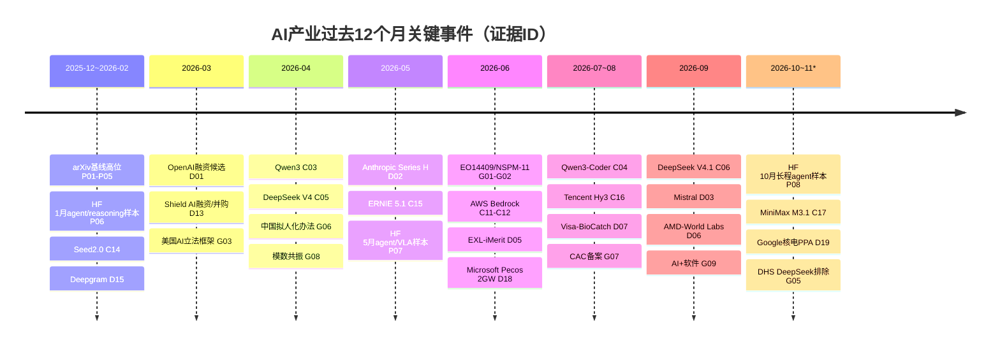
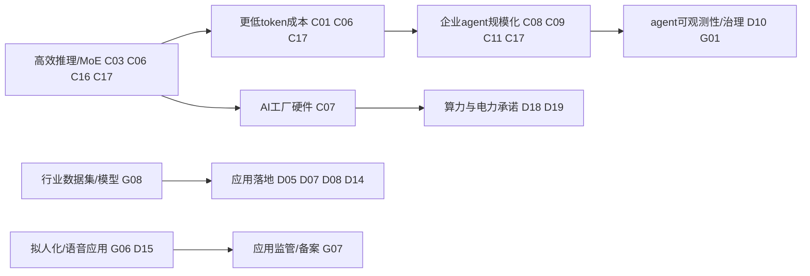

[← A股AI产业分析：综合评分排名](/2026/11/03/a-share-ai-pick)

**声明：** AI生成内容，仅供参考，不构成投资建议。市场有风险，入市需谨慎。

## AI产业趋势：美国、中国与欧盟政策背景，2025-11-03至2026-11-03

**报告截至：** 2026-11-03T09:07:16Z（UTC）  
**资料检索：** 2026-11-03 UTC  
**范围与方法：** 过去12个月；地区为美国、中国，并在政策层加入欧盟；证据流包括arXiv计数、HF daily papers样本、公司发布、融资/并购/算力与电力承诺、政策。证据ID见 `AI产业趋势.md`。本文只描述产业趋势，不构成投资建议。

### 执行摘要

1. **模型层仍上行，但主叙事从“更大”转向“更便宜、更长上下文、更会执行”。** arXiv五类计数中cs.AI、cs.LG、cs.CL在Q2冲高后仍处高位，HF三个月top papers也从agentic reasoning、agent harness、VLA转向长程业务agent和工具轨迹合成（P01-P09）。公司侧DeepSeek、Qwen、ERNIE、Hunyuan、MiniMax、Anthropic都强调MoE、缓存、长上下文、agent和降本（C01-C06、C14-C17）。
2. **软件/平台层是最清晰的上行层。** Microsoft、AWS、Qwen、DeepSeek、MiniMax、ByteDance、Tencent都把模型封装进agent工具链、Bedrock/Foundry/API、企业工作流或编码工具（C04、C08-C12、C14、C16-C17）。
3. **硬件和能源/电力从间接约束变成直接证据。** NVIDIA Rubin/DGX SuperPOD强调AI工厂全栈与token成本；Microsoft宣布Pecos约2GW数据中心容量并配套 onsite energy；Google/Constellation签20年PPA带来890MW新增核电和2700MW供应协议（C07、D18-D19）。
4. **资本仍集中于模型、算力和垂直应用。** 已记录19条交易/承诺，其中18条带金额；OpenAI和中国私募融资仍为候选，但P1/P2验证金额已覆盖Anthropic、Shield AI、AMD、Visa、Google/Constellation、Microsoft、Deepgram、SiMa.ai等（D02-D19）。
5. **政策分化加深。** 美国同时推进自愿前沿模型框架、国安AI、出口控制和DeepSeek采购排除；中国用备案、拟人化互动办法和“模数共振/AI+软件”推动可控落地；欧盟AI Act进入执行并以AI工厂支持算力（G01-G11）。

### 研究论文（arXiv）

arXiv计数覆盖cs.AI、cs.CL、cs.LG、cs.CV、cs.RO五类。cs.AI从Q1的12,041升至Q2的17,130，Q3为15,302，Q4*为12,851；cs.LG为11,704→15,192→13,326→12,905；cs.RO则逐季上行，Q4*已达4,529（P01、P03、P05）。这说明模型方法和语言技术仍维持高产，机器人/具身智能从小基数进入更快增长区。

Hugging Face每日论文月度接口的网页抓取路径仍失败，但脚本成功取得2026-01、2026-05、2026-10三个月top papers。样本显示：1月主题是agentic reasoning、RL优化、音视频生成；5月出现`Code as Agent Harness`、`Qwen-VLA`、`MolmoAct2`；10月转向`BizAgentBench`、`Trajectory2Gym`和self-retrospection distillation（P06-P09）。三个月top 10人工归类中，智能体/工具/编码从4→4→5篇，多模态从3→3→1篇，机器人/VLA从0→2→2篇，安全/评测从1→2→3篇。计数只代表研究注意力，不证明商业采用。

### 主要公司动态

**美国与欧洲公司。** Anthropic推出Haiku 5.5并称运行成本较Haiku 4.5平均低约75%，Series H融资用于扩算力和产品伙伴关系（C01-C02）。Microsoft把Copilot、Agent 365、Foundry和多模型harness打包成企业智能体平台（C08-C09）。AWS继续把OpenAI、Anthropic模型放进Bedrock分发和治理层（C11-C12）。NVIDIA Rubin/DGX SuperPOD强调Vera CPU、Rubin GPU、NVLink、DPU和Ethernet全栈协同，目标是降低推理token成本（C07）。OpenAI官网仍403，但搜索索引显示GPT-5.6主叙事为“每token智能”和“performance per dollar”（C13）。

**中国公司。** Qwen3开源MoE和dense模型，Qwen3-Coder进入agentic coding和Qwen Code工具链（C03-C04）。DeepSeek V4/V4.1强调开权、1M上下文、KV缓存压缩、峰谷价格和更低推理成本（C05-C06）。ByteDance Seed 2.0、百度ERNIE 5.1、腾讯Hunyuan Hy3、MiniMax M3.1 Flash都把复杂任务、agent、长上下文、MoE/稀疏化与成本效率作为发布重点（C14-C17）。Moonshot/Kimi平台迁移到K3.1 Pro；Z.ai GLM-5.2资料仅为候选（C18-C19）。

### 并购、投资与初创企业

资本流向仍偏模型、基础设施和高价值应用。模型与算力侧包括Anthropic US$65B Series H、Mistral约€3B、OpenAI US$122B候选、DeepSeek/Moonshot候选、中国外的Shield AI US$2B融资/并购（D01-D04、D11-D13）。硬件与空间/物理AI包括AMD以约US$8.2B股票收购World Labs、SiMa.ai US$150M Series C（D06、D16）。应用侧包括Visa以US$2.4B收购BioCatch、Agilent以US$240M+里程碑收购Proscia、Rezolve AI以US$230M收购Reward、Pathos AI US$237M Series E、Deepgram US$130M Series C并收购OfOne（D07-D09、D14-D15）。

能源和算力承诺已补强：Microsoft宣布Pecos数据中心约2GW容量、未来5-7年多十亿美元投资并配套现场能源；Google/Constellation 20年PPA带来890MW新增核电、另有2700MW供应协议和超过US$4.3B投资（D18-D19）。这把能源/电力从“由芯片和融资间接推断”提高到“有直接容量和PPA证据”。

### 各国政策

美国：EO 14409建立面向covered frontier models的自愿早期接触框架；NSPM-11推动国安体系采用AI；白宫提出全国AI立法框架；BIS撤销AI Diffusion规则但强化半导体与Huawei Ascend相关限制；Federal Register API确认DHS排除DeepSeek产品的采购/移除通知（G01-G05、G11）。

中国：网信办等发布《人工智能拟人化互动服务管理暂行办法》，7月15日生效；生成式AI备案到8月31日累计1112款服务、731款应用/功能；工信部和国家数据局推动“模数共振”，以行业数据集、行业模型和智能体服务新型工业化；工信部另印发“人工智能+软件”专项行动（G06-G09）。

欧盟：AI Act自2026年8月2日起由AI Office和成员国主管机关执行，同时欧盟以AI Continent Action Plan、AI Factories/Gigafactories和InvestAI支持算力与产业能力（G10）。

### 美国与中国对比

美国主线是“资本—云—芯片—模型—企业平台—电力”的闭环：巨额融资、云模型分发、芯片出口控制、联邦采购限制和GW级电力/数据中心项目同时推进。中国主线是“开权/低成本模型—备案治理—行业数据与场景落地”：Qwen、DeepSeek、Hunyuan、MiniMax、ERNIE、Seed强化开权、MoE、agent和成本优势；监管侧用备案和拟人化互动规则设边界；产业侧通过行业数据集、软件专项和智能体推进制造/软件落地。

### 过去12个月的时间线

### 概念与实践的演进

| 概念/实践 | 想法 | 演示 | 产品 | 资本 | 政策 | 状态 | 瓶颈 |
|---|---|---|---|---|---|---|---|
| Agentic coding/工具执行 | P06/P07/P08 | C04/C16/C17 | C04/C09/C11/C17 | D05/D10/D13 | G01 | accelerating | 可靠执行、权限和审计 |
| 高效推理/MoE/KV缓存 | P03/P08 | C03/C06/C16/C17 | C01/C06/C17 | D01-D04 | G04 | accelerating | 真实负载成本透明度 |
| 开权模型生态 | P06-P08 | C03/C05/C16 | C03-C06/C16-C18 | D03/D11/D12 | G07 | accelerating | 合规、商业化和分发 |
| 企业Copilot/Agent平台 | P07/P08 | C08/C09/C11 | C08-C12 | D10/D17 | G01/G03 | mature/accelerating | 数据连接器、可观测性 |
| 机器人/具身/VLA | P05/P07/P09 | C07 | G08 | D06/D16 | G08 | emerging | 数据、仿真到真机迁移 |
| AI工厂/电力 | P03 | C07/D18/D19 | C11/C12/D18 | D01-D04/D18-D19 | G04/G10 | accelerating | 电力接入、许可、供应链 |
| 拟人化/语音/多模态应用 | P06/P09 | C14/C17/G06 | G06/G07/D15 | D09/D15 | G06 | regulated growth | 用户依赖、未成年人保护 |
| AI评测/可观测性 | P08/P09 | D10/C17 | D10 | D05/D10 | G01/G10 | emerging | 标准化、独立验证 |

### 趋势判断与置信度

| 层 | 论文 | 公司动态 | 资本 | 政策 | 方向 | 变化幅度与期间 | 最强反证 |
|---|---|---|---|---|---|---|---|
| 能源和电力 | 间接 | NVIDIA token-per-cost；Microsoft 2GW | Google/Constellation 890MW+2700MW；Microsoft多十亿美元 | EU支持AI工厂，美国管制芯片 | rising | 从间接证据升级为2条P1容量/PPA证据（Q2/Q4） | 中国AI电力合同缺口；PPA不等于即时投运 |
| 硬件 | cs.LG/AI高位 | Rubin全栈发布 | AMD-World Labs、SiMa.ai、模型公司融资 | BIS限制先进芯片 | rising | Q2/Q3硬件与算力交易金额高 | 出口控制可能压制中国高端硬件获取 |
| 软件/平台 | HF agent/工具主题3个月均高 | Copilot/Foundry/Bedrock/Qwen Code/DeepSeek API/MiniMax | iMerit/Fiddler/Fonoa等交易 | 中国模数共振、美国自愿框架 | rising | 公司发布≥19条、覆盖≥14家公司；交易≥5条 | 平台锁定和治理复杂度上升 |
| 模型 | cs.AI Q2较Q1 +42%；HF top papers补足3个月 | Qwen/DeepSeek/Anthropic/ERNIE/Hunyuan/MiniMax连续发布 | 超大额融资 | AI Act、备案、出口控制 | rising | cs.AI、cs.LG、cs.CL高位，模型发布跨中美 | OpenAI与中国私募融资部分候选 |
| 应用 | cs.RO逐季上升；HF VLA/业务agent | Copilot、拟人化、行业AI、语音/视频 | Visa/Agilent/Pathos/Deepgram/Rezolve等 | 中国/欧盟应用监管加强 | rising但分化 | cs.RO Q1 2581→Q4*4529；应用交易多 | 消费陪伴类受监管约束，ROI不均 |

### 情景与失效条件

- **基准情景：平台化扩散。** 模型成本继续下降，企业通过Bedrock、Foundry、Copilot、Qwen/DeepSeek/MiniMax工具链采用多模型agent。失效条件：推理成本下降停止，安全事故导致强制许可或大规模采购暂停。
- **约束情景：算力与政策瓶颈。** 电力、芯片出口控制和融资成本限制前沿扩张，低成本开权模型和行业专用模型受益。失效条件：先进硬件供给快速放量且监管放松。
- **应用情景：行业数据胜出。** 医疗、金融、制造、软件开发、语音/客服等场景因数据和流程闭环先兑现价值。失效条件：客户ROI不足或合规成本高于自动化收益。

### 方法与数据缺口

- HF daily papers 网页抓取仍不可达；但脚本已取得2026-01、2026-05、2026-10三个月top papers，最低项已满足，复现时需注意网络路径差异。
- OpenAI官网对网页抓取仍403，OpenAI发布和融资保留为candidate，未作为唯一关键证据。
- Z.ai GLM页面网页抓取空白，相关公司行不计入强验证发布数。
- 中国DeepSeek、Moonshot私募融资缺少公司公告或监管文件，不能与P1交易同等看待。
- 能源/电力已补P1直接证据，但中国AI算力电力合同、PPA和并网进度仍缺。

### 数据来源

详见 `AI产业趋势.md`：P01-P09、C01-C19、D01-D19、G01-G11。
